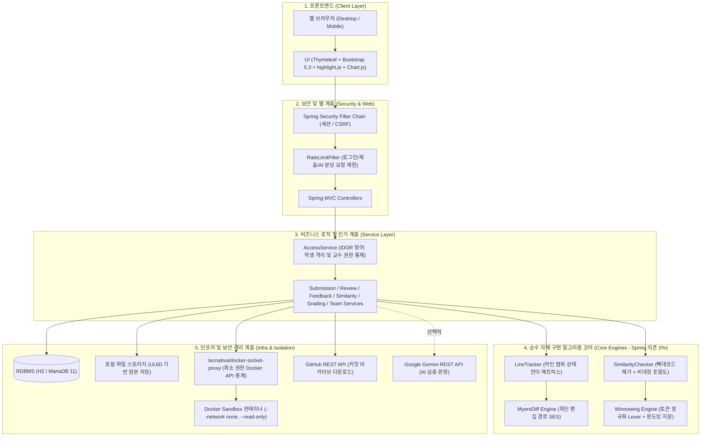
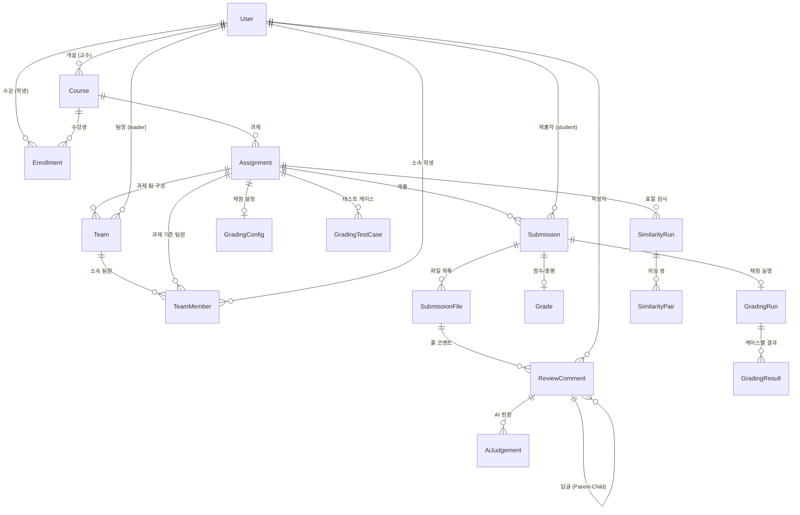

# SubmitHub

과제 제출을 **Git처럼** 관리하는 웹 서비스.
제출할 때마다 버전이 쌓이고, 교수는 GitHub PR 리뷰처럼 **코드 줄에 피드백**을 남기며,
학생이 다음 버전에서 그 피드백을 고쳤는지 **시스템이 자동으로 추적**합니다.
표절 검사와 제출 통계, Docker 격리 자동 채점, 조별과제 팀 기여도 감사 기능도 제공합니다.

---

## 📌 핵심 기능

| 기능 | 설명 |
| --- | --- |
| **버전 제출 (Git-like)** | 파일 또는 ZIP 아카이브(다중 파일), 제출 메모, 버전 번호 자동 부여(동시 제출 안전), 마감·지각 처리, UTF-8/CP949 자동 인식 |
| **GitHub 커밋 제출** | 공개 저장소 주소와 브랜치(또는 커밋 SHA)를 입력하면 해당 시점의 소스코드를 자동 임포트하여 새 버전으로 저장. 커밋 SHA·메시지·링크를 버전에 영구 보존. github.com 외 주소 거부 및 동일 커밋 중복 제출 방어 |
| **버전 비교 (Diff Viewer)** | 임의의 두 버전을 파일별로 정밀 비교 (순수 Java 자체 구현 Myers diff). 좌우 분할(Side-by-Side) ↔ 통합(Unified) 보기, 공백/들여쓰기 무시 토글, 변경 없는 긴 구간 접기(fold) |
| **줄 단위 코드 리뷰** | 교수가 특정 줄 또는 라인 범위(Shift+클릭)를 선택해 피드백 코멘트 작성, 교수·학생 간 답글(스레드), 학생의 자율 "수정 완료" 표시 |
| **피드백 반영 자동 추적 (`LineTracker`)** | 새 버전을 제출하면 이전 버전의 코멘트 구간이 어떻게 되었는지 diff 로 추적하여 🔴**미반영(줄 밀림 자동 보정)** / 🟢**반영됨(수정 감지)** / ⚪**삭제됨**으로 자동 판정. 학생에게는 "남은 피드백 N개", 교수에게는 학생별 "피드백 반영률(%)" 제공 |
| **구조적 표절 검사 (Winnowing)** | 학생별 최신 제출물을 쌍(Pair)으로 비교 (토큰 정규화 Lexer + Winnowing 윈도잉 지문). 변수명·함수명·주석·들여쓰기·리터럴 값을 바꿔도 검출, 교수가 제공한 뼈대 코드(Baseline)는 $O(1)$ 사전 배제. 의심 쌍은 두 코드를 나란히 놓고 겹치는 줄을 형광펜 하이라이트 |
| **Docker 격리 자동 채점** | 교수가 테스트 케이스(입력 $\to$ 기대 출력, 배점, 공개/비공개)를 등록하면, 제출 즉시 **Docker 격리 샌드박스**에서 컴파일·실행하여 채점(Java, Python). 버전별 통과율 추이 제공. **Docker Socket Proxy**로 컨테이너 탈출 원천 차단 |
| **조별과제 및 팀 협업 감사** | 팀 생성 및 초대 코드 합류, 팀 단위 과제 제출(버전 공유), Git 브랜치별/작성자별 커밋 감사 및 기여도 시각화 |
| **AI 심층 판정 보완 (Gemini)** | LineTracker의 정적 분석 결과에 더해, 학생이 교수의 피드백 의도대로 로직을 올바르게 고쳤는지 Google Gemini 3.8 Flash를 연계하여 심층 검증 (일일 쿼터 제한 내장) |
| **제출 통계 대시보드** | 제출률, 미제출자, 지각자, 마감 직전 24시간 제출 비율, 시간대별 제출 분포, 학생별 제출 버전 수 및 피드백 반영률 시각화 (Chart.js) |

---

## 🏗️ 시스템 아키텍처



---

## 📂 전체 디렉토리 구조

```
submithub/
├── docker/                      # 채점용 베이스 Dockerfile (Java 17, Python 3.11)
├── docs/                        # ★ 핵심 기술 설계 및 가이드 문서
│   ├── ARCHITECTURE.md          # 시스템 아키텍처 및 도메인 상세 설계서
│   ├── ALGORITHM_CORE.md        # Myers Diff, LineTracker, Winnowing 알고리즘 코어 로직 설명서
│   ├── DEMO_GUIDE.md            # 심사위원 5분 시연 가이드
│   ├── DEPLOY.md                # 프로덕션 클라우드 배포 가이드 (HTTPS / Caddy)
│   ├── EVALUATION.md            # 표절 검사 정확도 및 diff 성능 정량 평가 보고서
│   └── TEAM_AUDIT_FEATURE.md    # 조별과제 기여도 감사 기능 명세
├── src/
│   ├── main/
│   │   ├── java/com/submithub/
│   │   │   ├── core/            # ★ [순수 Java 알고리즘] 외부 의존성 제로 (0%)
│   │   │   │   ├── diff/        # MyersDiff, SideBySide, DiffOptions
│   │   │   │   ├── review/      # LineTracker (라인 범위 상태 전이 추적)
│   │   │   │   ├── similarity/  # CodeTokenizer, Winnowing, SimilarityChecker
│   │   │   │   └── text/        # TextDecoder (UTF-8/CP949 자동 판별), LineSplitter
│   │   │   ├── domain/          # JPA 엔티티 (User, Course, Submission, Team, Grading 등)
│   │   │   ├── service/         # 비즈니스 서비스 + AccessService (접근 제어)
│   │   │   ├── grading/         # DockerGradingRunner (격리 컨테이너 채점 제어)
│   │   │   ├── storage/         # LocalFileStorage, UploadProcessor (Zip Slip 방어)
│   │   │   ├── github/          # RestGitHubClient (GitHub REST API 연동)
│   │   │   ├── ai/              # GeminiJudgeProvider, JudgePrompt
│   │   │   ├── security/        # SecurityConfig, RateLimitFilter
│   │   │   ├── web/             # Spring MVC Controllers & GlobalExceptionHandler
│   │   │   └── demo/            # DemoDataLoader (시연용 시드 데이터)
│   │   └── resources/
│   │       ├── application.yml  # 기본 프로퍼티
│   │       ├── templates/       # Thymeleaf 화면 템플릿
│   │       └── static/          # CSS, JS, 폰트(Pretendard, JetBrains Mono)
│   └── test/                    # JUnit 5 테스트 (단위, 알고리즘, 권한 매트릭스, MockMvc)
├── docker-compose.yml           # 개발/시연용 Compose (DB + Socket Proxy + App)
├── docker-compose.prod.yml      # 프로덕션 Compose (Caddy + Socket Proxy + App + MariaDB)
├── Caddyfile                    # 자동 HTTPS 및 리버스 프록시 보안 헤더 설정
└── pom.xml                      # Maven 의존성 및 빌드 설정
```

---

## 🧠 핵심 알고리즘 원리 요약

자세한 수학적 증명, 상태 전이 매트릭스 및 의사코드는 **[알고리즘 코어 로직 설명서 (docs/ALGORITHM_CORE.md)](docs/ALGORITHM_CORE.md)**를 참조하십시오.

### 1. Myers Diff 최단 편집 경로 (SES)
- Eugene W. Myers (1986) 논문 기반. 시간 $O((N+M)D)$, 메모리 $O(D^2)$ ($D$: 변경된 줄 수).
- 기존 $O(NM)$ LCS 동적 계획법(3,000줄 비교 시 36MB 메모리 필요) 대비 메모리 소모를 99% 절감.
- 변경 전/후의 공통 접두어(Prefix)와 접미어(Suffix)를 $O(N)$으로 사전 제거하여 실제 변경 구간만 대각선 탐색.

### 2. 복수 라인 범위 피드백 추적 (`LineTracker`)
- 교수가 남긴 코멘트 라인 범위 $[L_{start}, L_{end}]$를 Myers diff 결과와 매핑.
- **들여쓰기 위장 방어**: 공백 정규화(`DiffOptions.IGNORE_WHITESPACE`)로 탭/스페이스 변경은 `UNCHANGED`로 유지.
- **상태 전이 규칙**:
  - 전 줄 보존 $\to$ 🔴 `UNCHANGED` (앞쪽 코드 삽입으로 줄이 밀려도 최신 버전의 새 줄 번호로 포인터 갱신)
  - 1줄 이상 수정 또는 분할/치환 $\to$ 🟢 `MODIFIED`
  - 전 줄 완전 삭제 $\to$ ⚪ `DELETED`
  - diff 상한 초과 $\to$ ⚠️ `UNKNOWN`
- 연속된 다중 버전($v_1 \to v_2 \to v_3$)을 누적 추적하여 최초로 수정된 버전 번호(`changedAtIndex`)를 확정.

### 3. 구조적 표절 검사 (`Winnowing` Engine)
- Schleimer, Wilkerson, Aiken (SIGMOD 2003) 논문 기반.
- **토큰 정규화 (`CodeTokenizer`)**: 변수/함수명 $\to$ `I`, 숫자 $\to$ `N`, 문자열 $\to$ `S`, 주석/공백 제거, 70여 종 프로그래밍 키워드 보존.
- **최적 파라미터**: $k$-gram 크기 $k=5$, 윈도우 크기 $w=4 \implies$ 보장 탐지 임계값 $t = w + k - 1 = 8$개 토큰. 의미 있는 제어문 1개 이상 일치 시 반드시 지문 공유.
- **SplitMix64 해싱**: 다항 롤링 해시 후 64비트 비트 믹싱으로 해시 충돌 방지.
- **동점 처리**: 윈도우 내 최소값이 중복될 경우 가장 오른쪽 지문 선택(논문 표준).
- **뼈대 코드(Baseline) 필터링**: 교수가 제공한 템플릿 지문 해시를 $O(1)$로 사전 배제하여 False Positive 방어.
- **비대칭 포함도 (Containment)**: $\text{Score} = \max(cov_A, cov_B)$. 코드를 통째로 베낀 뒤 뒤에 긴 코드를 덧붙이는 침투 공격(Subsumption Attack) 완벽 탐지.

---

## 🔒 데이터베이스 ERD (Entity Relationship Diagram)



- **불변 제출 모델 (`@Immutable`)**: 제출(`Submission`, `SubmissionFile`)은 오직 `INSERT`만 발생하며, 이전 버전을 수정하거나 덮어쓰지 않습니다.
- **피드백 상태 동적 계산**: 피드백 반영 상태는 DB에 고정 저장하지 않고, 최신 버전과의 Diff를 통해 요청 시 동적으로 계산하여 정합성을 보장합니다.

---

## 🛡️ 보안 및 샌드박스 격리 설계

| 보안 영역 | 위협 모델 | 대응 설계 및 구현 |
| :--- | :--- | :--- |
| **도커 탈출 방어** | 앱 침투 시 호스트 루트 권한 탈취 | **`tecnativa/docker-socket-proxy`** 도입. `/var/run/docker.sock`을 `ro` 마운트하고 `CONTAINERS=1`, `POST=1` 외 `VOLUMES=0`, `EXEC=0`, `BUILD=0`, `NETWORKS=0` 차단 |
| **채점 샌드박스 격리** | 악성 제출 코드 실행 (포크 폭탄, 해킹) | 채점 컨테이너에 `--network none`, `--read-only`, `--pids-limit 64`, `--memory 256m`, `--cap-drop ALL`, `no-new-privileges`, 소스코드 읽기 전용(`:ro`) 바인드 마운트 |
| **타인 제출물 열람 (IDOR)** | URL 파라미터 조작으로 타인 코드 조회 | 모든 조회·수정이 `AccessService`를 통과. "본인 제출물" 또는 "해당 강의 개설 교수"만 인가 (403 Forbidden). 권한 매트릭스 테스트로 100% 검증 |
| **파일 업로드 공격** | Zip Slip, 대용량 폭탄, 경로 조작 | 메모리 내 압축 해제, 경로 정규화(`..` 차단), 파일 개수/용량 제한, 실제 디스크 저장은 UUID 난수 파일명 사용 |
| **동시성 충돌** | 연속 제출 시 버전 번호 중복 생성 | 과제 행 `SELECT ... FOR UPDATE` 비관적 락 + 복합 유니크 제약(`assignment_id, student_id, version_no`) 충돌 시 1회 자동 재시도 |
| **무차별 대입 (Brute Force)** | 로그인 및 AI API 남용 | Token Bucket 기반 `RateLimitFilter` (로그인 분당 10회, 제출 5회, AI 3회) 및 일일 쿼터 테이블(`AiDailyUsage`) |
| **네트워크 전송 보안** | 패킷 감청, MIME 스니핑, 클릭재킹 | `Caddy v2` 자동 HTTPS (TLS 1.3), HSTS, `X-Content-Type-Options: nosniff`, `X-Frame-Options: DENY`, `/actuator/*` 외부 차단 |

---

## 🚀 빠른 시작 (Getting Started)

### 사전 요구사항
- **JDK 17 LTS** 이상
- **Maven 3.9+** (또는 내장 Maven 플러그인)
- *MariaDB 11* 및 *Docker* (선택 사항: H2 인메모리 파일 모드로 즉시 실행 가능)

### 1. 로컬 개발 모드 실행 (H2 파일 DB 모드)
```bash
mvn spring-boot:run
```
브라우저에서 `http://localhost:8080` 접속. DB는 `./data/`에, 업로드 파일은 `./uploads/`에 자동 보존됩니다.
- 최초 기동 시 풍부한 **시연용 샘플 데이터**가 자동 주입됩니다.
- 샘플 데이터를 끄려면: `--submithub.demo-data=false` 옵션 전달.

### 2. Docker Compose 실행 (운영 환경 동일 구성)
```bash
cp .env.example .env
docker compose up -d --build
```
`db(MariaDB 11)` + `socket-proxy(Docker API 방어)` + `app(Spring Boot)` 컨테이너가 유기적으로 기동됩니다.

---

## 👥 시연용 테스트 계정 안내

| 역할 | 아이디 | 비밀번호 | 시연 핵심 시나리오 |
| :--- | :--- | :--- | :--- |
| **교수** (김교수) | `prof` | `prof1234!` | 과제 관리, 줄 코멘트 작성, 표절 검사, 채점 결과 조회, 제출 통계 |
| **학생 1** (이민준) | `student1` | `student1234!` | 과제 1을 3번 제출, 교수 피드백 중 일부만 반영 (**반영 추적 시연**) |
| **학생 2** (박서연) | `student2` | `student1234!` | 과제 1 원본 독립 풀이 |
| **학생 3** (최지호) | `student3` | `student1234!` | 박서연의 코드를 변수명/주석/들여쓰기를 바꿔 제출 (**표절 검출 100% 시연**) |
| **학생 4** (정하은) | `student4` | `student1234!` | 과제 1 **지각 제출** 처리 확인 |
| **학생 5** (강도윤) | `student5` | `student1234!` | 과제 1을 2번 제출 (피드백 반영 완료) |
| **학생 6** (윤지우) | `student6` | `student1234!` | 과제 1 **미제출자** 통계 확인 |
| **학생 7** (한서준) | `student7` | `student1234!` | 센티넬 노드 방식의 독립 풀이 |

---

## 📚 관련 기술 문서

- 📘 **[알고리즘 코어 로직 상세 설명서 (docs/ALGORITHM_CORE.md)](docs/ALGORITHM_CORE.md)**: Myers Diff SES 대각선 탐색, LineTracker 상태 전이 매트릭스, Winnowing $k$-gram / $w$ 파라미터 수학적 근거 및 의사코드
- 📐 **[시스템 아키텍처 및 도메인 상세 설계서 (docs/ARCHITECTURE.md)](docs/ARCHITECTURE.md)**: 패키지별 상세 역할, 도메인 ERD 명세, Docker Socket Proxy 보안 격리도, 서비스 시퀀스 다이어그램
- 🚀 **[심사위원 5분 시연 가이드 (docs/DEMO_GUIDE.md)](docs/DEMO_GUIDE.md)**: 단계별 5분 시연 시나리오 및 핵심 관전 포인트
- ☁️ **[운영 배포 가이드 (docs/DEPLOY.md)](docs/DEPLOY.md)**: Oracle Cloud ARM64 / Azure 가상머신 환경 Docker Compose 및 Caddy HTTPS 배포
- 📊 **[정량 평가 보고서 (docs/EVALUATION.md)](docs/EVALUATION.md)**: 표절 변형 9종 정확도(JPlag 비교) 및 Myers Diff 성능 벤치마크
- 👥 **[조별과제 기여도 감사 기능 명세 (docs/TEAM_AUDIT_FEATURE.md)](docs/TEAM_AUDIT_FEATURE.md)**: Git 브랜치별 기여도 및 팀 활동 감사
