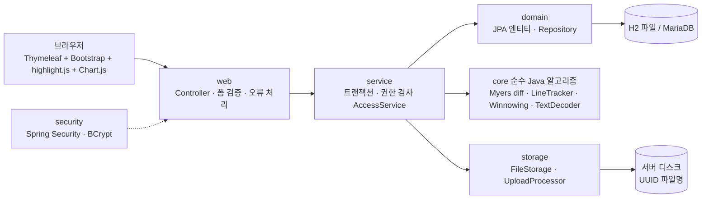
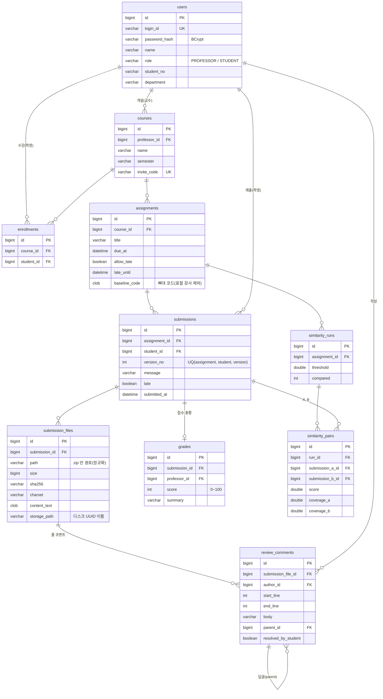

# SubmitHub

과제 제출을 **Git처럼** 관리하는 웹 서비스.
제출할 때마다 버전이 쌓이고, 교수는 GitHub PR 리뷰처럼 **코드 줄에 피드백**을 남기며,
학생이 다음 버전에서 그 피드백을 고쳤는지 **시스템이 자동으로 추적**합니다.
표절 검사와 제출 통계도 제공합니다. (졸업작품, 강서원)

## 핵심 기능

| 기능 | 설명 |
| --- | --- |
| 버전 제출 | 파일 또는 zip(여러 파일), 제출 메모, 버전 번호 자동 부여(동시 제출 안전), 마감·지각 처리, UTF-8/CP949 자동 인식 |
| GitHub 커밋으로 제출 | 공개 저장소 주소와 브랜치(또는 SHA)를 입력하면 그 커밋의 소스 파일을 가져와 새 버전으로 저장하고, 커밋 SHA·메시지·링크를 버전에 기록. github.com 외 주소 거부, 같은 커밋 재제출은 "변경 없음"으로 차단 |
| 버전 비교 | 임의의 두 버전을 파일별로 비교 (Myers diff). 좌우 분할/통합 보기, 공백 무시, 긴 구간 접기 |
| 줄 단위 코드 리뷰 | 교수가 줄(범위)을 선택해 코멘트, 교수·학생 답글, 학생의 "수정했어요" 표시 |
| **피드백 반영 자동 추적** | 새 버전을 올리면 이전 코멘트가 어떻게 되었는지 diff 로 줄을 따라가 🔴미반영 / 🟢반영됨 / ⚪삭제됨으로 판정. 학생은 "남은 피드백 N개", 교수는 반영률 |
| **표절 검사** | 학생별 최신 제출물을 쌍으로 비교 (토큰 기반 Winnowing). 변수명·주석·들여쓰기·문자열 값을 바꿔도 검출, 교수가 준 뼈대 코드는 제외. 의심 쌍은 두 코드를 나란히 놓고 겹치는 줄을 하이라이트 |
| 코드 자동 채점 | 교수가 테스트 케이스(입력→기대 출력, 공개/비공개, 배점)를 등록하면 제출할 때마다 Docker 격리 컨테이너에서 컴파일·실행해 채점(Java·Python). 버전별 통과율 추이를 반영 추적 카드 옆에 표시. Docker 가 없으면 "채점 불가"로 표시하고 나머지는 그대로 동작 |
| 제출 통계 | 제출률, 미제출자, 지각, 마감 직전 24시간 제출 비율, 시간대별 분포, 학생별 버전 수·반영률 (Chart.js) |

## 화면 구성

| 화면 | 주소 | 누가 |
| --- | --- | --- |
| 로그인 / 회원가입 | `/login`, `/signup` | 모두 |
| 내 강의 | `/courses` | 교수·학생 |
| 강의 개설 / 수강 등록(초대 코드) | `/courses/new`, `/courses/join` | 교수 / 학생 |
| 강의 상세 (과제 목록, 수강생, 초대 코드) | `/courses/{id}` | 해당 강의 교수·학생 |
| 과제 등록·수정 (마감, 지각, 뼈대 코드) | `/courses/{id}/assignments/new`, `/assignments/{id}/edit` | 교수 |
| 과제 상세 — 제출 폼, 내 이력, 남은 피드백 / 제출 현황, 반영률 | `/assignments/{id}` | 학생 / 교수 |
| 제출 이력 타임라인, 버전 비교 선택 | `/assignments/{a}/students/{s}` | 본인·교수 |
| 코드 보기 (파일 트리, 줄 코멘트, 점수) | `/submissions/{id}` | 본인·교수 |
| GitHub 커밋으로 제출 | 공개 저장소 주소와 브랜치(또는 SHA)를 입력하면 그 커밋의 소스 파일을 가져와 새 버전으로 저장하고, 커밋 SHA·메시지·링크를 버전에 기록. github.com 외 주소 거부, 같은 커밋 재제출은 "변경 없음"으로 차단 |
| 버전 비교 | `/assignments/{a}/students/{s}/diff` | 본인·교수 |
| 표절 검사, 쌍 비교 | `/assignments/{id}/similarity`, `/similarity/pairs/{id}` | 교수 |
| 제출 통계 대시보드 | `/courses/{id}/stats` | 교수 |

## 실행 방법

필요한 것: **JDK 17**, **Maven 3.9+** (MariaDB·Docker 는 선택)

### 1. 바로 실행 (H2 파일 DB, MariaDB 필요 없음)

```bash
mvn spring-boot:run
```

`http://localhost:8080` 으로 접속합니다. DB 는 `./data/` 에, 업로드 파일은 `./uploads/` 에 저장됩니다.
처음 실행할 때 DB 가 비어 있으면 **시연용 샘플 데이터**가 자동으로 들어갑니다 (아래 테스트 계정).
샘플 데이터를 원하지 않으면 `mvn spring-boot:run -Dspring-boot.run.arguments=--submithub.demo-data=false` 로 실행하세요.

이 PC 에서는 (Maven 이 PATH 에 없으므로):

```powershell
$env:JAVA_HOME = "D:\Dev\Tools\java\jdk-17.0.12"
D:\Dev\Tools\apache-maven-3.9.9\bin\mvn.cmd spring-boot:run
```

### 2. Docker Compose (MariaDB + 앱)

```bash
cp .env.example .env        # 처음 한 번. DB 비밀번호는 원하는 값으로 바꿔도 된다
docker compose up --build
```

`http://localhost:8080` 에 접속합니다. MariaDB 는 `mariadb` 프로필로 연결되고, 데이터는 Docker 볼륨(`db-data`, `uploads`)에 남습니다.
`.env` 의 `DEMO_DATA=false` 로 시연용 데이터를 끌 수 있습니다.
> 개발 PC 에 Docker 가 없어 이 구성은 아직 실제로 실행해 보지 못했습니다. 시연 PC 에서 처음 실행할 때 한 번 확인하세요.

### 3. 로컬 MariaDB 에 직접 연결

```bash
DB_URL=jdbc:mariadb://localhost:3306/submithub DB_USER=submithub DB_PASSWORD=... \
  mvn spring-boot:run -Dspring-boot.run.profiles=mariadb
```

### 4. 실서버 운영 배포 및 시연 가이드

- **[심사위원 5분 시연 가이드](docs/DEMO_GUIDE.md)**: 심사위원이 혼자 따라 할 수 있는 5분 시연 순서 및 화면별 핵심 관전 포인트
- **[운영 배포 가이드](docs/DEPLOY.md)**: Oracle Cloud ARM64 환경에서 Caddy 자동 HTTPS 및 Docker Compose 기반 실서버 구축 가이드


접속 정보는 환경변수나 `application-local.yml`(커밋 제외)에 둡니다.

### 설정값 (`application.yml` 의 `submithub.*`)

| 설정 | 기본값 | 설명 |
| --- | --- | --- |
| `storage-dir` | `./uploads` | 업로드 원본 저장 폴더 (UUID 이름으로 저장) |
| `demo-data` | `true` | DB 가 비어 있을 때 시연용 샘플 데이터 입력 |
| `professor-signup-code` | (빈 값) | 값을 넣으면 교수 가입 시 이 코드 필요. 비우면 누구나 교수로 가입 가능 |
| `max-file-bytes` / `max-total-bytes` / `max-files` | 5MB / 20MB / 200개 | 제출 한도 (zip 을 푼 뒤 기준) |

## 시연용 테스트 계정

| 역할 | 아이디 | 비밀번호 |
| --- | --- | --- |
| 교수 (김교수) | `prof` | `prof1234!` |
| 학생 7명 | `student1` ~ `student7` | `student1234!` |

강의 "자료구조" (초대 코드 `DEMO2026`), 과제 2개. 학생별 상황:

| 학생 | 아이디 | 상황 |
| --- | --- | --- |
| 이민준 | `student1` | 과제 1 을 3번 제출, 교수 코멘트 중 일부만 반영 (**반영 추적 시연**), 과제 2 제출 |
| 박서연 | `student2` | 과제 1 원본 풀이 |
| 최지호 | `student3` | 과제 1 에서 박서연의 코드를 **변수명·주석·들여쓰기를 바꿔 베낌** (**표절 시연**) |
| 정하은 | `student4` | 과제 1 **지각 제출** |
| 강도윤 | `student5` | 과제 1 을 2번 제출 (리뷰 후 수정) |
| 윤지우 | `student6` | 과제 1 **미제출** |
| 한서준 | `student7` | 과제 1 센티넬 노드 방식의 독립 풀이 |

## 시연 순서 (약 10분)

1. **문제 제기**: 과제를 덮어써서 내면 무엇이 바뀌었는지, 피드백을 고쳤는지 알 수 없다.
2. **학생 `student1` 로그인** → 내 강의 → 과제 1 → "남은 피드백 2개" 와 제출 이력(v1~v3, 직전 버전 대비 변경 요약)을 보여준다.
3. 제출 이력 → **코드 보기** v1 → 교수가 단 줄 코멘트와 🟢반영됨/🔴미반영/⚪삭제됨 배지 (줄이 밀려도 "최신 v3 N줄에 그대로 있음"으로 따라간다).
4. **버전 비교**(v1 → v3): 좌우 분할 ↔ 통합, 공백 무시 토글, 긴 구간 접기.
5. 로그아웃 후 **교수 `prof` 로그인** → 과제 1 → 제출 현황(학생별 최신 버전·점수·**반영률**, 미제출자).
6. 이민준의 v3 코드 보기에서 줄 번호를 클릭(Shift+클릭으로 범위) → **새 줄 코멘트** 작성 → 점수·총평 저장.
7. 과제 1 → **표절 검사** → 박서연 ↔ 최지호 100% (변수명을 바꿨어도 잡힘) → "나란히 비교"에서 겹치는 줄 하이라이트.
   뼈대 코드(과제에 등록)는 비교에서 제외된다는 점을 설명.
8. 강의 상세 → **📊 제출 통계**: 제출률, 시간대별 분포, 마감 직전 24시간 제출 비율, 학생별 반영률.
9. (선택) 학생 `student6` 로 로그인해서 직접 파일/zip 을 제출 → 새 버전이 쌓이는 것, 다른 학생의 제출물 주소를 열면 403 이 나오는 것을 보여준다.
10. **기술**: Myers diff / LineTracker / Winnowing 직접 구현(`core` 패키지, 순수 Java), 권한 검사와 업로드 보안.

## 아키텍처



```
src/main/java/com/submithub/
├── core/        ★ 순수 Java 알고리즘 (Spring 의존 없음)
│   ├── text/        TextDecoder(UTF-8/CP949), LineSplitter(CRLF/LF)
│   ├── diff/        MyersDiff, SideBySide, DiffOptions
│   ├── review/      LineTracker (피드백 반영 추적)
│   └── similarity/  CodeTokenizer, Winnowing, SimilarityChecker
├── domain/      JPA 엔티티 + Repository
├── service/     비즈니스 로직 (제출, diff, 리뷰, 반영 추적, 표절 검사, 통계) + AccessService(권한)
├── web/         Controller, 폼, 공통 오류 처리
├── security/    SecurityConfig, 로그인 사용자
├── storage/     FileStorage(UUID 저장), UploadProcessor(zip 안전 추출)
└── demo/        시연용 샘플 데이터
```

### 핵심 알고리즘

- **Myers diff** (E. Myers, 1986): 시간 O((N+M)·D), 메모리 O(D²). 기존 LCS 방식(n×m 표)은 3,000줄 두 개만 비교해도 약 36MB 가 필요했다.
- **피드백 반영 추적 (`LineTracker`)**: 코멘트를 단 버전부터 최신 버전까지 연속된 버전 사이의 diff 로 줄을 한 단계씩 따라간다.
  줄이 그대로면 UNCHANGED(최신 버전의 줄 번호 포함), 수정되면 MODIFIED, 지워지면 DELETED.
  들여쓰기만 바꾼 것은 공백 무시 비교로 반영으로 보지 않는다. 결과는 저장하지 않고 조회할 때 계산한다.
- **표절 검사 (Winnowing)**: Schleimer et al., *"Winnowing: Local Algorithms for Document Fingerprinting"*, SIGMOD 2003.
  코드를 토큰으로 바꿔(변수·숫자·문자열은 종류만 남김, 주석·공백 제거) k-gram 해시 지문을 뽑아 비교한다.
  교수의 뼈대 코드 지문은 미리 제외한다.

## ERD



- **제출(submissions, submission_files)은 INSERT 만 합니다.** 기존 버전을 수정·삭제하지 않습니다 (`@Immutable`).
- 반영 추적 결과는 저장하지 않고 조회할 때 계산합니다.

## 보안·안정성 설계

| 위험 | 대응 |
| --- | --- |
| 비밀번호 | BCrypt 해시. CSRF 보호(모든 POST), 폼 로그인 |
| 다른 학생의 제출물을 주소로 열기 (IDOR) | 모든 조회·수정이 `AccessService` 를 거쳐 "본인이거나 해당 강의 교수"만 허용 (403). 권한 매트릭스 테스트로 검증 |
| 업로드 파일명 조작 (`../`) | 디스크에는 UUID 이름으로만 저장, 사용자 파일명은 DB 에만 |
| zip 경로 조작 (Zip Slip) | zip 은 메모리에서 풀고 경로 정규화, 절대 경로·`..` 는 거부 |
| zip 폭탄·대용량 | 풀면서 크기를 세고 파일 크기·총 크기·개수 제한 |
| 버전 번호 충돌 (연타·동시 제출) | 과제 행 `SELECT ... FOR UPDATE` 안에서 번호 부여 + 유니크 키 충돌 시 1회 재시도 |
| 마감 후 제출 | 지각 허용이면 `late=true` 로 기록, 아니면 거부 |
| 점수 입력 오류 | 서버에서 0~100 정수 검증 후 오류 메시지 |
| 오류 시 앱이 멈춤 | `@ControllerAdvice` 공통 오류 처리, 사용자 입력 오류는 이전 화면으로 돌려보내 메시지 표시 |
| 이동 경로 조작 (open redirect) | 폼 처리 후 돌아갈 주소는 같은 사이트의 경로만 허용 |

## 테스트

```bash
mvn test
```

- `core`: 알고리즘 단위 테스트 (무작위 입력 1,000건으로 diff 정확성·최소성 검증 포함)
- 서비스: 동시 제출 버전 번호, 마감/지각, zip 보안, 반영 추적, 표절 검사(변수명 변경 복사본·뼈대 제외), 통계, 점수
- 권한: 모든 주요 주소를 (담당 교수 / 다른 교수 / 수강 학생 / 같은 강의 다른 학생 / 수강하지 않은 학생)으로 호출하는 매트릭스 테스트
- 화면: MockMvc 로 모든 화면 렌더링과 폼 처리
- GitHub 제출: 주소 검사, GitHub 응답을 흉내 낸 로컬 서버로 클라이언트(오류·리다이렉트·크기 상한), 가짜 클라이언트로 저장·중복 차단·제한·화면
- 채점: 출력 비교, Docker 명령 구성(격리 옵션), 러너의 프로세스 처리(가짜 docker), 서비스·화면(가짜 러너). Docker 가 있으면 실제 컨테이너 통합 테스트도 실행
- 시연 데이터 테스트: 샘플 데이터가 의도한 시나리오(반영률 75%, 표절 쌍, 지각, 미제출)를 실제로 만든다

## 정량 평가

표절 검사 정확도(변형 9종 × 원본 25개, JPlag 비교)와 diff 성능(기존 LCS vs Myers)을 실험했습니다. 표와 그래프, 한계는 [docs/EVALUATION.md](docs/EVALUATION.md) 에 있고, 실험은 `mvn -Pexperiments test`(JDK 21)로 다시 돌릴 수 있습니다.

## 관련 문서

- [심사위원 시연 가이드 (docs/DEMO_GUIDE.md)](docs/DEMO_GUIDE.md): 5분 핵심 기능 체험 안내서 및 화면별 관전 포인트
- [운영 배포 가이드 (docs/DEPLOY.md)](docs/DEPLOY.md): Oracle Cloud ARM64 환경 완전 배포 및 보안 아키텍처
- [정량 평가 보고서 (docs/EVALUATION.md)](docs/EVALUATION.md): 표절 검사 및 diff 성능 정량 실험 결과
- [아키텍처 설계서 (docs/ARCHITECTURE.md)](docs/ARCHITECTURE.md): 시스템 구조 및 보안 설계
- [사용자 설명서 (docs/USER_MANUAL.md)](docs/USER_MANUAL.md): 교수/학생 기능별 사용 방법


## 한계와 향후 과제

- 표절 검사는 학생별 최신 제출물만 비교하며, 같은 강의 안에서만 비교한다. 의심 쌍은 반드시 사람이 확인해야 한다.
- 반영 추적은 줄 단위 diff 기반이라, 코드를 크게 재작성하거나 함수를 옮기면 "삭제됨/수정됨"으로 보일 수 있다.
- 자동 채점은 Docker 가 있는 PC 에서만 동작한다. 이 개발 PC 에는 Docker 가 없어 실제 컨테이너 채점은 확인하지 못했고(가짜 docker 로 프로세스 처리만 테스트), Docker Compose 의 앱 컨테이너 안에서는 채점이 "사용 불가"다(호스트 Docker 를 조작할 수 없게 소켓을 마운트하지 않았다).
- 제출 알림 메일은 구현하지 않았다.
- GitHub 제출은 공개 저장소만 가능하고, 인증 없이 호출하면 서버 IP 당 시간당 60회 한도가 있다(환경변수 `GITHUB_TOKEN` 으로 늘릴 수 있음). 실제 GitHub 와의 끝까지 연동은 이 PC 에서 확인하지 못했다.
- Docker Compose 구성은 개발 PC 에 Docker 가 없어 실제 실행은 확인하지 못했다.
