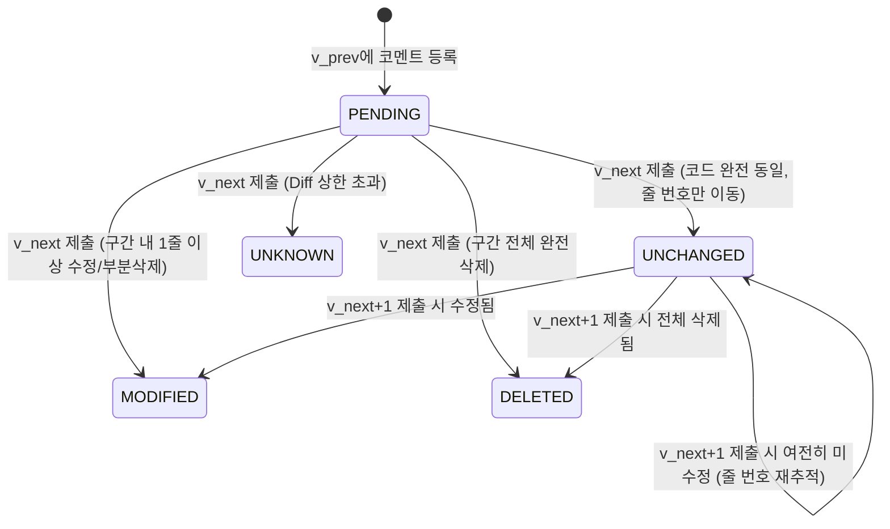

# SubmitHub 알고리즘 코어 로직 상세 설명서 (Algorithm Core Engine)

SubmitHub는 외부 diff 라이브러리(jgit 등)나 외부 표절 검사 도구에 의존하지 않고, **순수 Java 17 표준 라이브러리만으로 고성능 알고리즘 엔진(`com.submithub.core`)을 자체 구현**하였습니다.

본 문서는 SubmitHub의 양대 핵심 엔진인 **① LineTracker (Myers Diff 기반 라인 범위 피드백 추적 엔진)**와 **② Winnowing (토큰 정규화 및 윈도잉 지문 기반 표절 탐지 엔진)**의 수학적 원리, 설계 근거, 상태 전이 규칙, 의사코드를 상세히 기술합니다.

---

## 1. LineTracker: Myers Diff 기반 피드백 반영 추적 엔진

### 1.1. 설계 배경 및 문제 정의

전통적인 과제 관리 시스템(LMS)에서는 학생이 새 버전의 과제를 제출하면 이전 제출물에 작성된 교수의 피드백 코멘트가 유실되거나, 단순히 "수정 완료" 체크박스에 의존해야 했습니다. 
SubmitHub는 **GitHub PR의 "Outdated Diff" 추적 매커니즘을 학생 과제 환경에 맞게 고도화**하여, 학생이 코드를 수정하여 재제출했을 때 교수가 남긴 코멘트 구간이 실제로 고쳐졌는지를 자동으로 판정합니다.

#### 핵심 도전 과제
1. **단일 라인이 아닌 라인 범위(Line Range: $L_{start} \sim L_{end}$) 코멘트 추적**: 교수의 코멘트는 대개 함수 전체나 루프 블록 등 여러 줄에 걸쳐 작성됩니다.
2. **코드 줄 밀림(Line Shift) 대응**: 이전 줄에 주석이나 새 코드가 삽입되어 줄 번호만 바뀌고 실제 코멘트 대상 코드는 그대로 남아있는 경우, 미반영(`UNCHANGED`)으로 판정하고 **최신 버전에서의 새로운 줄 번호로 포인터를 자동 갱신**해야 합니다.
3. **들여쓰기/공백 위장(Whitespace Tampering) 필터링**: 학생이 탭을 스페이스로 바꾸거나 줄바꿈만 추가한 경우 실제 로직 수정으로 인정하지 않아야 합니다.
4. **코드 분할 및 병합 시 상태 전이(State Transition)**: 5줄짜리 블록 중 1줄만 수정된 경우, 전체가 다른 함수로 치환된 경우, 블록 전체가 삭제된 경우의 상태 전이 엄밀성.

---

### 1.2. Myers Diff 최단 편집 경로(SES) 산출 원리

SubmitHub는 Eugene W. Myers의 1986년 논문 *"An O(ND) Difference Algorithm and Its Variations"*를 채택하였습니다.

#### 1) 기존 LCS(최장 공통 부분 수열) 동적 계획법과의 비교
- **전통적 LCS ($O(NM)$ 공간/시간)**: 길이 $N, M$인 두 파일 비교 시 $N \times M$ 2차원 배열 필요. $3,000$줄 소스코드 비교 시 $9 \times 10^6$ 셀($\approx 36\text{MB}$) 메모리 소모.
- **Myers SES ($O((N+M)D)$ 시간, $O(D^2)$ 공간)**: $D$는 두 파일 간의 편집 거리(Edit Distance, 추가/삭제된 줄 수). 학생 과제는 이전 버전을 바탕으로 점진 수정되므로 $D \ll N+M$입니다. 따라서 $O((N+M)D)$는 거의 $O(N)$에 수렴하는 극적인 성능을 발휘합니다.

#### 2) 편집 그래프(Edit Graph)와 대각선 탐색
- 텍스트 $A = (a_1, a_2, \dots, a_n)$과 $B = (b_1, b_2, \dots, b_m)$에 대해 그리드 좌표 $(x, y)$ 정의:
  - $(x, y) \to (x+1, y)$ (수평 이동): $A$의 $a_{x+1}$ 삭제 (`DEL`, cost 1)
  - $(x, y) \to (x, y+1)$ (수직 이동): $B$의 $b_{y+1}$ 삽입 (`INS`, cost 1)
  - $(x, y) \to (x+1, y+1)$ (대각선 이동): $a_{x+1} == b_{y+1}$ 일 때 스네이크(Snake, cost 0)
- 대각선 번호 $k = x - y$ ($-D \le k \le D$, step 2):
  - 각 스텝 $D$에서 대각선 $k$에 도달할 수 있는 가장 먼 $x$ 좌표 $V[k]$를 갱신:
  $$x = \begin{cases} V[k+1] & \text{if } k = -D \text{ or } (k \ne D \text{ and } V[k-1] < V[k+1]) \\ V[k-1] + 1 & \text{otherwise} \end{cases}$$
  $$y = x - k$$
  - 일치하는 줄이 있으면 대각선 스네이크를 따라 최대한 전진:
  $$\text{while } x < n \text{ and } y < m \text{ and } A[x+1] == B[y+1] \implies x++, y++$$
  - $(n, m)$에 처음 도달하는 순간의 $D$가 최단 편집 거리(Shortest Edit Script)가 되며, 히스토리 역추적으로 최소 변경 연산열을 복원합니다.

#### 3) 전처리 최적화: 공통 접두어 및 접미어(Prefix/Suffix) 트리밍
Myers Diff 수행 전, 파일의 앞/뒤에서 완전히 일치하는 행을 $O(N)$으로 사전 제거하여 실제 가운데 변경 구간($n', m'$)에 대해서만 Myers 알고리즘을 수행합니다:
```
[공통 접두어 prefix줄 (cost 0)] + [가운데 변경 블록 Myers SES] + [공통 접미어 suffix줄 (cost 0)]
```

---

### 1.3. Side-by-Side 행 재배열 및 매핑 구축

Diff 결과로부터 이전 버전의 줄 번호($L_{old}$)가 새 버전에서 어떻게 되었는지를 매핑하기 위해 `SideBySide.build(diff)`를 수행합니다.

1. **연속 변경 구간 정렬 (`groupChanges`)**:
   연속된 `REMOVED` 행들을 먼저 모으고, 이어서 `ADDED` 행들을 배치합니다 (git diff 표준).
2. **좌우 매칭 (`flush`)**:
   - `REMOVED` 개수와 `ADDED` 개수의 최소값만큼은 1:1로 짝지어 `RowType.MODIFIED`로 승격합니다.
   - 짝이 남는 `REMOVED`는 `RowType.REMOVED`(삭제)로 처리합니다.
   - 짝이 남는 `ADDED`는 `RowType.ADDED`(신규 추가)로 처리합니다.
   - `EQUAL` 행은 `RowType.EQUAL`로 처리하며, 좌우 줄 번호가 보존됩니다.

---

### 1.4. 여러 줄(Line Range) 코멘트의 상태 전이(State Transition) 조건

교수가 버전 $v_{prev}$의 라인 구간 $[L_{start}, L_{end}]$에 남긴 코멘트에 대해, 학생이 버전 $v_{next}$를 제출했을 때의 상태 전이 규칙은 다음과 같습니다.

#### 1) 공백 무시 정규화 (`DiffOptions.IGNORE_WHITESPACE`)
줄 비교 시 `line.strip().replaceAll("\\s+", " ")` 정규화를 적용하여 키(`key`)를 생성합니다.
- 단순 들여쓰기 변경(스페이스 4칸 $\to$ 탭, 빈 줄 삽입/삭제 등)은 Myers Diff에서 `EQUAL`로 판정되므로 **미반영(`UNCHANGED`)**으로 유지됩니다.

#### 2) 라인별 매핑 상태 집계
구간 내 각 줄 $l \in [L_{start}, L_{end}]$에 대해 $v_{next}$에서의 매핑 결과를 조회합니다:
- $step(l) = \text{UNCHANGED}(newLine)$ : 해당 줄의 로직이 $v_{next}$의 $newLine$ 줄에 그대로 보존됨.
- $step(l) = \text{MODIFIED}(newLine)$ : 해당 줄이 수정됨.
- $step(l) = \text{DELETED}$ : 해당 줄이 삭제됨 (매핑 없음).

#### 3) 전이 조건 매트릭스 (Transition Matrix)

| 구간 내 라인들의 상태 분포 | 최종 전이 상태 (`Status`) | 설명 | 화면 표시 |
| :--- | :--- | :--- | :--- |
| **모든 줄이 `UNCHANGED`** | **`UNCHANGED`** | 코드가 전혀 수정되지 않음. 앞선 코드 추가/삭제로 줄 번호만 밀린 경우 $[L'_{start}, L'_{end}]$로 좌표 갱신 | 🔴 **미반영** (최신 v$N$ L5~L7줄) |
| **일부 줄이 `MODIFIED`** | **`MODIFIED`** | 학생이 코멘트 구간의 코드를 수정함 | 🟢 **반영됨 (확인 필요)** |
| **일부 줄이 `DELETED`, 일부 `MODIFIED`** | **`MODIFIED`** | 코드 리팩토링으로 줄 수가 줄어들거나 일부 수정됨 | 🟢 **반영됨 (확인 필요)** |
| **일부 줄이 `UNCHANGED`, 일부 `MODIFIED`** | **`MODIFIED`** | 3줄 중 1줄만 수정되었어도 변경으로 감지 | 🟢 **반영됨 (확인 필요)** |
| **모든 줄($100\%$)이 `DELETED`** | **`DELETED`** | 해당 코드 블록 전체가 새 버전에서 완전히 삭제됨 | ⚪ **삭제됨** |
| **Diff 한도 초과 (줄 수 1만 줄 이상 등)** | **`UNKNOWN`** | 변경량이 너무 커서 정밀 추적 불가 | ⚠️ **판정 불가** |



#### 4) 연쇄 버전 추적 (Multi-version Timeline Tracking)
학생이 $v_1 \to v_2 \to v_3 \to v_4$를 순차 제출할 경우:
- $v_1$ 코멘트에 대해 루프를 돌며 $v_1 \to v_2$, $v_2 \to v_3$ 단계별 Diff를 누적 추적합니다.
- 최초로 `MODIFIED` 또는 `DELETED`로 바뀐 시점의 버전 인덱스(`changedAtIndex`)를 확정하여, UI에서 **"v3에서 반영됨"**과 같이 정확한 수정 시점을 안내합니다.

---

## 2. Winnowing: 토큰 정규화 및 윈도잉 지문 기반 표절 탐지 엔진

### 2.1. 설계 배경 및 문제 정의

프로그래밍 과제에서의 표절은 일반 문서 표절과 다른 독특한 양상을 보입니다:
1. **식별자 변경(Alpha Renaming)**: 변수명, 함수명, 클래스명을 다른 이름으로 일괄 치환.
2. **주석 조작(Comment Tampering)**: 원본 주석 삭제, 새로운 주석 삽입, 불필요한 설명 추가.
3. **포맷 및 서식 변경(Layout Modification)**: 들여쓰기 방식 변경(2칸 $\to$ 4칸), 줄바꿈 변경, 괄호 위치 변경.
4. **리터럴 치환**: 상수 값(예: `10` $\to$ `20`), 문자열 출력 메시지 변경.
5. **뼈대 코드(Skeleton Code)의 높은 공통도**: 교수가 제공한 기본 인터페이스나 입출력 템플릿 코드는 모든 정상 학생에게 공통으로 존재하여, 기존 문자열 매칭 시 거대한 거짓 양성(False Positive)을 유발함.

SubmitHub는 스탠퍼드 대학교 Alex Aiken 연구팀의 논문 *"Winnowing: Local Algorithms for Document Fingerprinting"* (SIGMOD 2003)을 기반으로, 언어 독립적 **Token Lexer + SplitMix64 Rolling Hash + Local Minima Winnowing + Baseline Deduplication** 파이프라인을 구축했습니다.

---

### 2.2. 토큰 정규화 규칙 (`CodeTokenizer`)

임의의 프로그래밍 언어(Java, C/C++, Python, JavaScript 등) 소스코드를 4가지 정규형태로 추상화합니다.

```
[원본 코드]
int totalPrice = unitPrice * count;   // 총 금액 계산

[토큰 변환 흐름]
"int"         --> 예약어(KEYWORD)이므로 그대로 "int" 유지
"totalPrice"  --> 일반 식별자(Identifier)이므로 "I"로 치환
"="           --> 연산자이므로 그대로 "=" 유지
"unitPrice"   --> 일반 식별자이므로 "I"로 치환
"*"           --> 연산자이므로 그대로 "*" 유지
"count"       --> 일반 식별자이므로 "I"로 치환
";"           --> 구분자이므로 그대로 ";" 유지
"// 총 금액..." --> 주석이므로 완전 제거 (DROP)

[최종 정규화 토큰열]
int I = I * I ;
```

#### 토큰 변환 명세표

| 원본 토큰 유형 | 정규화 규칙 | 보존 줄 번호 | 변환 목적 및 효과 |
| :--- | :--- | :---: | :--- |
| **언어 예약어 (Keywords)** | 원본 키워드 문자열 유지 (`if`, `for`, `class`, `return`, `def` 등 70여 종) | 시작 줄 | 프로그램의 제어 흐름 구조(Control Flow) 보존 |
| **식별자 (Identifiers)** | `"I"` 로 일괄 치환 | 시작 줄 | 변수명/함수명 변경(Alpha-renaming) 위장 무력화 |
| **숫자 리터럴 (Numbers)** | `"N"` 으로 일괄 치환 | 시작 줄 | 상수값, 루프 카운터 변경 위장 무력화 |
| **문자열/문자 리터럴 (Strings)** | `"S"` 로 일괄 치환 | 시작 줄 | 출력 메시지, 에러 텍스트 변경 위장 무력화 |
| **연산자 및 구분 기호** | 원본 기호 유지 (`+`, `-`, `*`, `{`, `}`, `(`, `)` 등) | 시작 줄 | 수식 구조 및 블록 깊이 보존 |
| **공백, 탭, 개행** | 무시 및 탈락 (단, 개행은 라인 카운터 증가에만 사용) | - | 들여쓰기 위장 무력화 |
| **한 줄/여러 줄 주석** | `//`, `#`, `/* ... */` 완전 제거 | - | 주석 삽입/삭제 위장 무력화 |

---

### 2.3. $k$-gram 크기 및 윈도우 크기($w$) 수학적 설정 근거

#### 1) 보장 임계값 수식 (Guarantee Threshold)
Winnowing 알고리즘의 핵심 수학적 정리는 다음과 같습니다:
$$\text{Guarantee Threshold } t = w + k - 1$$
- **정리**: 두 코드 간에 연속하여 일치하는 토큰의 길이가 $t$ 이상이면, **두 코드는 최소 하나 이상의 동일한 지문(Fingerprint)을 반드시 공유**합니다.
- **길이 $k$ 미만의 일치**: 지문이 생성되지 않으므로 우연한 1~2개 토큰 일치는 완전히 무시됩니다.
- **길이 $k \le L < t$의 일치**: 윈도우의 위치에 따라 지문이 잡힐 수도 있고 잡히지 않을 수도 있습니다.

#### 2) SubmitHub의 최적 파라미터 ($k = 5, w = 4$)
SubmitHub의 기본 파라미터는 $k = 5, w = 4$로 설정되어 있습니다:
$$t = 4 + 5 - 1 = 8 \text{ 토큰}$$

- **선정 근거**:
  1. **대학 과제 코드 길이의 특성**: 1~2학년 자료구조 과제(LinkedList, Stack, 정렬 등)는 전체 함수가 20~50줄 내외로 비교적 짧습니다. $k$가 너무 크면($k \ge 15$) 1줄짜리 핵심 조건문이나 헬퍼 메소드 표절을 놓칩니다 (False Negative).
  2. **8개 정규화 토큰의 의미**:
     `if ( I . I == N ) { return I ; }` $\to$ 총 12개 토큰.
     즉, 단순한 빈출 관용구(`int I = N ;` $\to$ 5개 토큰)는 $t=8$ 미만이므로 지문이 공유되지 않아 **오탐(False Positive)이 억제**되고, 의미 있는 1개 제어문 이상이 일치할 때부터 확실하게 지문이 적발됩니다.
  3. **지문 압축률(Sampling Density)**:
     윈도우 $w=4$에 의해 생성되는 지문의 개수는 전체 $k$-gram의 약 $\frac{2}{w+1} = \frac{2}{5} = 40\%$ 수준으로 압축되어, 학생 간 비교 연산량을 60% 이상 절감합니다.

#### 3) 해시 알고리즘 및 믹싱 함수
$k$-gram의 해시는 다항 롤링 해시(Polynomial Rolling Hash)로 계산 후, 충돌(Collision) 방지를 위해 64비트 SplitMix64 비트 시프트 믹싱을 수행합니다:
$$h_0 = \text{1125899906842597L}$$
$$h_{i+1} = 31 \times h_i + \text{token}[i].\text{hashCode}()$$
$$mix(z) = (z \oplus (z \gg 30)) \times \text{0xbf58476d1ce4e5b9L} \dots$$

#### 4) 윈도잉 로컬 미니멈 선택 규칙 (Tie-breaking)
슬라이딩 윈도우 $[i, i + w - 1]$ 내에서 가장 작은 해시 값을 선택하되:
- **동점 발생 시(Tie)**: 윈도우 내에서 **가장 오른쪽에 위치한 최소값**을 선택합니다 (`hashes[i] <= hashes[min]`).
- 이는 Schleimer et al. 논문의 표준 증명 규칙으로, 윈도우가 오른쪽으로 전진할 때 지문이 불필요하게 자주 교체되는 현상을 방지합니다.
- 직전에 선택된 지문과 인덱스가 같으면 중복 저장하지 않습니다 (`min != lastPicked`).

---

### 2.4. 뼈대 코드(Baseline) 필터링 및 유사도 계산식

#### 1) 뼈대 코드 사전 필터링 ($O(1)$ Deduplication)
교수가 과제 등록 시 제공한 `baselineCode`(예: 클래스 선언부, 메소드 시그니처, main 입출력)를 먼저 토큰화하여 지문 해시 집합 $H_{base}$를 생성합니다.
학생의 지문 집합 $H_{student}$ 생성 시:
$$H_{student} = \{ fp.hash \mid fp \in \text{Winnow}(code), fp.hash \notin H_{base} \}$$
뼈대 코드에 포함된 해시는 사전에 탈락되므로, 모든 학생이 동일하게 작성한 템플릿으로 인해 유사도가 70~80%로 치솟는 문제를 원천 차단합니다.

#### 2) 비대칭 포함도(Containment) 점수 산출
두 학생 $A, B$의 유효 지문 집합 $H_A, H_B$에 대해:
$$cov_A = \frac{|H_A \cap H_B|}{|H_A|}, \quad cov_B = \frac{|H_A \cap H_B|}{|H_B|}$$
$$\text{Similarity Score}(A, B) = \max(cov_A, cov_B)$$

#### 왜 자카드 계수(Jaccard Index) 대신 비대칭 포함도(Containment)의 최대값을 사용하는가?
전통적인 자카드 유사도 $J(A, B) = \frac{|H_A \cap H_B|}{|H_A \cup H_B|}$는 **코드 덧붙이기 공격(Subsumption / Code Injection Attack)**에 취약합니다.
- 예: 학생 $B$가 학생 $A$의 과제를 $100\%$ 그대로 베낀 뒤, 감시를 피하기 위해 파일 끝에 무의미한 오픈소스 코드나 긴 주석을 3배 분량 덧붙인 경우:
  - $|H_A| = 100$, $|H_B| = 400$, $|H_A \cap H_B| = 100$
  - 자카드 유사도: $\frac{100}{400} = 25\%$ (탐지 실패!)
  - SubmitHub의 포함도: $cov_A = \frac{100}{100} = 100\%$, $cov_B = \frac{100}{400} = 25\%$
  - $\text{Score} = \max(1.0, 0.25) = 1.0$ (**$100\%$ 표절로 정확히 적발!**)

#### 3) 의심 줄 번호(Matched Lines) 역추적
각 지문은 생성 시점의 소스코드 라인 범위 $[startLine, endLine]$를 `Map<Long, List<int[]>>` 형태로 보존합니다.
공통 지문 $h \in H_A \cap H_B$에 대해 해당 라인들을 합집합(`TreeSet<Integer>`)하여, 표절 비교 화면에서 교수가 두 코드를 좌우로 나란히 놓고 **실제 표절된 코드 줄들을 형광펜으로 즉시 확인**할 수 있도록 지원합니다.

---

## 3. 알고리즘 코어 로직 의사코드 (Pseudocode)

### 3.1. LineTracker.track 의사코드

```text
function track(versions: List<String>, startLine: int, endLine: int) -> Result:
    lines = [startLine ... endLine]
    
    for v from 1 to versions.size() - 1:
        diff = MyersDiff.diff(versions[v-1], versions[v], IGNORE_WHITESPACE)
        if diff.truncated:
            return Result(Status.UNKNOWN, 0, 0, v)
            
        mapping = buildSideBySideMapping(diff) // leftLine -> (status, rightLine)
        deletedCount = 0
        isChanged = false
        
        for i from 0 to lines.length - 1:
            step = mapping.get(lines[i])
            if step is null or step.status == DELETED:
                deletedCount++
                isChanged = true
            else if step.status == MODIFIED:
                isChanged = true
            else:
                lines[i] = step.newLine // 줄 밀림 포인터 갱신
                
        if isChanged:
            status = (deletedCount == lines.length) ? Status.DELETED : Status.MODIFIED
            return Result(status, 0, 0, v)
            
    // 전 버전을 거치는 동안 변경이 없었음
    return Result(Status.UNCHANGED, lines[0], lines[last], -1)
```

### 3.2. Winnowing.fingerprints 의사코드

```text
function fingerprints(tokens: List<Token>, k: int, w: int) -> List<Fingerprint>:
    gramCount = tokens.size() - k + 1
    if gramCount <= 0: return []
    
    hashes = array of size gramCount
    for i from 0 to gramCount - 1:
        h = SEED
        for j from 0 to k - 1:
            h = 31 * h + tokens[i + j].value.hashCode()
        hashes[i] = splitmix64(h)
        
    result = []
    lastPicked = -1
    
    for start from 0 to gramCount - w:
        minIdx = start
        for i from start + 1 to start + w - 1:
            if hashes[i] <= hashes[minIdx]: // 동점 시 오른쪽 선택
                minIdx = i
                
        if minIdx != lastPicked:
            result.add(Fingerprint(
                hash = hashes[minIdx],
                startLine = tokens[minIdx].line,
                endLine = tokens[minIdx + k - 1].line
            ))
            lastPicked = minIdx
            
    return result
```

---

## 4. 요약 및 성능 지표

| 지표 / 항목 | Myers Diff & LineTracker | Tokenizer & Winnowing |
| :--- | :--- | :--- |
| **시간 복잡도** | $O((N+M)D)$ (점진 수정 시 사실상 $O(N)$) | $O(N)$ 토큰화 + $O(N)$ 윈도잉 + $O(1)$ 해시셋 |
| **공간 복잡도** | $O(D^2)$ (기존 DP의 $O(NM)$ 대비 $99\%$ 절감) | $O(N / w)$ (지문 개수 $40\%$로 압축) |
| **외부 라이브러리** | **0개** (순수 JDK 17 내장 컬렉션/타입만 사용) | **0개** (순수 JDK 17 내장 컬렉션/타입만 사용) |
| **특화 기능** | - 공백 무시 비교로 단순 들여쓰기 위장 방어<br/>- 복수 라인 범위 분할/병합 상태 추적<br/>- 최초 수정 버전 번호 역추적 | - 70여 개 다중 언어 예약어 정규화<br/>- 변수명/숫자/문자열/주석 위장 무력화<br/>- 교수 뼈대 코드 $O(1)$ 사전 배제<br/>- 덧붙이기 공격 방어 비대칭 포함도 |
