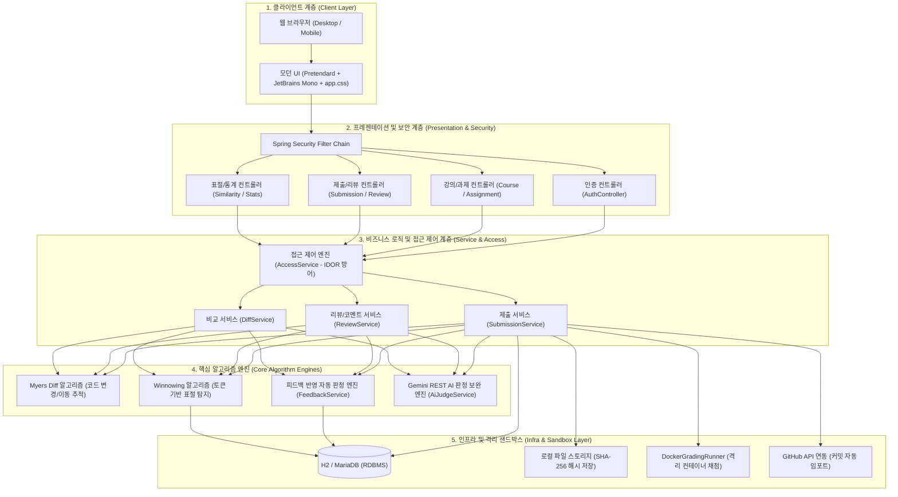
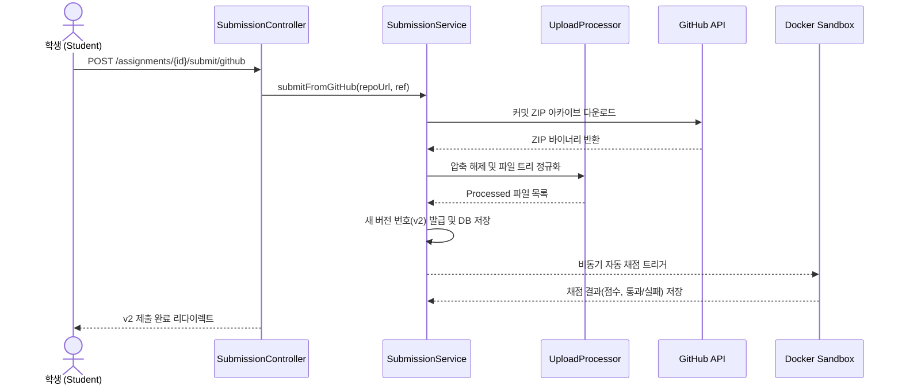
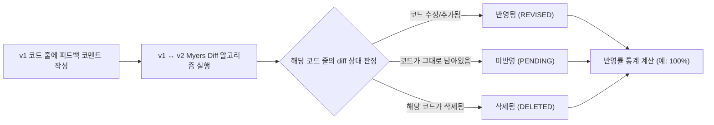
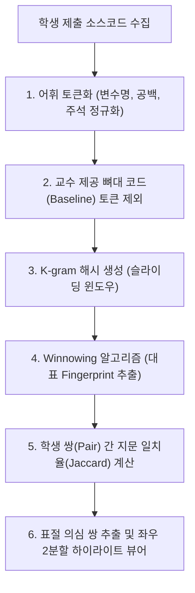
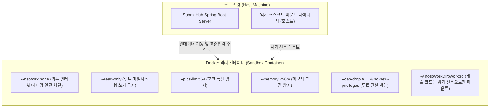
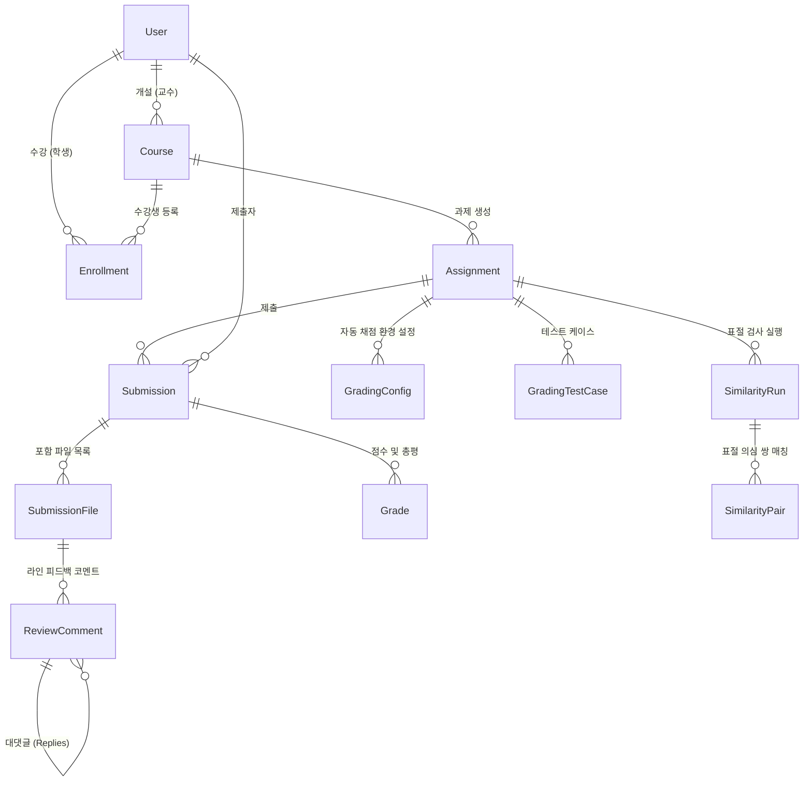

# SubmitHub 시스템 아키텍처 및 설계 명세서

> **프로젝트명**: SubmitHub (버전 관리 기반 과제 제출 및 자동 피드백 추적 플랫폼)  
> **기술 스택**: Java 17 LTS, Spring Boot 3.5, Spring Security, Spring Data JPA, H2/MariaDB, Docker Engine, Gemini REST API, Thymeleaf, Bootstrap 5.3, Pretendard, JetBrains Mono

---

## 1. 전체 시스템 아키텍처 (System Architecture)

SubmitHub는 프레젠테이션 계층, 비즈니스 및 핵심 알고리즘 계층, 인프라 및 격리 실행 계층으로 명확히 분리된 계층형 아키텍처(Layered Architecture)를 따릅니다.

---

## 2. 핵심 데이터 흐름 및 파이프라인

### 2.1. 과제 제출 및 자동 파이프라인
1. 학생이 ZIP 파일 또는 GitHub 저장소 URL을 통해 과제를 제출합니다.
2. `UploadProcessor`가 메모리 상에서 파일 목록을 추출하고 유효성을 검증(Zip Slip, 용량 초과 방어)합니다.
3. 버전 번호가 자동 부여되고, 제출 파일들은 SHA-256 해시 기반의 파일 스토리지 및 DB에 저장됩니다.
4. 백그라운드에서 과제에 설정된 Docker 테스트 케이스 자동 채점이 비동기로 수행됩니다.

---

### 2.2. 피드백 반영 자동 추적 파이프라인 (핵심 킬러 기능)
교수가 이전 버전(v1)의 특정 코드 줄에 코멘트를 남기면, 학생이 새 버전(v2)을 제출했을 때 **Myers Diff 알고리즘**을 통해 해당 줄이 어떻게 변경되었는지 역추적합니다.

---

### 2.3. 표절 검사 (Winnowing) 파이프라인
학생 간의 변수명 변경, 공백 삽입, 주석 추가 등의 치환 시도를 원천 무력화하고 코드의 구조적 유사도를 측정합니다.

---

## 3. Docker 샌드박스 보안 격리 구조

학생들이 제출한 코드는 임의의 시스템 명령어 실행, 무한 루프, 포크 폭탄(Fork Bomb), 네트워크 해킹 시도 등의 위험을 내포하고 있습니다. SubmitHub는 다중 보안 플래그를 적용하여 호스트 시스템을 완벽히 보호합니다.

---

## 4. 데이터베이스 ERD 구조 (Entity Relationship Diagram)

