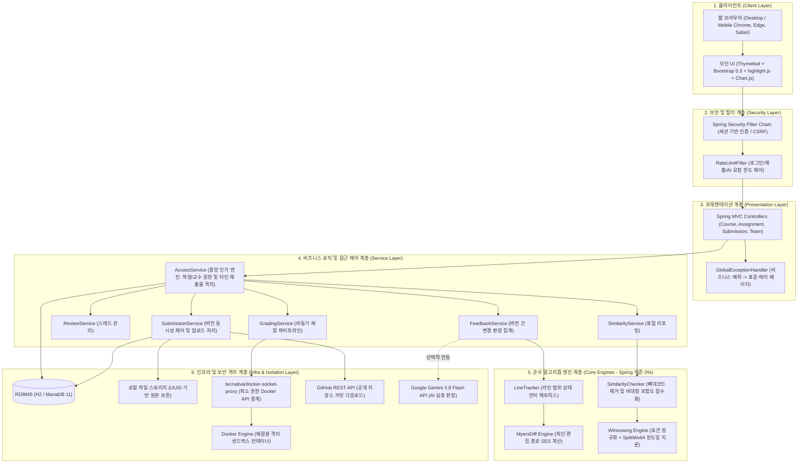
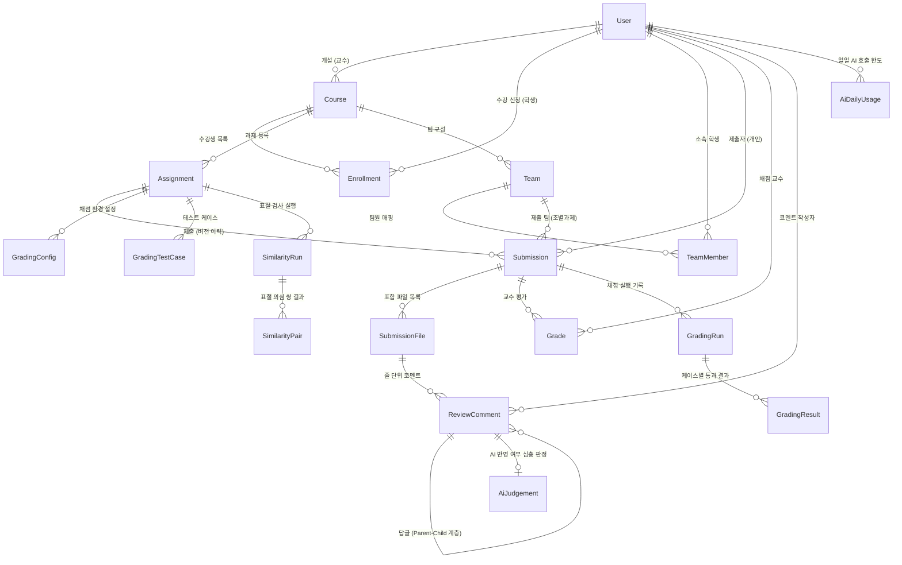
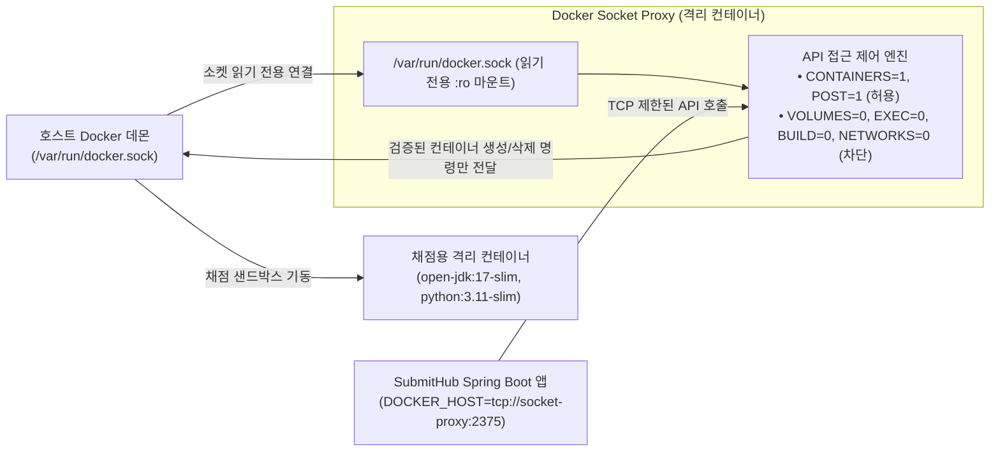
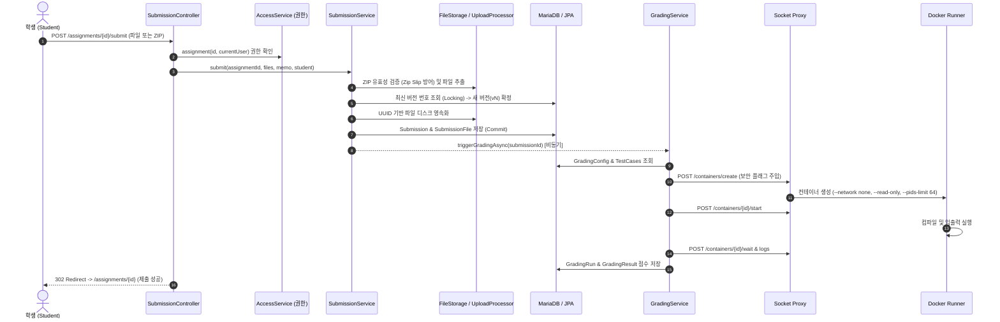

# SubmitHub 시스템 아키텍처 및 상세 설계 명세서 (ARCHITECTURE.md)

> **프로젝트명**: SubmitHub (버전 관리 기반 과제 제출 및 자동 피드백 추적 플랫폼)  
> **시스템 역할**: LMS(과제 제출) + GitHub PR(코드 리뷰 및 변경 추적) + 토큰 기반 표절 검사(Winnowing) + 백준/프로그래머스(도커 격리 자동 채점)의 유기적 결합  
> **기술 스택**: Java 17 LTS, Spring Boot 3.5, Spring Security, Spring Data JPA, H2 / MariaDB 11, Docker Engine API (Socket Proxy), Google Gemini REST API, Thymeleaf, Bootstrap 5.3, Caddy v2

---

## 1. 전체 시스템 디렉토리 구조 (Directory Structure)

SubmitHub는 프레임워크와 완전히 독립된 **순수 Java 알고리즘 계층(`core`)**, 영속성 및 비즈니스 규칙을 담당하는 **도메인·서비스 계층(`domain`, `service`)**, 격리 인프라를 다루는 **인프라 계층(`grading`, `storage`, `github`, `ai`)**, 그리고 견고한 **보안 및 웹 계층(`security`, `web`)**으로 명확히 모듈화되어 있습니다.

```
submithub/
├── .github/                     # CI/CD 및 저장소 템플릿
├── docker/                      # 채점용 샌드박스 베이스 이미지 (Java, Python)
├── docs/                        # 시스템 기술 문서
│   ├── ARCHITECTURE.md          # ★ 시스템 아키텍처 및 도메인 상세 설계서 (본 문서)
│   ├── ALGORITHM_CORE.md        # ★ Myers Diff, LineTracker, Winnowing 알고리즘 코어 로직 설명서
│   ├── DEMO_GUIDE.md            # 심사위원 5분 시연 가이드
│   ├── DEPLOY.md                # 프로덕션 클라우드(Oracle/Azure) 배포 가이드
│   ├── EVALUATION.md            # 시스템 성능 및 알고리즘 평가 보고서
│   └── TEAM_AUDIT_FEATURE.md    # 조별과제 기여도 감사 기능 명세
├── src/
│   ├── main/
│   │   ├── java/com/submithub/
│   │   │   ├── SubmitHubApplication.java      # Spring Boot 메인 엔트리포인트
│   │   │   ├── AppProperties.java             # submithub.* 프로퍼티 매핑
│   │   │   ├── ProdProfileValidator.java      # 프로덕션 기동 시 환경변수/비밀값 무결성 검증
│   │   │   │
│   │   │   ├── core/                          # ★ [순수 Java 17 코어 알고리즘] (Spring 의존 0%)
│   │   │   │   ├── diff/                      # Myers Diff 최단 편집 경로(SES) 및 분할 뷰어
│   │   │   │   │   ├── MyersDiff.java         # O((N+M)D) Myers diff 엔진 (Prefix/Suffix 트리밍)
│   │   │   │   │   ├── SideBySide.java        # 2분할(좌우) diff 행 정렬 및 긴 구간 접기(fold)
│   │   │   │   │   ├── DiffLine.java          # EQUAL, ADDED, REMOVED 라인 모델
│   │   │   │   │   ├── DiffResult.java        # diff 연산 결과 컨테이너
│   │   │   │   │   ├── DiffType.java          # 행 상태 열거형
│   │   │   │   │   └── DiffOptions.java       # 공백 무시(IGNORE_WHITESPACE) 옵션
│   │   │   │   ├── review/                    # 라인 피드백 반영 추적
│   │   │   │   │   └── LineTracker.java       # 복수 라인 범위(Line Range) 상태 전이 추적기
│   │   │   │   ├── similarity/                # 표절 탐지 엔진
│   │   │   │   │   ├── CodeTokenizer.java     # 다중 언어 예약어 보존 Token Lexer (변수/리터럴 정규화)
│   │   │   │   │   ├── Winnowing.java         # SplitMix64 해싱 + 로컬 미니멈 슬라이딩 윈도우 지문 추출
│   │   │   │   │   └── SimilarityChecker.java # 뼈대 코드(Baseline) 필터링 및 비대칭 포함도 계산
│   │   │   │   └── text/                      # 텍스트 전처리
│   │   │   │       ├── LineSplitter.java      # CRLF/LF 자동 정규화 분할기
│   │   │   │       └── TextDecoder.java       # UTF-8 및 CP949 자동 판별 및 디코더
│   │   │   │
│   │   │   ├── domain/                        # [도메인 모델 계층] JPA Entities & Repositories
│   │   │   │   ├── User.java / UserRepository # 사용자 계정 (교수 PROFESSOR / 학생 STUDENT)
│   │   │   │   ├── Course.java / CourseRepository # 개설 강의 (초대 코드 발급)
│   │   │   │   ├── Enrollment.java            # 수강생 매핑 테이블
│   │   │   │   ├── Assignment.java            # 과제 (마감일, 뼈대코드, 팀과제 여부)
│   │   │   │   ├── Submission.java            # 제출물 (버전 번호, 제출 메모, GitHub SHA)
│   │   │   │   ├── SubmissionFile.java        # 제출 파일 (경로, 원본/디스크 매핑, SHA-256)
│   │   │   │   ├── ReviewComment.java         # 코드 줄 단위 피드백 코멘트 및 답글 스레드
│   │   │   │   ├── Grade.java                 # 교수 평가 점수 및 피드백 총평
│   │   │   │   ├── Team.java / TeamMember.java# 조별과제 팀 및 팀원 구성
│   │   │   │   ├── GradingConfig.java         # 과제별 Docker 채점 환경 (Java, Python, 제한시간)
│   │   │   │   ├── GradingTestCase.java       # 테스트 케이스 (입력값, 기대출력, 공개/비공개)
│   │   │   │   ├── GradingRun.java / Result   # 자동 채점 실행 기록 및 입출력 검증 결과
│   │   │   │   ├── SimilarityRun.java / Pair  # 과제별 표절 검사 실행 이력 및 의심 쌍 데이터
│   │   │   │   ├── AiJudgement.java           # LLM 기반 피드백 반영 심층 판정 기록
│   │   │   │   └── AiDailyUsage.java          # 일일 AI API 호출 쿼터 제한
│   │   │   │
│   │   │   ├── service/                       # [비즈니스 서비스 계층]
│   │   │   │   ├── AccessService.java         # IDOR 방어 및 엔티티 접근 권한 중앙 통제소
│   │   │   │   ├── SubmissionService.java     # 파일/GitHub 과제 제출 및 버전 채번 (동시성 제어)
│   │   │   │   ├── ReviewService.java         # 코드 리뷰 코멘트 작성/수정 및 스레드 관리
│   │   │   │   ├── FeedbackService.java       # LineTracker 연동 버전 간 피드백 자동 판정 엔진
│   │   │   │   ├── SimilarityService.java     # Winnowing 엔진 구동 및 표절 리포트 생성
│   │   │   │   ├── GradingService.java        # Docker 채점 러너 비동기 호출 및 결과 기록
│   │   │   │   ├── CourseService.java         # 강의 개설, 초대 코드 및 수강 관리
│   │   │   │   ├── AssignmentService.java     # 과제 등록/수정, 마감 임박 브리핑 및 삭제
│   │   │   │   ├── StatsService.java          # 시간대별/학생별 제출 통계 및 반영률 집계
│   │   │   │   ├── TeamService.java           # 팀 생성, 참여, 팀 과제 제출
│   │   │   │   ├── TeamAuditService.java      # Git 브랜치별 기여도 및 팀 활동 감사
│   │   │   │   └── AiJudgeService.java        # Gemini API 연계 의미론적 반영 검증
│   │   │   │
│   │   │   ├── grading/                       # [자동 채점 인프라]
│   │   │   │   ├── DockerGradingRunner.java   # Docker 컨테이너 실행 및 입출력 제어
│   │   │   │   ├── DockerCommands.java        # CLI fallback 및 컨테이너 명령 생성기
│   │   │   │   ├── GradingWorkRoot.java       # 호스트 ↔ 컨테이너 바인드 마운트 워크스페이스 관리
│   │   │   │   └── OutputComparator.java      # 공백/개행 정규화 채점 출력 비교기
│   │   │   │
│   │   │   ├── storage/                       # [파일 스토리지 인프라]
│   │   │   │   ├── LocalFileStorage.java      # UUID 기반 로컬 디스크 파일 저장
│   │   │   │   └── UploadProcessor.java       # ZIP 파일 파싱, 디렉터리 순회, Zip Slip 경로 검증
│   │   │   │
│   │   │   ├── github/                        # [GitHub 외부 연동 인프라]
│   │   │   │   ├── RestGitHubClient.java      # GitHub REST API 연동 및 소스 아카이브 수집
│   │   │   │   └── GitHubRepoRef.java         # GitHub 공개 URL 및 커밋 SHA 파서
│   │   │   │
│   │   │   ├── ai/                            # [AI LLM 연동 인프라]
│   │   │   │   ├── GeminiJudgeProvider.java   # Google Gemini 3.8 Flash REST API 통신
│   │   │   │   └── JudgePrompt.java           # 코드 diff 기반 판정 프롬프트 템플릿
│   │   │   │
│   │   │   ├── security/                      # [인증 및 웹 보안 계층]
│   │   │   │   ├── SecurityConfig.java        # Spring Security Filter Chain 및 접근 규칙
│   │   │   │   ├── AppUserDetailsService.java # DB 기반 사용자 인증
│   │   │   │   └── RateLimitFilter.java       # Token Bucket 기반 IP/사용자별 Brute-force 방어 필터
│   │   │   │
│   │   │   ├── web/                           # [웹 프레젠테이션 계층] Spring MVC Controllers
│   │   │   │   ├── AuthController.java        # 로그인, 회원가입
│   │   │   │   ├── CourseController.java      # 강의 목록 및 상세
│   │   │   │   ├── AssignmentController.java  # 과제 관리 및 학생 제출 화면
│   │   │   │   ├── SubmissionController.java  # 파일 다운로드, 버전 비교, 코드 뷰어
│   │   │   │   ├── ReviewController.java      # 라인 코멘트 비동기/동기 작성 및 답글
│   │   │   │   ├── SimilarityController.java  # 표절 검사 결과 및 2분할 의심 쌍 뷰어
│   │   │   │   ├── StatsController.java       # 강의 통계 대시보드
│   │   │   │   ├── GradingController.java     # 테스트 케이스 등록 및 채점 결과 조회
│   │   │   │   ├── TeamController.java        # 팀 구성 및 조별과제 관리
│   │   │   │   └── GlobalExceptionHandler.java# 예외 통합 처리 (403 IDOR, 404, 400 등)
│   │   │   │
│   │   │   └── demo/                          # [시연용 시드 데이터]
│   │   │       └── DemoDataLoader.java        # 첫 기동 시 풍부한 시연 데이터 자동 생성
│   │   │
│   │   └── resources/
│   │       ├── application.yml                # 기본 애플리케이션 프로퍼티
│   │       ├── application-mariadb.yml        # MariaDB 접속 프로퍼티
│   │       ├── application-prod.yml           # 프로덕션 운영 프로퍼티 (엄격한 보안 검증)
│   │       ├── static/                        # 정적 리소스 (Bootstrap, highlight.js, Chart.js)
│   │       └── templates/                     # Thymeleaf 뷰 템플릿
│   │
│   └── test/                                  # 단위 및 통합 테스트 (304개 테스트 케이스)
├── docker-compose.yml                         # 개발 및 시연용 Docker Compose
├── docker-compose.prod.yml                    # 프로덕션 운영 Docker Compose (Socket Proxy 완비)
├── Caddyfile                                  # Caddy 자동 TLS 및 리버스 프록시 설정
├── Dockerfile                                 # Multi-stage 빌드 애플리케이션 컨테이너 정의
└── pom.xml                                    # Maven 빌드 명세서
```

---

## 2. 계층형 시스템 아키텍처 (Layered Architecture)

SubmitHub는 각 계층의 관심사를 철저히 분리하여, 비즈니스 로직 변경이 알고리즘 코어나 인프라 환경에 영향을 주지 않도록 설계되었습니다.



---

## 3. 도메인 엔티티 관계도 (Domain ERD)

SubmitHub의 도메인은 **강의 및 과제 기본 모델**, **버전 기반 제출물 및 줄 리뷰 모델**, **조별과제(Team) 모델**, **Docker 자동 채점 모델**, 그리고 **표절 검사 및 AI 판정 모델**의 5대 영역으로 구성됩니다.



### 3.1. 핵심 엔티티 명세 및 무결성 제약조건

1. **Submission (제출물)**:
   - `assignment_id` + `student_id` (또는 `team_id`) + `version_no` 복합 고유 키(`UK`)로 동시 제출 시 중복 버전 생성을 DB 수준에서 차단.
   - `git_commit_sha`, `git_commit_msg`, `git_commit_url`: GitHub 연동 제출 시 커밋 메타데이터를 저장하여 재현성 보장.
2. **SubmissionFile (제출 파일)**:
   - `submission_id` + `path` 고유 제약.
   - `file_hash`: SHA-256 해시를 기록하여 파일 무결성 및 변경 여부를 $O(1)$로 검증.
   - `content_text`: 텍스트 소스코드 원문 (바이너리 파일은 스토리지 파일시스템에만 보존).
3. **ReviewComment (줄 피드백 코멘트)**:
   - `start_line`, `end_line`: 피드백 대상 라인 범위 (단일 라인 및 복수 라인 지원).
   - `parent_id`: 교수 코멘트와 학생/교수 답글을 Self-referencing 계층 구조로 매핑.
   - `resolved_by_student`: 학생의 자율 "수정 완료" 플래그 (LineTracker 자동 판정과 상호 교차 검증).
4. **Team & TeamMember (조별과제 도메인)**:
   - 과제 단위가 아닌 강의 단위로 팀을 구성하여 재사용 가능.
   - 팀장(`LEADER`)과 팀원(`MEMBER`) 역할 부여, 조별과제 제출 시 모든 팀원이 동일 제출물 공유.

---

## 4. 인프라 보안 및 격리 설계 (Infrastructure & Sandbox Security)

SubmitHub는 사용자가 업로드한 임의의 소스코드를 서버에서 빌드·실행하므로, 시스템 침투(RCE) 및 호스트 탈취(Container Escape)를 방지하는 다층 방어 체계(Defense-in-Depth)를 구축하였습니다.

### 4.1. Docker Socket Proxy 기반 최소 권한 인프라

전통적인 방식인 `/var/run/docker.sock`을 웹 애플리케이션 컨테이너에 직접 바인드 마운트하는 것은 **웹 앱 탈취 시 곧바로 호스트 OS의 루트 권한 탈취로 이어지는 치명적인 안티패턴**입니다. 
SubmitHub는 `tecnativa/docker-socket-proxy`를 전면에 배치하여 권한을 극단적으로 축소하였습니다.



#### Socket Proxy 세부 보안 정책 명세

| 환경변수 설정 | 상태 | 보안 목적 및 차단되는 공격 벡터 |
| :--- | :---: | :--- |
| `CONTAINERS=1`, `POST=1` | **허용** | 채점용 컨테이너 생성(`create`), 시작(`start`), 대기(`wait`), 삭제(`rm`), 로그 조회(`logs`) 허용 |
| `VOLUMES=0` | **차단** | 호스트의 민감 경로(`/etc`, `/root`, `/var/lib`)를 마운트하는 임의 볼륨 생성 방어 |
| `EXEC=0` | **차단** | 이미 실행 중인 다른 서비스 컨테이너에 `docker exec`로 명령어를 침투시키는 공격 방어 |
| `BUILD=0`, `COMMIT=0` | **차단** | 악의적인 백도어가 삽입된 이미지를 호스트에서 임의 빌드하거나 스냅샷하는 행위 차단 |
| `NETWORKS=0` | **차단** | 도커 브릿지 네트워크를 조작하여 내부망 스니핑이나 ARP 스푸핑을 시도하는 공격 방어 |
| `SECRETS=0`, `CONFIGS=0` | **차단** | Docker Swarm이나 호스트에 등록된 시크릿/환경변수 유출 방지 |
| `SYSTEM=0`, `SWARM=0` | **차단** | Docker 데몬 종료, 시스템 프룬, 클러스터 탈취 명령 전면 거부 |

---

### 4.2. 채점 샌드박스 컨테이너 내부 보안 플래그

채점 컨테이너가 생성될 때 주입되는 보안 격리 플래그는 다음과 같습니다:

1. **`--network none`**: 네트워크 인터페이스를 루프백조차 비활성화하여 외부 인터넷 호출, 악성코드 C&C 서버 통신, 내부 사내망 스캔을 $100\%$ 차단합니다.
2. **`--read-only`**: 컨테이너의 루트 파일시스템을 완전 읽기 전용으로 잠급니다. (악성 바이너리 다운로드 및 설치 불가)
3. **`--cap-drop ALL & --security-opt no-new-privileges`**: Linux Capabilities를 전부 제거하여 root 권한 상승을 원천 차단합니다.
4. **`--pids-limit 64`**: 프로세스 생성 수를 64개로 엄격히 제한하여 포크 폭탄(Fork Bomb, `:(){ :|:& };:`) 공격을 즉시 방어합니다.
5. **`--memory 256m --memory-swap 256m`**: OOM Killer를 통한 호스트 자원 고갈 공격을 방지합니다.
6. **호스트 코드 디렉터리 읽기 전용 바인드 (`:ro`)**: 제출된 코드는 컨테이너 내부의 `/work:ro`로 마운트되어 실행 중 소스코드 훼손이나 변조를 방지합니다.

---

### 4.3. Caddy v2 리버스 프록시 및 헤더 보안

운영 환경(Production)에서는 `Caddyfile`을 통해 TLS 암호화 및 L7 계층 보안을 완성합니다:

- **자동 HTTPS**: Let's Encrypt / ZeroSSL 인증서의 자동 발급 및 무중단 자동 갱신.
- **Actuator 모니터링 경로 은폐**: 외부에서 `/actuator/*` 접근 시 **403 Forbidden**으로 즉시 거부하며, 헬스체크용 `/actuator/health` 경로만 예외 허용합니다. (Spring Boot의 내부 환경변수, 빈 목록, 힙 메모리 정보 노출 방어).
- **보안 헤더 주입**:
  - `Strict-Transport-Security "max-age=31536000; includeSubDomains; preload"`: HSTS 강제 암호화.
  - `X-Content-Type-Options "nosniff"`: 브라우저의 MIME 타입 스니핑 방지.
  - `X-Frame-Options "DENY"`: 클릭재킹(Clickjacking) 방어.
  - `Referrer-Policy "strict-origin-when-cross-origin"`: 민감 URL 유출 방어.

---

## 5. 핵심 서비스 호출 흐름도 (End-to-End Sequence)

### 5.1. 과제 제출 $\to$ 버전 채번 $\to$ 격리 채점 파이프라인



---

## 6. 결론

SubmitHub의 아키텍처는 **표준 웹 프레임워크의 생산성**과 **저수준 알고리즘의 고성능**, 그리고 **컨테이너 기반의 격리 보안**이 완벽히 조화를 이루도록 설계되었습니다. 
모든 핵심 알고리즘은 외부 라이브러리 없이 순수 Java 코드로 유지되어 유지보수성과 독립성을 극대화하였으며, Docker Socket Proxy를 통해 다중 사용자 환경에서도 강력한 보안 격리를 보장합니다.
