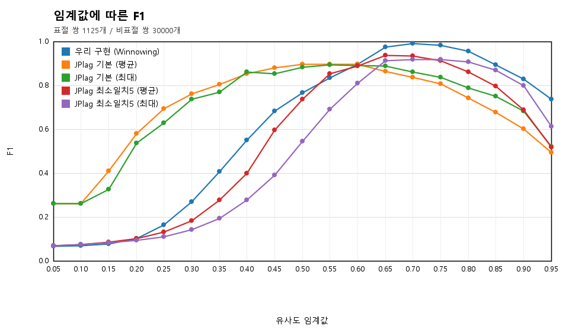
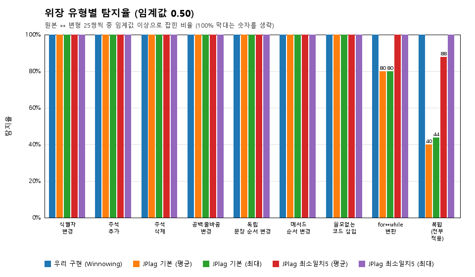
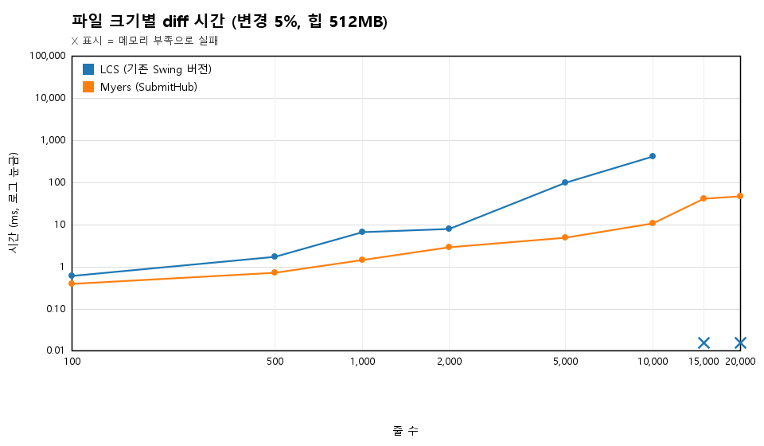
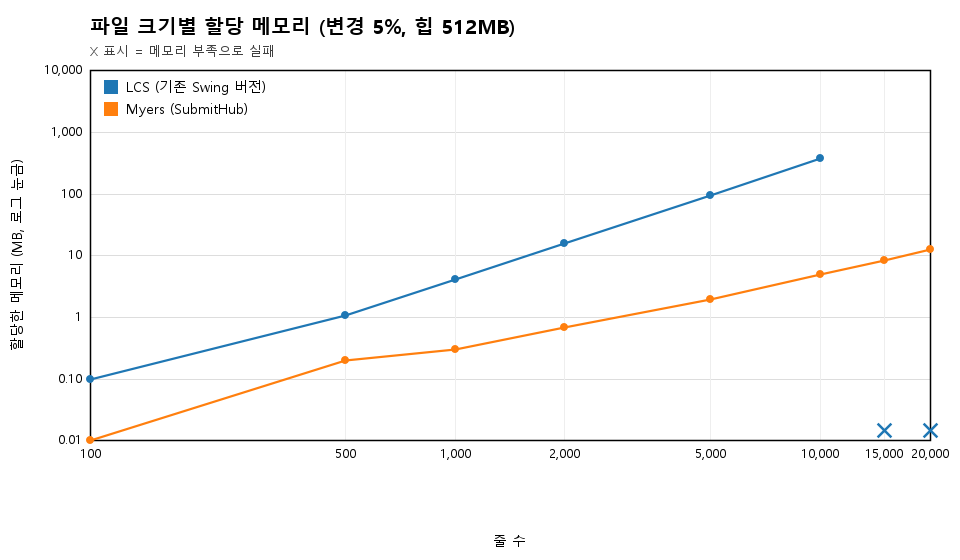
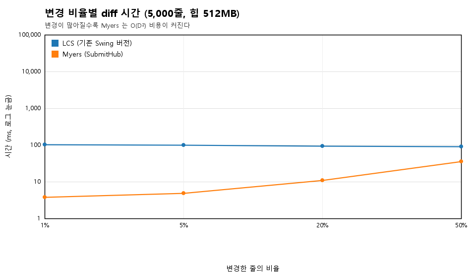

# 정량 평가

SubmitHub 의 두 알고리즘(표절 검사, diff)을 숫자로 평가한 실험 결과입니다.
실험 코드는 `src/experiments/`에 있고 기본 `mvn test` 에는 포함되지 않습니다. 원자료(CSV)는 `docs/experiments/`, 그래프는 `docs/img/`에 있습니다.

| 실험 | 질문 |
| --- | --- |
| [1. 표절 검사 정확도](#1-표절-검사-정확도) | 변수명·주석·순서를 바꿔도 잡아내는가? 다른 코드를 오탐하지 않는가? JPlag 와 비교하면? |
| [2. diff 성능](#2-diff-성능) | 기존 Swing 버전의 LCS diff 와 Myers diff 는 크기·변경 비율에 따라 얼마나 다른가? |

## 재현 방법

```bash
# JPlag 5.x 가 Java 21 로 빌드돼 있어 실험 프로필은 JDK 21 로 실행한다 (애플리케이션 자체는 JDK 17 기준 그대로)
JAVA_HOME=<JDK 21 경로> mvn -Pexperiments test
# 개별 실행: -Dtest=DatasetValidityTest | PlagiarismExperimentTest | DiffPerfExperimentTest
```

- 실험 환경: Windows 11, OpenJDK 21.0.12, JPlag 5.1.0(`de.jplag:jplag`, `de.jplag:java`).
- 데이터는 시드(42)로 결정적으로 생성되므로 같은 결과가 다시 나옵니다. 처리 시간은 PC 에 따라 달라집니다.
- 이 프로필에서는 일반 테스트 대신 실험만 실행되고, 결과 파일이 `docs/` 아래에 다시 써집니다.

---

## 1. 표절 검사 정확도

### 1-1. 데이터셋

**원본 프로그램 25개** (`src/experiments/resources/programs/`, 각 40~80줄, 과제 수준의 Java):

| 번호 | 내용 | 번호 | 내용 |
| --- | --- | --- | --- |
| 01 | 버블 정렬 | 14 | 최대공약수·완전수 |
| 02 | 선택 정렬 | 15 | 행렬 곱·전치 |
| 03 | 삽입 정렬 | 16 | 이진 탐색(반복/재귀) |
| 04 | 퀵 정렬 | 17 | 원형 큐 |
| 05 | 병합 정렬 | 18 | 문자열 뒤집기·모음 수 |
| 06 | 배열 스택 + 괄호 검사 | 19 | 자릿수 합·콜라츠·암스트롱 수 |
| 07 | 단일 연결 리스트 | 20 | 은행 계좌 클래스 |
| 08 | 격자 BFS | **21** | 버블 정렬 (01 과 **독립적으로 푼** 다른 구현) |
| 09 | DFS 연결 요소 | **22** | 양방향 연결 리스트 (07 과 독립) |
| 10 | 이진 탐색 트리 | **23** | 배열 큐 BFS (08 과 독립) |
| 11 | 단어 빈도·회문 | **24** | 소수 판별 (13 의 체와 독립) |
| 12 | 피보나치 DP | **25** | 연결 스택 + 괄호 검사 (06 과 독립) |
| 13 | 소수 체 | | |

21~25 는 **같은 과제를 서로 다르게 푼** 프로그램입니다. 과제가 같아서 코드가 어느 정도 비슷해 보이지만 표절은 아니므로, 오탐을 평가하는 "어려운 음성"으로 씁니다.

**위장 변형 9종** (원본마다 자동 생성, `ProgramTransforms`):

| 변형 | 하는 일 |
| --- | --- |
| 식별자 변경 | 지역 변수·매개변수·메서드·클래스 이름을 전부 다른 이름으로 |
| 주석 추가 | 문장 앞에 주석 줄, 줄 끝 주석, 머리말 주석 삽입 |
| 주석 삭제 | 모든 주석 제거 |
| 공백·줄바꿈 변경 | 들여쓰기를 탭으로, 여는 중괄호를 다음 줄로(Allman), 빈 줄 제거 |
| 독립 문장 순서 변경 | 서로 독립적인 선언·초기화 문장의 순서를 바꿈 |
| 메서드 순서 변경 | 연속한 메서드들의 순서를 바꿈 |
| 쓸모없는 코드 삽입 | 실행되지 않거나 결과에 영향이 없는 문장(반복문 포함)을 곳곳에 삽입 |
| for↔while 변환 | 단순 증가 for → 블록으로 감싼 while, while → `for (; 조건; )` |
| 복합 | 위 변형을 모두 적용 |

**변형이 의미를 바꾸지 않았다는 확인** (`DatasetValidityTest`): 250개 프로그램이 **전부 `javac` 로 컴파일**되고, 모든 변형이 **원본과 똑같은 출력**을 냅니다. 변형이 원본과 같은 텍스트가 되는 경우(해당 변형이 적용되지 않은 경우)도 없습니다. 이 검증 과정에서 프로그램 몇 개에 변형이 적용되지 않는 문제(독립 문장 묶음·반복문 없음)를 발견해 원본을 고쳤습니다.

**정답 라벨**: 같은 원본에서 나온 10개(원본 1 + 변형 9)는 한 "계열"이고, **같은 계열의 쌍 = 표절, 다른 계열의 쌍 = 비표절**입니다.

| 구분 | 쌍 수 |
| --- | --- |
| 표절 쌍 (25계열 × C(10,2)) | 1,125 |
| 어려운 음성 (같은 과제를 독립적으로 푼 계열 사이: 5과제 × 100) | 500 |
| 쉬운 음성 (서로 다른 과제) | 29,500 |
| 합계 (250개 프로그램의 모든 쌍) | 31,125 |

### 1-2. 비교 대상과 지표

- **우리 구현**: `SimilarityChecker.compareAll` (토큰화 → k=5, w=4 Winnowing 지문 → 두 코드 중 겹치는 비율이 큰 쪽). 점수는 0~1.
- **JPlag 5.1.0** (Java 언어 모듈): 기본 설정(최소 토큰 일치 9)과 **최소 토큰 일치 5**(우리 지문 단위와 비슷한 세밀도) 두 가지를 모두 돌렸고, 각각 평균 유사도(`similarity`)와 최대 유사도(`maximalSimilarity`)를 점수로 썼습니다.
- 지표: 임계값 이상이면 "표절"로 판정했을 때의 **정밀도·재현율·F1**, 위장 유형별 **탐지율**(원본 ↔ 변형 25쌍씩).

### 1-3. 결과



**방법별 최적 F1** (임계값을 0.05 단위로 훑어 F1 이 가장 높은 값):

| 방법 | 최적 임계값 | 정밀도 | 재현율 | F1 | 어려운 음성 오탐 |
| --- | --- | --- | --- | --- | --- |
| **우리 구현 (Winnowing)** | 0.70 | 1.000 | 0.988 | **0.994** | 0 / 500 |
| JPlag 기본 (평균) | 0.60 | 1.000 | 0.817 | 0.899 | 0 / 500 |
| JPlag 기본 (최대) | 0.55 | 0.943 | 0.855 | 0.897 | 0 / 500 |
| JPlag 최소일치5 (평균) | 0.65 | 0.979 | 0.903 | 0.939 | 0 / 500 |
| JPlag 최소일치5 (최대) | 0.75 | 0.981 | 0.868 | 0.921 | 0 / 500 |

**위장 유형별 탐지율** (임계값 0.50 / 각 방법의 최적 임계값에서, 원본 ↔ 변형 25쌍씩):



| 위장 유형 | 우리 구현 | JPlag 기본(평균) | JPlag 기본(최대) | JPlag 최소일치5(평균) | JPlag 최소일치5(최대) |
| --- | --- | --- | --- | --- | --- |
| 식별자 변경 | 100% / 100% | 100% / 100% | 100% / 100% | 100% / 100% | 100% / 100% |
| 주석 추가 | 100% / 100% | 100% / 100% | 100% / 100% | 100% / 100% | 100% / 100% |
| 주석 삭제 | 100% / 100% | 100% / 100% | 100% / 100% | 100% / 100% | 100% / 100% |
| 공백·줄바꿈 변경 | 100% / 100% | 100% / 100% | 100% / 100% | 100% / 100% | 100% / 100% |
| 독립 문장 순서 변경 | 100% / 100% | 100% / 100% | 100% / 100% | 100% / 100% | 100% / 100% |
| 메서드 순서 변경 | 100% / 100% | 100% / 100% | 100% / 100% | 100% / 100% | 100% / 100% |
| 쓸모없는 코드 삽입 | 100% / 100% | 100% / 100% | 100% / 100% | 100% / 100% | 100% / 100% |
| for↔while 변환 | 100% / 100% | 80% / 80% | 80% / 80% | 100% / 100% | 100% / 84% |
| **복합(전부 적용)** | **100% / 92%** | 40% / 32% | 44% / 40% | 88% / 48% | 100% / 48% |

**점수 분포** (임계값을 정할 때의 여유):

| 방법 | 표절 쌍 최저 | 표절 쌍 하위 5% | 표절 쌍 중앙값 | 쉬운 음성 최고 | 쉬운 음성 상위 1% | 어려운 음성 최고 |
| --- | --- | --- | --- | --- | --- | --- |
| 우리 구현 | 0.606 | 0.771 | 0.969 | 0.663 | 0.563 | 0.632 |
| JPlag 기본 (평균) | 0.000 | 0.262 | 0.862 | 0.561 | 0.330 | 0.539 |
| JPlag 최소일치5 (평균) | 0.436 | 0.571 | 0.909 | 0.803 | 0.528 | 0.629 |

처리 시간(250개 전체 쌍): 우리 구현 0.3초, JPlag 약 15초 (JPlag 는 JVM 예열·파일 파싱·보고서 준비를 포함하므로 알고리즘 속도 비교는 아님).
전체 임계값별 표는 [`experiments/plagiarism-summary.md`](experiments/plagiarism-summary.md), 원자료는 `experiments/plagiarism-thresholds.csv`, `plagiarism-by-type.csv`, `plagiarism-worst-pairs.csv`.

### 1-4. 해석

1. **이 데이터셋에서는 우리 구현이 가장 높은 F1(0.994)을 냈다.** 모든 위장 유형을 100% 탐지했고, 복합 위장도 최적 임계값에서 92% 잡았다.
   이유는 토큰화 방식에 있다: 식별자·숫자·문자열 값을 종류로만 남기고 주석·공백을 버리므로 식별자 변경, 주석, 공백 변형은 구조적으로 영향을 받지 않는다. 지문은 짧은 단위(토큰 5개)라서 문장·메서드 순서를 바꾸거나 쓸모없는 코드를 끼워도 대부분의 지문이 살아남는다.
2. **JPlag 는 단일 변형에는 강하지만 복합 변형에서 크게 놓쳤다.** 기본 설정(최소 일치 9토큰)에서는 for↔while 변환 20%, 복합 변형 56~60%를 놓쳤고, 작은 프로그램(01, 03번)의 복합 변형은 유사도 0 이 나왔다. 짧은 프로그램에서 쓸모없는 코드가 곳곳에 끼면 9토큰 이상 이어지는 일치가 남지 않기 때문이다.
   최소 일치를 5로 낮추면 크게 개선되지만(F1 0.899 → 0.939) 쉬운 음성 최고 점수가 0.80~0.91 로 올라가 임계값을 정하기 어려워진다 (우리 구현은 표절 최저 0.606 과 쉬운 음성 최고 0.663 이 겹치는 구간이 좁다).
3. **어려운 음성(같은 과제를 독립적으로 푼 쌍)에서는 모든 방법이 최적 임계값에서 오탐 0건**이었다. 다만 우리 구현의 점수는 0.63까지 올라간다. 정렬·연결 리스트처럼 구조가 비슷한 과제에서는 임계값이 너무 낮으면 오탐이 생긴다.
4. **앱의 기본 임계값(60%)은 이 데이터셋의 최적값(70%)보다 낮다.** 60%에서는 재현율 1.000, 정밀도 0.818 (쉬운 음성의 일부가 0.56~0.66 점수)이다. 이 데이터에서는 70% 가 가장 균형이 좋았다. 실제 수업에서는 뼈대 코드를 등록하면 공통 부분이 빠지므로 점수가 더 낮게 나오지만, 같은 근거로 확인한 값은 아니다.

### 1-5. 한계 (정직하게)

- **데이터셋을 직접 만들었다.** 실제 학생이 낸 표절 사례가 아니라, 내가 쓴 프로그램 25개와 내가 만든 변형이다. 실제 표절은 변형이 더 섞여 있고 일부만 베끼는 경우도 많다 (부분 표절은 평가하지 않았다).
- **변형이 우리 구현의 설계와 잘 맞는다.** 변형 종류를 내가 골랐고, 우리 토큰화가 불변인 변형(식별자, 주석, 공백)이 많다. 그래서 우리 구현에 유리하게 보일 수 있다. 반대로 우리가 약한 변형(자료구조를 바꾸기, 알고리즘을 다른 알고리즘으로 바꾸기, 조건식 뒤집기 등 의미를 바꾸는 변형)은 데이터에 넣지 않았다.
- **임계값을 같은 데이터로 골랐다.** "최적 F1"은 평가에 쓴 데이터에서 임계값을 고른 값이라 낙관적이다. 별도의 검증 데이터를 두지 않았다.
- 프로그램이 작고(40~80줄) 25개뿐이며 언어는 Java 하나다. 변형끼리의 쌍은 같은 원본을 공유해서 통계적으로 독립이 아니다.
- JPlag 는 설정 두 가지만 시험했다. JPlag 를 튜닝하면(정규화 옵션 등) 결과가 달라질 수 있다.
- 음성 쌍이 대부분 서로 다른 과제라서 정밀도가 쉽게 높게 나온다. 어려운 음성은 500쌍(5과제)뿐이다.

---

## 2. diff 성능

### 2-1. 방법

- 비교 대상: 기존 Swing 버전의 `DiffUtil`(LCS 표 `int[n+1][m+1]`)을 **알고리즘은 그대로 복사**(`LcsDiff`, 패키지·클래스 이름만 변경)한 것과 `MyersDiff`.
- 입력: n 줄짜리 원본과, 그 중 일정 비율의 줄을 무작위로 수정/삭제/추가한 새 버전 (시드 고정, 어휘 600개로 코드처럼 일부 줄이 겹침).
- 측정은 **알고리즘마다 별도 JVM** 에서 `-Xmx` 로 힙을 제한해 실행했다 (메모리 부족을 실제로 재현). 시간은 예열 후 중앙값(큰 입력은 1~3회 측정), 메모리는 diff 한 번 동안 **할당한 바이트 수**(`getThreadAllocatedBytes`).
- 두 알고리즘이 모두 성공한 모든 조건에서 **변경된 줄 수가 같다**(둘 다 최소 편집 스크립트)는 것을 확인했다.

### 2-2. 결과

**파일 크기별** (변경 5%, 힙 512MB):

| 줄 수 | LCS 시간 | Myers 시간 | LCS 할당 메모리 | Myers 할당 메모리 |
| --- | --- | --- | --- | --- |
| 100 | 0.6 ms | 0.4 ms | 0.1 MB | 0.0 MB |
| 500 | 1.7 ms | 0.7 ms | 1.1 MB | 0.2 MB |
| 1,000 | 6.6 ms | 1.5 ms | 4.1 MB | 0.3 MB |
| 2,000 | 8.1 ms | 2.9 ms | 15.8 MB | 0.7 MB |
| 5,000 | 100.1 ms | 4.9 ms | 96.6 MB | 2.0 MB |
| 10,000 | 429.7 ms | 10.8 ms | 384.6 MB | 5.0 MB |
| **15,000** | **메모리 부족** | 42.2 ms | **메모리 부족** | 8.5 MB |
| **20,000** | **메모리 부족** | 47.2 ms | **메모리 부족** | 12.9 MB |




**LCS 가 실패하는 지점**: 힙 512MB 에서 10,000줄까지는 되고 **15,000줄에서 메모리 부족**이다 (표 크기 ≈ (n+1)²×4바이트 = 15,000줄에서 약 0.9GB). 20,000줄은 힙 1GB 에서도 실패하고, 2GB 힙에서야 1.5GB 를 할당해 1.8초에 끝났다. Myers 는 같은 입력을 13MB, 47ms 에 처리한다.

**변경 비율별** (힙 512MB):

| 변경 비율 | 5,000줄: LCS | 5,000줄: Myers | 20,000줄: LCS | 20,000줄: Myers |
| --- | --- | --- | --- | --- |
| 1% | 103.4 ms / 96.7 MB | 3.8 ms / 1.6 MB | 메모리 부족 | 37.0 ms / 6.4 MB |
| 5% | 100.1 ms / 96.6 MB | 4.9 ms / 2.0 MB | 메모리 부족 | 47.2 ms / 12.9 MB |
| 20% | 96.2 ms / 96.0 MB | 11.0 ms / 8.4 MB | 메모리 부족 | 162.9 ms / 115.6 MB |
| 50% | 91.6 ms / 96.1 MB | 36.7 ms / 44.7 MB | 메모리 부족 | **메모리 부족** |



### 2-3. 해석

1. **과제처럼 "조금씩 고친" 버전 비교에서 Myers 가 압도적으로 유리하다.** 5,000줄·변경 5%에서 시간은 약 20배(100ms → 4.9ms), 메모리는 약 50배(97MB → 2MB) 적다. LCS 는 변경 비율과 상관없이 항상 n×m 표를 채우므로 시간·메모리가 입력 크기에만 비례한다.
2. **LCS 는 약 10,000줄이 실용 한계**(512MB 힙)이고 그 위에서는 실패한다. 서버에서 여러 사용자가 동시에 요청하면 메모리 부족이 더 일찍 난다. 과제 파일은 보통 수백~수천 줄이라 평소엔 문제가 없지만, 큰 파일 하나가 서버 전체를 죽일 수 있다는 점이 위험이다.
3. **Myers 도 만능은 아니다.** 시간과 메모리가 변경량 D 에 대해 O(D²)(경로 복원용 기록)이라, 변경이 많아질수록 비용이 빠르게 늘어난다. 20,000줄의 20%를 바꾸면 116MB, **절반을 바꾸면 힙 512MB 에서 실패**했다. 5,000줄 50% 변경에서는 LCS(91.6ms)와의 시간 격차가 2.5배로 줄었다(36.7ms).
   즉 "버전 간 비교"처럼 변경이 적은 용도에는 Myers 가 맞고, 완전히 다시 쓴 파일끼리의 비교에는 장점이 줄어든다. 서버에서는 편집 거리 상한으로 보호한다.

### 2-4. 한계

- 입력이 무작위로 만든 텍스트라 실제 코드의 줄 반복 패턴(`}` 등)이나 변경이 한곳에 몰리는 경향을 반영하지 않는다. 수정/삭제/추가를 같은 확률로 흩뿌려서 변경량 D 가 실제보다 크게 잡힐 수 있다.
- 시간은 한 대의 PC 에서 한 번 돌린 중앙값(큰 입력은 1~3회)이라 편차가 있다. 메모리는 "할당한 총량"이며 GC 후 최대 사용량이 아니다.
- 메모리 부족 지점은 `-Xmx512m` 기준이다. 실제 서버의 힙 크기에 따라 달라진다 (힙 크기별 결과: `experiments/diff-summary.md`).
- `MyersDiff` 는 문자열을 줄로 나누는 비용(`LineSplitter`)을 포함하고, `LcsDiff` 는 `split("\n")` 을 포함한다 (각 API 를 그대로 호출).
