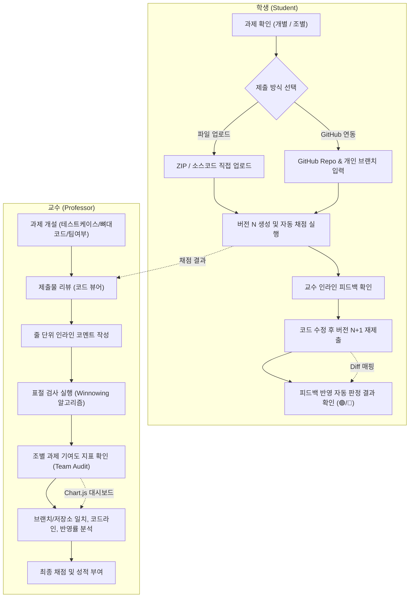

# SubmitHub 전체 기능 구현 명세서 (Full Feature Specification)

SubmitHub는 컴퓨터공학 및 소프트웨어 교육 현장을 위해 개발된 **Git 연동 과제 및 코드 협업 평가 플랫폼**입니다.  
과제 제출 시 버전 이력 관리, Myers Diff 알고리즘 기반 코드 차이점 분석, 인라인 코드 리뷰 및 피드백 자동 추적(Feedback Resolution Tracking), 토큰 기반 Winnowing 표절 검사, Docker 격리 자동 채점, 그리고 **조별 과제 브랜치 활동 감사(Team Contribution Audit)**를 지원합니다.

---

## 1. 시스템 핵심 기능 매트릭스

| 대분류 | 핵심 기능 | 구현 기술 및 알고리즘 | 대상 사용자 |
| :--- | :--- | :--- | :--- |
| **인증 및 강좌 관리** | • 역할 기반 계정 (교수, 학생)<br>• 교수 가입 보안 코드<br>• 강좌 개설 및 고유 초대 코드 수강생 등록 | Spring Security 6, BCrypt, Session Auth | 교수, 학생 |
| **과제 관리** | • 개별 과제 및 조별 과제(팀 프로젝트) 모드<br>• 마감일, 지각 허용 여부 및 지각 제출 기한 설정<br>• 뼈대 코드(Skeleton Code) 배포 | Spring Data JPA, Hibernate, Multipart I/O | 교수 |
| **코드 제출 및 버전화** | • 파일/ZIP 다중 파일 업로드 (인코딩 자동 감지 UTF-8/CP949)<br>• **GitHub 공개 커밋 URL 연동 제출** (SHA/브랜치 지정 연동)<br>• 불변(Immutable) 버전 체계 및 비관적 락/유니크 제약 동시성 제어 | Spring MVC, GitHub REST API, Pessimistic Lock | 학생 |
| **코드 뷰어 & 차이 분석** | • 웹 기반 소스코드 트리 및 신택스 하이라이팅<br>• **임의 두 버전 간 Myers Diff 알고리즘 비교**<br>• Side-by-Side (좌우 분할) 및 Unified (통합) 뷰 | Custom Myers Diff Engine, Highlight.js | 교수, 학생 |
| **인라인 코드 피드백** | • 코드 줄(Line/Range) 단위 인라인 코멘트<br>• 교수-학생 코멘트 스레드(답글)<br>• 학생의 '수정 완료' 체크 기능 | Ajax/REST API, Form POST, Thymeleaf Fragment | 교수, 학생 |
| **피드백 반영 자동 추적**<br>*(주요 기능 1)* | • 새 버전 제출 시 이전 피드백의 수정 여부 **자동 Diff 트래킹**<br>• 상태 판정: 🟢 반영됨(Resolved), 🔴 미반영(Unresolved), ⚪ 줄 삭제(Deleted)<br>• 버전별 피드백 해소율(%) 및 교수 피드백 통계 카드 | Git Diff Line Tracking Service (`LineTracker`) | 교수, 학생 |
| **표절 검사**<br>*(주요 기능 2)* | • **토큰 기반 Winnowing 표절 검사** (MOSS와 같은 Winnowing 방식)<br>• 식별자 정규화, 주석, 공백 무시 토큰화 (`CodeTokenizer`)<br>• 교수 뼈대 코드 제외 필터링<br>• 의심 쌍 나란히 비교(Side-by-Side) 및 겹치는 토큰 하이라이트 | Custom Tokenizer, Winnowing Algorithm, SimilarityChecker | 교수 |
| **격리 자동 채점** | • 입력값 $\to$ 기대 출력값 단위 테스트케이스 등록 (공개/비공개)<br>• Java(javac/java) 및 Python3 샌드박스 컴파일 및 실행<br>• 시간 초과(Timeout) 및 메모리 제한 제어 | Docker Container Execution / Fallback Local Runner | 교수, 학생 |
| **조별 과제 & 기여도 지표**<br>*(주요 기능 3)* | • 조별 과제 활성화 및 최대 팀원 수 제한 설정<br>• 팀 생성, 조원 가입, 팀 리포지토리 지정<br>• **조원별 개인 개발 브랜치 매핑**<br>• `CodeTokenizer` 기반 실질 유효 코드 라인(LoC) 집계 및 기여율 산출<br>• **활동 저조(확인 필요) 감지 배지 및 동료 코드 중복(70% 이상) 경고**<br>• Chart.js 기반 제출 참고 지표 대시보드 | TeamAuditService, Chart.js, Pessimistic Lock | 교수, 학생 |
| **통계 및 대시보드** | • 과제별 제출률, 정시/지각/미제출 현황<br>• 마감 직전 24시간 제출 집중도 분석<br>• 시간대별 제출 분포 및 학생별 평균 반영률 | Chart.js, Spring Data JPA Aggregation | 교수 |

---

## 2. 세부 기능 아키텍처 및 워크플로우



---

## 3. 핵심 기술 상세

### 3.1. Myers Diff 기반 버전 차이 분석
- 학생이 제출한 이전 버전($v_{i}$)과 최신 버전($v_{i+1}$)의 소스코드 차이를 Myers Diff 알고리즘을 통해 계산합니다.
- 공백 무시 옵션을 제공하여 실질적인 로직 변경을 파악할 수 있습니다.
- Side-by-Side 뷰를 통해 삭제된 행(빨간색), 추가된 행(초록색)을 시각화합니다.

### 3.2. 피드백 반영 자동 추적 시스템 (Feedback Resolution Tracking)
- 교수가 이전 버전($v_i$)의 특정 라인에 남긴 코멘트에 대해, 학생이 버전($v_{i+1}$)을 제출하면 시스템이 Diff 변경 이력을 추적합니다.
- **판정 로직**:
  - 해당 라인의 코드가 변경된 경우: `🟢 반영됨 (Resolved)`
  - 해당 라인의 코드가 그대로 유지된 경우: `🔴 미반영 (Unresolved)`
  - 해당 라인이 포함된 블록 전체가 삭제된 경우: `⚪ 삭제됨 (Deleted)`
- 학생과 교수 모두에게 해결된 피드백 수 및 비율을 제공합니다.

### 3.3. 토큰 기반 Winnowing 표절 검사 (MOSS와 같은 방식)
- 제출된 소스코드에서 공백, 주석을 제외하고 식별자를 정규화 토큰으로 치환합니다 (`CodeTokenizer`).
- K-gram 토큰 슬라이딩 윈도우와 Winnowing 알고리즘을 적용하여 핑거프린트 해시 집합을 생성합니다.
- 교수가 등록한 **뼈대 코드(Baseline Code)**의 핑거프린트는 검사 대상에서 제외합니다.
- 유사도 기준(threshold) 이상인 쌍은 비교 뷰에서 겹치는 코드 구간을 하이라이트합니다.

### 3.4. Docker 기반 격리 자동 채점 (Auto-Grading Sandbox)
- 사전에 등록된 입출력 테스트케이스를 바탕으로 Docker 컨테이너 내에서 소스코드를 컴파일 및 실행합니다.
- 타임아웃 및 메모리 한도를 적용하여 무한 루프나 유해 시스템 콜을 방지합니다.
- Docker가 없는 환경에서는 로컬 프로세스 폴백(Fallback) 모드를 지원합니다.

### 3.5. 조별 과제 및 브랜치별 활동 감사 (Team Project & Branch Audit)
- 조별 과제에서 팀원별 역할 분담과 활동량을 파악할 수 있도록 **제출 기반 참고 지표**를 제공합니다.
- 팀 레포지토리와 팀원별 작업 브랜치(`branchName`)를 등록받아, `CodeTokenizer`로 주석·공백·문서를 제외한 유효 코드 라인(LoC), 피드백 반영률, 저장소 일치 여부를 집계합니다.
- 팀원 간 제출물 중복도가 70% 이상일 경우 코드 중복 경고를 표시하고, 활동 저조 여부를 참고할 수 있는 상태 배지를 제공합니다.

---

## 4. 권한 및 사용자 인터페이스 구조

```
/
├── /login, /signup                  # 로그인 및 회원가입 (교수 가입 코드 지원)
├── /courses                         # 나의 강좌 목록 (교수/학생 대시보드)
│   ├── /courses/new                 # 강좌 개설 (교수)
│   ├── /courses/join                # 초대 코드로 수강 등록 (학생)
│   └── /courses/{id}                # 강좌 상세 (과제 목록, 수강생 관리)
│       ├── /assignments/new         # 과제 생성 (개별/조별, 마감일, 뼈대코드, 테스트케이스)
│       └── /stats                   # 강좌 통계 대시보드 (교수 전용)
├── /assignments/{id}                # 과제 상세 (제출 폼, 제출 내역, 피드백 현황)
│   ├── /edit                        # 과제 수정 (교수)
│   ├── /teams                       # 조별 과제 팀 목록 및 팀 생성/참가
│   └── /similarity                  # 과제 표절 검사 대시보드 (교수)
│       └── /pairs/{pairId}          # 표절 의심 쌍 비교 상세
├── /teams/{id}
│   ├── /join                        # 팀 참가 (학생)
│   └── /audit                       # 브랜치별 활동 감사 대시보드 (차트 및 참고 지표)
└── /submissions/{id}                # 제출물 상세 뷰어 (코드 트리, 줄 코멘트, 점수)
    └── /diff                        # 버전 간 Myers Diff 비교 화면
```
