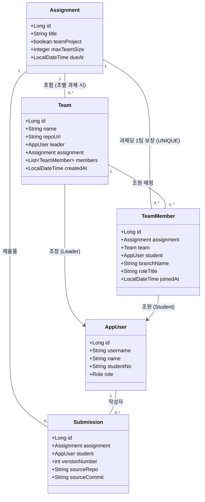

# SubmitHub 조별 과제 모드 및 활동 감사(Team Audit) 기능 명세서

SubmitHub의 **「조별 과제(팀 프로젝트) 모드 및 브랜치별 활동 감사(Team Contribution Audit)」**에 대한 기술 명세 및 운영 가이드입니다.

---

## 1. 개발 배경 및 문제 정의

### 1.1. 교육 현장의 조별 과제 페인포인트 (Pain Points)
- **무임승차 및 활동 불균형**: 조별 과제에서 특정 학생이 작업을 하지 않거나 최소한의 참여만 하고 동일한 점수를 가져가는 불공정 문제.
- **협업 과정 확인의 어려움**: GitHub 브랜치를 나누어 협업하더라도 교수가 각 학생의 커밋 이력, 실질 작성 코드량, 피드백 수정 여부를 일일이 수작업으로 확인하기 어려움.
- **주관적 평가의 한계**: 학생 상호 평가 설문조사 방식은 친분이나 감정에 치우치기 쉬움.

### 1.2. SubmitHub의 해결 전략
> **"누가 어떤 브랜치에서 실제 동작하는 소스코드를 작성했고, 교수의 코드 리뷰 피드백을 어떻게 고쳤는가?"**

SubmitHub는 **공동 저장소 URL과 학생별 개인 작업 브랜치(`branchName`)**를 등록받아, `CodeTokenizer` 기반 실질 유효 코드 라인(LoC), GitHub 저장소 일치 여부, 팀원 간 코드 중복도 및 피드백 반영률을 분석하여 **제출 기반 참고 지표**를 제공합니다.

---

## 2. 시스템 아키텍처 및 도메인 모델

### 2.1. ERD 및 엔티티 관계도

### 2.2. 핵심 엔티티 구성
- **[`Assignment`](file:///D:/Dev/Workspaces/submithub/src/main/java/com/submithub/domain/Assignment.java)**:
  - `teamProject (boolean)`: 조별 과제 여부 플래그
  - `maxTeamSize (Integer)`: 조당 최대 허용 인원
- **[`Team`](file:///D:/Dev/Workspaces/submithub/src/main/java/com/submithub/domain/Team.java)**:
  - 과제에 속한 조 엔티티. 조 이름, 팀 GitHub 레포지토리 주소, 조장(Leader) 정보 관리
- **[`TeamMember`](file:///D:/Dev/Workspaces/submithub/src/main/java/com/submithub/domain/TeamMember.java)**:
  - 팀에 가입된 조원과 개인 개발 브랜치(`branchName`), 역할(`roleTitle`) 매핑
  - `UNIQUE(assignment_id, student_id)` 제약으로 과제당 한 팀 소속 보장

---

## 3. 기여도 감사 엔진 (`TeamAuditService`) 핵심 알고리즘

### 3.1. 유효 코드 라인(LoC) 집계
- 소스코드 확장자(`.java`, `.py`, `.js`, `.ts`, `.c`, `.h`, `.cpp`, `.hpp`, `.cs`, `.kt`, `.go`, `.rs`, `.rb`, `.php`, `.html`, `.css`, `.sql`)만을 대상으로 집계합니다.
- `README.md`, 문서, 설정 파일(`.yaml`, `.json` 등)은 코드 줄 집계에서 제외됩니다.
- 주석 및 공백 처리는 표절 검사 모듈과 동일한 **`CodeTokenizer`**를 재사용하여, 토큰이 존재하는 라인 수(distinct line)만을 유효 라인으로 집계합니다. (C 포인터 연산자 `*p = 1;` 포함, `/* ... */` 여러 줄 주석 및 파이썬 삼중 따옴표 docstring 내부 라인 제외)

### 3.2. 기여도 점유율(Contribution Share) 산출 공식
각 팀원 $i$의 기여율 $C_i$는 팀 전체 유효 라인 합계 대비 비율로 계산됩니다:

$$C_i = \begin{cases} \text{round}\left( \frac{\text{ValidLoC}_i}{\sum_{k=1}^{N} \text{ValidLoC}_k} \times 100 \right) & \text{if } \sum \text{ValidLoC} > 0 \\ 0 & \text{if } \sum \text{ValidLoC} = 0 \end{cases}$$

*(제출이 0건이거나 유효 라인이 0인 경우 모든 팀원에게 0%가 부여됩니다.)*

### 3.3. 개인 기여도 건전성 배지 판정 로직

설정값(`submithub.team.lead-threshold=40`, `submithub.team.low-threshold=15`):

| 판정 배지 | 판정 기준 조건 | 의미 및 참고 가이드 |
| :--- | :--- | :--- |
| **`주도적 핵심 기여`** | 기여율 $C_i \ge 40\%$ (팀원 3명 이상) | 팀 프로젝트에서 높은 코드 비중을 구현한 멤버 |
| **`정상 균형 기여`** | $15\% \le C_i < 40\%$ | 팀 내에서 배정된 파트를 균형 있게 작성한 멤버 |
| **`기여도 저조 (주의)`** | $0\% < C_i < 15\%$ (팀원 2명 이상) | 코드 작성량이 팀 평균 대비 부족한 상태 |
| **`미제출 (활동 없음)`** | 제출 버전 수 $= 0$ | 본인 담당 브랜치에서 코드를 제출하지 않은 상태 |

> **2인 팀 기준**: 2인 팀의 경우 균등 분담(50:50) 시 양쪽 모두 핵심 기여로 오인되는 것을 방지하기 위해 3인 이상 팀에서 40% 이상 점유 시 '주도적 핵심 기여' 배지를 부여하며, 2인 팀은 '정상 균형 기여'로 분류됩니다.

### 3.4. 브랜치 출처 검증 및 팀원 간 코드 중복 감지
1. **저장소 및 출처 검증**:
   - 직접 파일 업로드 제출: `출처 미확인 (직접 업로드)`
   - GitHub 연동 제출 시 팀 저장소(`team.repoUrl`)와 제출 저장소(`submission.sourceRepo`) 비교: `저장소 일치 ✔` 또는 `저장소 불일치 ✖`
2. **팀원 간 코드 중복 감지**:
   - `SimilarityChecker.compareAll()`을 사용하여 팀원 최신 제출물 간 유사도를 비교합니다.
   - 70% 이상 코드가 중복되는 경우 대시보드에 **`⚠️ 코드 중복 의심 (N%)`** 경고 배지를 표시합니다.

### 3.5. 팀 협업 상태 종합 판정 (Collaboration Health Status)
- **`매우 원활 (협업 우수)`**: 팀원 전원이 코드를 제출하였고, 저조 판정 멤버가 0명인 경우
- **`불균형 감지 (활동 저조 — 확인 필요)`**: 미제출 인원이 있거나 기여도 저조 상태인 인원이 존재하는 경우 경고 표출

---

## 4. UI/UX 및 대시보드

대시보드 경로: `/teams/{id}/audit`

- **접근 권한 (IDOR 방지)**: 해당 강좌의 **담당 교수** 및 **해당 팀의 팀원**만 열람 가능 (그 외 사용자는 403 Forbidden).
- **점수 마스킹**: 학생 사용자가 열람할 경우 다른 팀원의 점수(score)는 마스킹(`-`) 처리되며 본인 점수만 열람 가능합니다.
- **안내 문구**: 대시보드 상단에 "본 화면은 학생의 브랜치 제출물 및 유효 코드 라인 수에 기반한 **제출 기반 참고 지표**를 제공합니다"라는 안내를 상시 노출합니다.

---

## 5. 관련 소스코드 파일 링크

- **도메인 엔티티**:
  - [Assignment.java](file:///D:/Dev/Workspaces/submithub/src/main/java/com/submithub/domain/Assignment.java)
  - [Team.java](file:///D:/Dev/Workspaces/submithub/src/main/java/com/submithub/domain/Team.java)
  - [TeamMember.java](file:///D:/Dev/Workspaces/submithub/src/main/java/com/submithub/domain/TeamMember.java)
  - [TeamRepository.java](file:///D:/Dev/Workspaces/submithub/src/main/java/com/submithub/domain/TeamRepository.java)
  - [TeamMemberRepository.java](file:///D:/Dev/Workspaces/submithub/src/main/java/com/submithub/domain/TeamMemberRepository.java)
- **비즈니스 서비스**:
  - [TeamService.java](file:///D:/Dev/Workspaces/submithub/src/main/java/com/submithub/service/TeamService.java)
  - [TeamAuditService.java](file:///D:/Dev/Workspaces/submithub/src/main/java/com/submithub/service/TeamAuditService.java)
  - [AccessService.java](file:///D:/Dev/Workspaces/submithub/src/main/java/com/submithub/service/AccessService.java)
- **웹 컨트롤러**:
  - [TeamController.java](file:///D:/Dev/Workspaces/submithub/src/main/java/com/submithub/web/TeamController.java)
- **화면 템플릿**:
  - [audit.html](file:///D:/Dev/Workspaces/submithub/src/main/resources/templates/teams/audit.html)
  - [list.html](file:///D:/Dev/Workspaces/submithub/src/main/resources/templates/teams/list.html)
- **테스트**:
  - [TeamAuditServiceTest.java](file:///D:/Dev/Workspaces/submithub/src/test/java/com/submithub/service/TeamAuditServiceTest.java)
  - [TeamServiceTest.java](file:///D:/Dev/Workspaces/submithub/src/test/java/com/submithub/service/TeamServiceTest.java)
  - [SecurityMatrixTest.java](file:///D:/Dev/Workspaces/submithub/src/test/java/com/submithub/web/SecurityMatrixTest.java)
