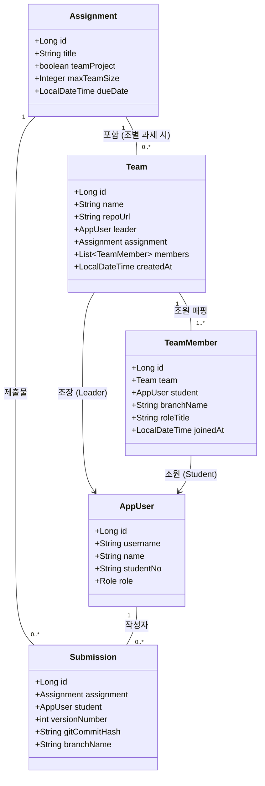
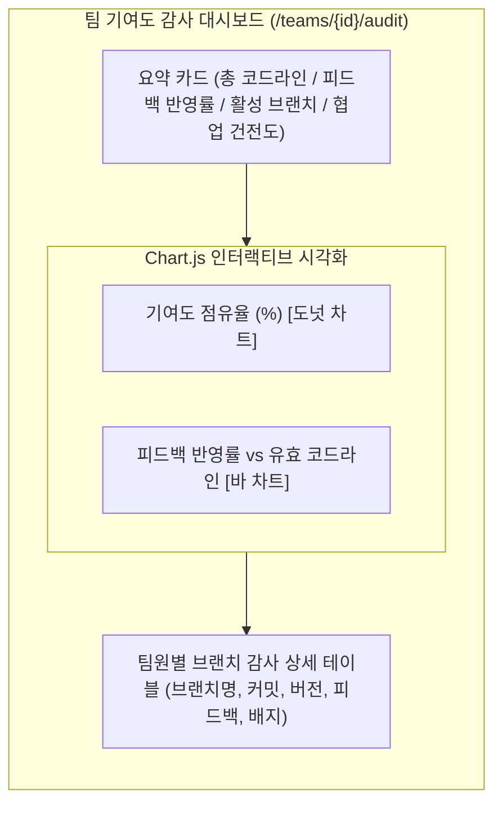

# SubmitHub 조별 과제 모드 및 브랜치별 기여도 감사(Team Audit) 기능 명세서

SubmitHub의 핵심 킬러 기능인 **「조별 과제(팀 프로젝트) 모드 및 브랜치별 기여도 감사(Team Contribution Audit)」**에 대한 전용 기술 명세 및 운영 가이드입니다.

---

## 1. 개발 배경 및 문제 정의

### 1.1. 대학 및 교육 현장의 조별 과제 페인포인트 (Pain Points)
- **무임승차(Free-rider) 문제**: 조별 과제에서 특정 학생이 작업을 하지 않거나 최소한의 형식적 참여만 하고 동일한 조별 점수를 가져가는 불공정 문제.
- **Git 협업 평가의 한계**: 실제 현업이나 대학 프로젝트에서는 GitHub를 통해 브랜치를 나누어 협업하지만, 교수가 각 학생의 브랜치 커밋 로그, 실질 코드 작성량, 피드백 수정 여부를 일일이 수작업으로 검증하기 불가능함.
- **주관적 기여도 평가**: 학생 상호 평가 설문조사 방식은 친분이나 감정에 치우쳐 객관적인 데이터 기반 평가가 이루어지지 못함.

### 1.2. SubmitHub의 해결 전략
> **"누가 어떤 브랜치에서 실제 동작하는 코드를 몇 줄 작성했고, 교수의 코드 리뷰 피드백을 어떻게 고쳤는가?"**

SubmitHub는 **공동 저장소 URL과 학생별 개인 작업 브랜치(`branchName`)**를 시스템에 등록받아, Git 버전 히스토리와 Myers Diff 알고리즘을 결합하여 **데이터에 기반한 객관적 기여도 감사(Audit)**를 실시간 자동 수행합니다.

---

## 2. 시스템 아키텍처 및 도메인 모델

### 2.1. ERD 및 엔티티 관계도

### 2.2. 핵심 엔티티 구성
- **[`Assignment`](file:///D:/Dev/Workspaces/submithub/src/main/java/com/submithub/domain/Assignment.java)**:
  - `teamProject (boolean)`: 해당 과제가 조별 과제인지 여부 플래그
  - `maxTeamSize (Integer)`: 조당 최대 허용 인원 (예: 4명)
- **[`Team`](file:///D:/Dev/Workspaces/submithub/src/main/java/com/submithub/domain/Team.java)**:
  - 과제에 속한 조 엔티티. 조 이름, 팀 GitHub 레포지토리 주소, 조장(Leader) 정보 관리
- **[`TeamMember`](file:///D:/Dev/Workspaces/submithub/src/main/java/com/submithub/domain/TeamMember.java)**:
  - 팀에 가입된 조원과 개인 개발 브랜치(`branchName`), 역할(`roleTitle`) 매핑

---

## 3. 기여도 감사 엔진 (`TeamAuditService`) 핵심 알고리즘

### 3.1. 유효 코드 라인(LoC) 집계
- 단순 파일 크기나 줄 수가 아닌, **공백 줄(Blank Line)과 주석(Comment)을 제외한 실질적 구현 코드 라인(Effective Valid LoC)**만을 파싱하여 집계합니다.
- 학생별 최신 버전 제출물에 포함된 소스코드 파일들을 전수 검사합니다.

### 3.2. 기여도 점유율(Contribution Share) 산출 공식
각 팀원 $i$의 기여율 $C_i$는 팀 전체 유효 라인 합계 대비 비율로 계산됩니다:

$$C_i = \begin{cases} \left( \frac{\text{ValidLoC}_i}{\sum_{k=1}^{N} \text{ValidLoC}_k} \right) \times 100 & \text{if } \sum \text{ValidLoC} > 0 \\ 0 & \text{if } \sum \text{ValidLoC} = 0 \end{cases}$$

### 3.3. 4단계 개인 기여도 건전성 배지 판정 로직

| 판정 배지 | 판정 기준 조건 | 의미 및 조치 가이드 |
| :--- | :--- | :--- |
| **`주도적 핵심 기여`** | 기여율 $C_i \ge 40\%$ | 팀 프로젝트 핵심 로직을 주도하여 개발한 멤버 |
| **`정상 균형 기여`** | $15\% \le C_i < 40\%$ | 팀 내에서 배정된 파트를 성실하고 균형 있게 완수한 멤버 |
| **`기여도 저조 (주의)`** | $0\% < C_i < 15\%$ | 코드 작성량이 팀 평균 대비 현저히 부족함. 교수 면담 필요 |
| **`미제출`** | 제출 버전 수 $= 0$ | 본인 담당 브랜치에서 코드를 제출하지 않은 무임승차 의심 상태 |

### 3.4. 팀 협업 상태 종합 판정 (Collaboration Health Status)
- **`매우 원활 (균형 기여)`**:
  - 팀원 전원이 코드를 제출하였고, 저조(Warning) 판정 멤버가 0명인 경우
- **`불균형 감지 (무임승차 주의)`**:
  - 미제출 인원이 1명 이상이거나, 기여도 저조(주의) 상태인 인원이 존재하는 경우 즉시 대시보드 상단에 경고 배지 표시

---

## 4. UI/UX 및 대시보드 시각화

전용 대시보드 경로: `/teams/{id}/audit`

### 4.1. 주요 화면 구성 요소
1. **요약 메트릭 카드 4종**:
   - 총 유효 코드 라인 수 (주석/공백 제외 합계)
   - 팀 평균 피드백 반영률 (%)
   - 등록된 활성 개발 브랜치 수 (예: 3개 브랜치)
   - 팀 협업 상태 배지 (`매우 원활` vs `무임승차 주의`)
2. **Chart.js 반응형 차트 2종**:
   - **기여도 점유율 도넛 차트**: 팀원별 기여 퍼센티지를 컬러풀하게 시각화
   - **피드백 개선 vs 코드량 바 차트**: 팀원별 작성 라인 수와 교수 피드백 개선율을 듀얼 축으로 비교
3. **팀원 브랜치 감사 상세 테이블**:
   - 팀원 정보 (이름, 학번, 역할, 조장 여부)
   - **할당 브랜치명** (예: `feature/rag-pipeline`, `feature/streamlit-ui`)
   - 최신 제출 버전 및 Git 커밋 해시 (GitHub 커밋 링크 연결)
   - 작성 유효 코드 라인 수 및 점유율 (%)
   - 교수 피드백 반영 현황 (반영 완료 / 전체 피드백 수)
   - 자동 채점 점수 및 건전성 판정 배지
   - **제출물 코드 뷰어 바로가기 버튼**

---

## 5. 사용자 흐름 (User Workflows)

### 5.1. 교수 워크플로우
1. **과제 생성**: 과제 등록 시 "조별 과제" 체크박스를 활성화하고 최대 팀 인원(예: 4명)을 지정합니다.
2. **과제 상세 확인**: 과제 상세 페이지(`/assignments/{id}`)에 **[조별 과제 / 팀 관리]** 버튼이 생성됩니다.
3. **기여도 감사**: 팀 목록(`/assignments/{id}/teams`)에서 각 조의 **[브랜치 기여도 감사]** 버튼을 클릭하여 감사 대시보드로 진입합니다.
4. **무임승차 판정 및 평가**: 도넛 차트와 무임승차 주의 경고를 확인하고, 이상이 감지된 학생의 브랜치 코드를 직접 열람하여 공정하게 개별 평가 점수를 부여합니다.

### 5.2. 학생 워크플로우
1. **조 생성 및 가입**: 조장이 팀명(예: `1조 - 대학 RAG 챗봇팀`)과 GitHub 리포지토리 URL을 입력하여 팀을 생성합니다. 조원들은 팀 목록에서 원클릭으로 팀에 가입합니다.
2. **개인 브랜치 설정**: 각자 자신이 개발하는 기능 브랜치(`feature/api`, `feature/ui` 등)와 역할(Frontend, Backend 등)을 등록합니다.
3. **코드 제출 및 피드백 수정**: 본인 브랜치에서 작업한 커밋을 제출하고, 교수가 남긴 피드백을 수정한 뒤 재제출하여 반영률을 높입니다.
4. **팀 대시보드 모니터링**: 언제든지 본인 팀의 기여도 감사 대시보드에 접근하여 팀 내 기여도 점유율과 동료들의 진행 상황을 투명하게 확인합니다.

---

## 6. 데모 시나리오 및 검증 데이터

시연용 데이터베이스에 탑재된 검증 시나리오:

- **대상 과제**: `인공지능 및 기계학습` 강좌 - **"과제 2: 대학 학사 RAG 챗봇 구축 (팀 프로젝트)"**
- **대상 팀**: `1조 - 대학 RAG 챗봇팀` (레포지토리: `https://github.com/ksw1295/univ-rag-chatbot`)
- **시나리오 구성**:
  1. **이민준 (student1, 팀장)**:
     - 브랜치: `feature/rag-pipeline`
     - v1 제출 $\to$ 교수 피드백 수신 $\to$ v2 재제출 (피드백 100% 개선 완료)
     - 기여도 점유율 약 70% $\to$ **`주도적 핵심 기여`** 배지 부여
  2. **최지호 (student3, 팀원)**:
     - 브랜치: `feature/streamlit-ui`
     - v1 제출 완료 (UI 구현 코드 작성)
     - 기여도 점유율 약 30% $\to$ **`정상 균형 기여`** 배지 부여
  3. **정하은 (student4, 팀원)**:
     - 브랜치: `feature/rest-api`
     - 미제출 상태 (0개 버전) $\to$ **`미제출`** 배지 부여
  4. **팀 종합 진단 결과**:
     - 정하은 학생의 미제출 감지로 인해 팀 상태가 **`불균형 감지 (무임승차 주의)`**로 즉시 경고 표출

---

## 7. 관련 소스코드 파일 링크

- **도메인 엔티티**:
  - [Assignment.java](file:///D:/Dev/Workspaces/submithub/src/main/java/com/submithub/domain/Assignment.java)
  - [Team.java](file:///D:/Dev/Workspaces/submithub/src/main/java/com/submithub/domain/Team.java)
  - [TeamMember.java](file:///D:/Dev/Workspaces/submithub/src/main/java/com/submithub/domain/TeamMember.java)
  - [TeamRepository.java](file:///D:/Dev/Workspaces/submithub/src/main/java/com/submithub/domain/TeamRepository.java)
  - [TeamMemberRepository.java](file:///D:/Dev/Workspaces/submithub/src/main/java/com/submithub/domain/TeamMemberRepository.java)
- **비즈니스 서비스**:
  - [TeamService.java](file:///D:/Dev/Workspaces/submithub/src/main/java/com/submithub/service/TeamService.java)
  - [TeamAuditService.java](file:///D:/Dev/Workspaces/submithub/src/main/java/com/submithub/service/TeamAuditService.java)
  - [AssignmentService.java](file:///D:/Dev/Workspaces/submithub/src/main/java/com/submithub/service/AssignmentService.java)
- **웹 컨트롤러**:
  - [TeamController.java](file:///D:/Dev/Workspaces/submithub/src/main/java/com/submithub/web/TeamController.java)
- **화면 템플릿**:
  - [detail.html](file:///D:/Dev/Workspaces/submithub/src/main/resources/templates/assignments/detail.html)
  - [list.html](file:///D:/Dev/Workspaces/submithub/src/main/resources/templates/teams/list.html)
  - [audit.html](file:///D:/Dev/Workspaces/submithub/src/main/resources/templates/teams/audit.html)
- **데모 및 테스트**:
  - [DemoDataLoader.java](file:///D:/Dev/Workspaces/submithub/src/main/java/com/submithub/demo/DemoDataLoader.java)
  - [DemoDataTest.java](file:///D:/Dev/Workspaces/submithub/src/test/java/com/submithub/demo/DemoDataTest.java)
  - [PagesRenderTest.java](file:///D:/Dev/Workspaces/submithub/src/test/java/com/submithub/web/PagesRenderTest.java)
