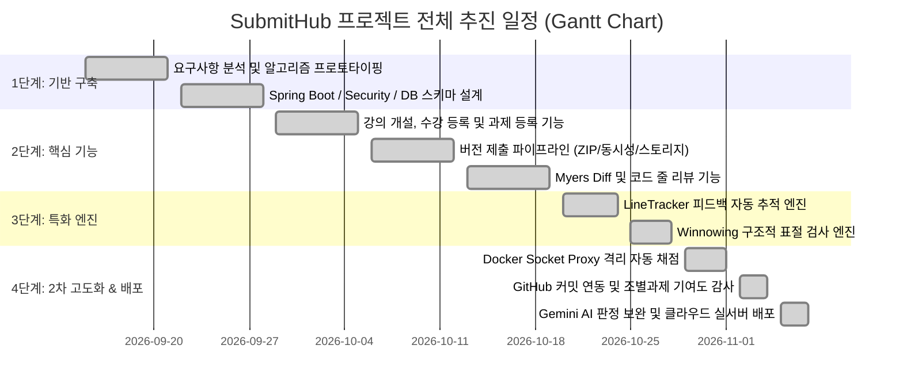

# [산출물 01] WBS 및 프로젝트 일정 계획서 (Work Breakdown Structure)

> **프로젝트명**: SubmitHub (버전 관리 기반 과제 제출 및 자동 피드백 추적 플랫폼)  
> **수행 기간**: 2026.09 ~ 2026.11 (총 8주: 기본 개발 6주 + 2차 고도화 2주)  
> **담당자**: 강서원 (1인 풀스택 개발 및 시스템 엔지니어링)  
> **문서 버전**: v1.2 (최종 배포 및 평가 완료 기준)

---

## 1. 프로젝트 개요 및 추진 목표

### 1.1. 추진 배경
- 기존 대학 교육 환경(LMS)에서는 학생이 과제를 수정하여 재제출할 때 이전 버전의 코드가 덮어쓰기되어 무엇이 바뀌었는지 확인하기 어렵고, 교수가 제공한 코드 줄 피드백이 실제로 반영되었는지 수작업으로 검증해야 하는 심각한 비효율이 존재함.
- MOSS 등 기존 표절 검사 도구는 뼈대 코드(Skeleton Code)의 공통 구문으로 인한 오탐(False Positive)이 높고, 학생 코드 실행 시 시스템 해킹이나 무한 루프 공격에 취약함.

### 1.2. 프로젝트 핵심 목표
1. **버전 관리 기반 과제 제출 체계 구축**: Git 커밋처럼 과제를 버전별(`v1, v2, ...`)로 누적 관리하고 변경 이력 보존.
2. **피드백 반영 자동 추적 (`LineTracker`)**: 순수 Java Myers Diff 알고리즘을 활용해 이전 피드백 줄의 상태를 자동 판정.
3. **토큰 기반 표절 검사 (`Winnowing`)**: 변수명/주석 위장을 무력화하고 교수 뼈대 코드를 $O(1)$로 사전 배제.
4. **보안 샌드박스 격리 자동 채점**: `Docker Socket Proxy`를 통해 컨테이너 생성 권한만 최소 부여하여 호스트 탈취 방어.
5. **조별과제 협업 감사 및 AI 보완**: Git 브랜치별 기여도 감사 및 Gemini LLM 연동을 통한 심층 피드백 판정.

---

## 2. 프로젝트 마일스톤 (Milestones)

---

## 3. WBS (Work Breakdown Structure) 상세 작업 분할표

| WBS 코드 | 1레벨 (단계) | 2레벨 (액티비티) | 3레벨 (세부 작업 패키지) | 기간 | 담당 | 산출물 | 상태 |
| :--- | :--- | :--- | :--- | :---: | :---: | :--- | :---: |
| **1.0** | **기반 및 아키텍처** | | | **1~2주차** | | | **완료** |
| 1.1 | 요구사항 정의 | 도메인 분석 및 요구사항 식별 | 기능/비기능 요구사항 36개 항목 도출 | 3일 | 강서원 | 요구사항 정의서 | 완료 |
| 1.2 | 알고리즘 검증 | Myers Diff 프로토타입 구현 | $O((N+M)D)$ 알고리즘 및 접두/접미 트리밍 | 4일 | 강서원 | MyersDiff.java, 테스트 | 완료 |
| 1.3 | 프로젝트 셋업 | Spring Boot 3.5 기반 구조화 | Maven 멀티 패키지 구성 및 Java 17 설정 | 2일 | 강서원 | pom.xml, 프로젝트 구조 | 완료 |
| 1.4 | 인증 및 인가 | Spring Security 기반 보안 계층 | Form 로그인, BCrypt 해싱, Role(교수/학생) | 3일 | 강서원 | SecurityConfig, User | 완료 |
| 1.5 | 도메인 모델링 | 기본 엔티티 및 스키마 설계 | User, Course, Enrollment, Assignment | 2일 | 강서원 | JPA Entity, ERD 초안 | 완료 |
| **2.0** | **강의 및 과제 제출** | | | **2~3주차** | | | **완료** |
| 2.1 | 강의/수강 관리 | 강의 개설 및 초대 코드 발급 | 8자리 랜덤 초대 코드, 수강생 매핑 | 3일 | 강서원 | CourseController, UI | 완료 |
| 2.2 | 과제 관리 | 과제 등록, 수정, 뼈대코드 관리 | 마감일자, 지각 허용, 뼈대 코드 설정 | 3일 | 강서원 | AssignmentController | 완료 |
| 2.3 | 버전 제출 엔진 | 단일/ZIP 파일 제출 및 저장 | UUID 기반 로컬 스토리지, Zip Slip 방어 | 4일 | 강서원 | UploadProcessor, Storage | 완료 |
| 2.4 | 동시성 제어 | 버전 번호 채번 동시성 보호 | 비관적 락(`FOR UPDATE`) 및 유니크 제약 | 2일 | 강서원 | SubmissionService | 완료 |
| 2.5 | GitHub 연동 | GitHub 커밋 아카이브 자동 임포트 | REST API 연동, SHA/메시지 불변 보존 | 3일 | 강서원 | RestGitHubClient | 완료 |
| **3.0** | **코드 리뷰 및 Diff** | | | **4~5주차** | | | **완료** |
| 3.1 | Diff 뷰어 구현 | 좌우 분할 및 통합 diff 렌더러 | SideBySide 매핑, 공백 무시, 긴 구간 접기 | 4일 | 강서원 | SideBySide.java, 뷰어 UI | 완료 |
| 3.2 | 줄 단위 리뷰 | 라인 범위 선택 및 코멘트 스레드 | Shift+클릭 라인 범위 지정, 대댓글 지원 | 3일 | 강서원 | ReviewService, Controller | 완료 |
| 3.3 | 피드백 자동 추적 | **LineTracker 엔진 개발** | Myers diff 기반 복수 라인 상태 전이 | 4일 | 강서원 | LineTracker.java | 완료 |
| 3.4 | 표절 검사 엔진 | **Winnowing 표절 탐지기 구축** | Token Lexer, SplitMix64 해싱, 뼈대 제외 | 5일 | 강서원 | Winnowing.java, Checker | 완료 |
| 3.5 | 통계 대시보드 | Chart.js 기반 학습 분석 | 제출률, 시간대별 분포, 학생별 반영률 | 3일 | 강서원 | StatsService, Chart UI | 완료 |
| **4.0** | **2차 고도화 & 인프라** | | | **6~8주차** | | | **완료** |
| 4.1 | 격리 자동 채점 | Docker Socket Proxy 기반 채점 러너 | 최소 권한 프록시 연동, 샌드박스 보안 플래그 | 5일 | 강서원 | DockerGradingRunner | 완료 |
| 4.2 | 조별과제 관리 | 팀 구성 및 협업 감사 시스템 | 팀 생성, 팀 과제 제출, Git 기여도 감사 | 4일 | 강서원 | TeamService, AuditService | 완료 |
| 4.3 | AI 판정 보완 | Gemini 3.8 Flash 연계 심층 분석 | 프롬프트 엔지니어링, 일일 쿼터 제한 | 3일 | 강서원 | GeminiJudgeProvider | 완료 |
| 4.4 | 인프라 및 배포 | Caddy 및 Docker Compose 운영화 | Let's Encrypt 자동 TLS, 보안 헤더 주입 | 3일 | 강서원 | Caddyfile, docker-compose | 완료 |
| 4.5 | 검증 및 보고서 | 304개 테스트 및 정량 평가 실험 | JPlag 비교 실험, 메모리 벤치마크, 문서화 | 4일 | 강서원 | EVALUATION.md, 포트폴리오 | 완료 |

---

## 4. 인력 및 역할 배분 (1인 개발 수행 책임 매트릭스 - RAM)

| 영역 | 세부 수행 업무 | 비중 | 사용 도구 및 기술 |
| :--- | :--- | :---: | :--- |
| **기획 & 아키텍처** | 요구사항 도출, 도메인/ERD 모델링, 시스템 아키텍처 설계 | 20% | Draw.io, Mermaid, Markdown |
| **알고리즘 코어 개발** | Myers Diff, LineTracker, Winnowing 자체 구현 및 튜닝 | 25% | Java 17, JUnit 5, JMH |
| **백엔드 엔지니어링** | Spring Boot, JPA, Spring Security, 비즈니스 트랜잭션, 동시성 | 25% | Spring Boot 3.5, MariaDB 11, H2 |
| **프론트엔드 UI/UX** | 반응형 웹, 코드 뷰어, 2분할 비교 화면, 통계 시각화 | 15% | Thymeleaf, Bootstrap 5.3, Chart.js, highlight.js |
| **인프라 & DevSecOps** | Docker Socket Proxy 보안 격리, Caddy 리버스 프록시, 클라우드 배포 | 15% | Docker, Caddy v2, Linux/Ubuntu |

---

## 5. 형상 관리 및 커밋/배포 정책

1. **브랜치 전략 (Trunk-based with Feature Branches)**:
   - `main`: 상시 배포 가능한 운영 브랜치.
   - `feature/*`: 단위 기능 개발 브랜치, 완료 후 단위 테스트 통과 시 `main`에 병합.
2. **커밋 메시지 규약**:
   - `feat:` 신규 기능 추가
   - `fix:` 버그 수정
   - `refactor:` 코드 리팩토링 (기능 변경 없음)
   - `test:` 테스트 코드 작성 및 검증
   - `docs:` 설계 문서 및 가이드 갱신
3. **무결성 원칙 (Zero Secret Policy)**:
   - 모든 API 키, DB 비밀번호, 서명 키는 소스코드에 하드코딩하지 않고 `.env` 및 환경변수로만 주입.
   - `.gitignore` 및 `ProdProfileValidator`를 통해 누출 원천 차단.
