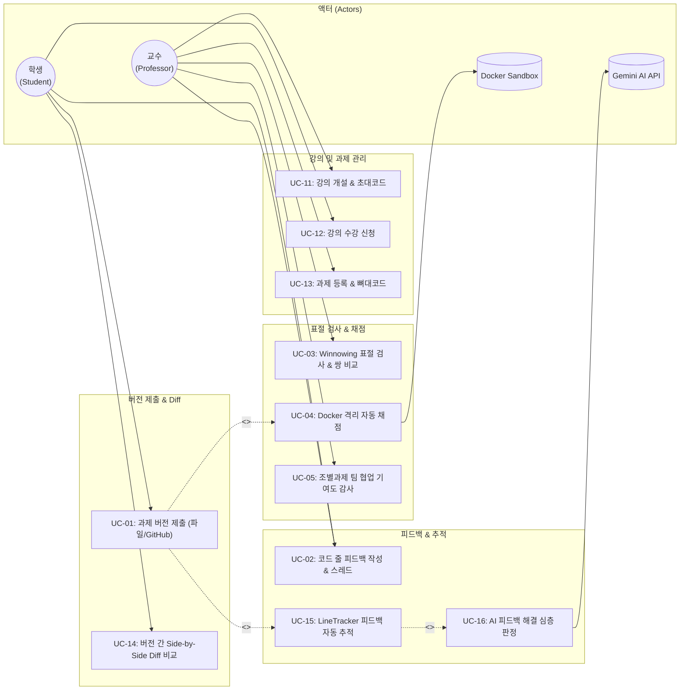

# [산출물 03] 유스케이스 명세서 (Use Case Specification)

> **프로젝트명**: SubmitHub (버전 관리 기반 과제 제출 및 자동 피드백 추적 플랫폼)  
> **문서 버전**: v1.2  
> **작성일자**: 2026-11-07  
> **작성자**: 강서원

---

## 1. 액터(Actor) 정의

| 액터명 | 분류 | 역할 및 권한 |
| :--- | :---: | :--- |
| **교수 (Professor)** | 주 액터 (Primary) | 강의를 개설하고 초대 코드를 발급하며, 과제를 등록하고 학생 코드에 줄 단위 피드백을 작성합니다. 표절 검사를 실행하고 채점 결과를 최종 확정합니다. |
| **학생 (Student)** | 주 액터 (Primary) | 초대 코드로 강의에 참여하고, 파일 또는 GitHub 커밋으로 과제를 버전별로 제출합니다. 교수 피드백을 확인하고 답글을 달며, 남은 피드백을 확인하고 개선 버전을 제출합니다. |
| **채점 샌드박스 (Grading Runner)** | 시스템 액터 (Secondary) | 학생 제출 이벤트에 의해 트리거되어 Docker Socket Proxy를 통해 격리 컨테이너를 기동하고, 테스트 케이스를 실행한 뒤 점수 및 입출력 결과를 반환합니다. |
| **AI 판정기 (Gemini Judge)** | 외부 액터 (External) | 교수의 승인 하에 `MODIFIED` 상태의 코드 변경 내역을 수신받아 피드백 의도 해결 여부를 심층 분석하여 소견을 반환합니다. |

---

## 2. 유스케이스 다이어그램 (Use Case Diagram)

---

## 3. 핵심 유스케이스 상세 기술서

### UC-01: 과제 버전 제출 (파일 업로드 및 GitHub 연동)

| 항목 | 내용 |
| :--- | :--- |
| **유스케이스 ID / 명** | **UC-01 / 과제 버전 제출** |
| **주 액터** | 학생 (Student) |
| **사전 조건** | • 학생이 로그인되어 있고 해당 강의에 등록되어 있어야 함. • 과제가 마감 전이거나 지각 제출이 허용된 상태여야 함. |
| **사후 조건** | • 새 버전 번호(`vN`)가 발급되고 소스코드가 안전하게 저장됨. • 자동 채점 파이프라인이 비동기로 트리거됨. |
| **기본 흐름 (Primary Flow)** | 1. 학생이 과제 상세 페이지에서 제출 방식(파일/ZIP 업로드 또는 GitHub 커밋)을 선택한다. 2. 파일 선택 또는 GitHub 저장소 URL과 브랜치(또는 커밋 SHA)를 입력하고 제출 메모를 작성한다. 3. [제출하기] 버튼을 클릭한다. 4. 시스템은 업로드된 ZIP 파일의 Zip Slip 공격 패턴을 검증하거나 GitHub API로 소스를 가져온다. 5. 시스템은 비관적 락을 통해 해당 학생의 최신 버전 번호를 조회하고 $+1$ 증가된 새 버전을 부여한다. 6. 소스코드를 디스크 및 DB에 불변 영속화(`INSERT`)한다. 7. 이전 버전 피드백이 존재할 경우 `LineTracker`를 즉시 구동하여 반영 상태를 갱신한다. 8. 자동 채점 태스크를 백그라운드로 전달하고 제출 이력 페이지로 리다이렉트한다. |
| **대안 흐름 (Alternative)** | • **지각 제출인 경우**: 마감 시각이 지났으나 지각 허용 기간인 경우, 제출을 승인하되 `late=true` 플래그를 영구 마킹한다. • **GitHub 연동인 경우**: GitHub REST API로부터 zipball을 내려받아 소스코드 확장자만 선별적으로 추출하여 저장한다. |
| **예외 흐름 (Exception)** | • **E1. Zip Slip 감지**: ZIP 내부에 `../` 등 상위 디렉터리 경로가 포함된 경우 즉시 거부하고 400 에러 반환. • **E2. 동일 커밋 중복 제출**: 직전 버전과 동일한 GitHub 커밋 SHA를 제출한 경우 "변경 사항이 없습니다" 경고 메시지 표시. • **E3. 파일 용량 초과**: 파일당 5MB 또는 전체 20MB를 초과한 경우 사용자에게 제한 안내 메시지 반환. |

---

### UC-02: 코드 줄 피드백 작성 및 LineTracker 피드백 자동 추적

| 항목 | 내용 |
| :--- | :--- |
| **유스케이스 ID / 명** | **UC-02 / 코드 줄 피드백 작성 및 반영 추적** |
| **주 액터** | 교수 (Professor), 학생 (Student) |
| **사전 조건** | • 학생이 최소 1개 이상의 과제 버전을 제출 완료한 상태여야 함. |
| **사후 조건** | • 특정 줄 번호 범위에 코멘트 레코드가 저장됨. • 학생이 새 버전을 제출할 때마다 각 코멘트의 반영 상태가 자동으로 계산됨. |
| **기본 흐름 (Primary Flow)** | 1. 교수는 학생의 제출 코드 뷰어에서 특정 줄 번호를 클릭하거나, Shift+클릭으로 라인 범위(예: 12~16줄)를 선택한다. 2. 나타나는 입력 폼에 피드백 코멘트를 작성하고 [등록]을 누른다. 3. 학생은 코드 화면에서 해당 줄 바로 아래에 달린 코멘트를 확인하고 필요 시 답글(대댓글)을 단다. 4. 학생이 해당 코드를 수정하여 다음 버전(v2)을 제출한다. 5. 시스템은 `LineTracker`를 실행하여 v1과 v2 사이의 Myers diff 결과를 추출한다. 6. 피드백 라인 범위가 수정/치환되었는지(`MODIFIED`), 그대로 남아있는지(`UNCHANGED`), 삭제되었는지(`DELETED`) 판정한다. 7. 학생 화면에는 "남은 피드백 N개", 교수 화면에는 "피드백 반영률(%)"이 실시간 반영된다. |
| **대안 흐름 (Alternative)** | • **코드 줄 밀림 발생**: 학생이 이전 라인에 새로운 주석이나 코드를 추가해 줄 번호만 밀린 경우, `LineTracker`는 코드가 변경되지 않았음을 감지하고 최신 버전에서의 새로운 라인 번호(예: 12줄 $\to$ 15줄)를 계산하여 화면에 표시한다. |
| **예외 흐름 (Exception)** | • **E1. 탭/스페이스만 바꾼 경우**: 학생이 공백이나 들여쓰기만 바꾼 경우 `DiffOptions.IGNORE_WHITESPACE`에 의해 수정으로 인정하지 않고 `UNCHANGED(미반영)`을 유지한다. |

---

### UC-03: Winnowing 표절 검사 및 2분할 의심 쌍 비교

| 항목 | 내용 |
| :--- | :--- |
| **유스케이스 ID / 명** | **UC-03 / Winnowing 구조적 표절 검사 및 쌍 비교** |
| **주 액터** | 교수 (Professor) |
| **사전 조건** | • 과제에 2명 이상의 학생이 제출물을 등록한 상태여야 함. |
| **사후 조건** | • 유사도 점수 내림차순으로 의심 쌍 목록이 생성되고 하이라이트 줄 정보가 저장됨. |
| **기본 흐름 (Primary Flow)** | 1. 교수가 과제 상세 페이지에서 [표절 검사] 탭으로 이동하여 유사도 임계값(기본 70%)을 확인하고 [검사 실행]을 클릭한다. 2. 시스템은 모든 학생의 최신 제출물 소스코드를 수집한다. 3. `CodeTokenizer`를 통해 주석과 공백을 제거하고, 변수명/함수명은 `I`, 숫자는 `N`, 문자열은 `S`로 정규화한다. 4. 교수가 등록한 뼈대 코드(Baseline)의 지문 해시를 $O(1)$로 사전 배제한다. 5. 슬라이딩 윈도우($k=5, w=4$)를 통해 로컬 미니멈 Fingerprint 해시 집합을 추출한다. 6. 모든 학생 쌍에 대해 비대칭 포함도 $\text{Score} = \max(cov_A, cov_B)$를 계산한다. 7. 임계값 이상인 쌍을 정렬하여 순위표를 출력한다. 8. 교수가 의심 쌍을 클릭하면, 좌우 2분할 화면에서 일치하는 코드 줄이 형광펜으로 하이라이트된 뷰어가 제공된다. |
| **대안 흐름 (Alternative)** | • **코드 덧붙이기(Subsumption Attack) 감지**: 학생 B가 학생 A의 코드를 100% 베낀 뒤 파일 끝에 무의미한 코드를 길게 덧붙인 경우, 비대칭 포함도 계산식을 통해 표절도 100%로 적발한다. |

---

### UC-04: Docker 격리 샌드박스 비동기 자동 채점

| 항목 | 내용 |
| :--- | :--- |
| **유스케이스 ID / 명** | **UC-04 / Docker 격리 자동 채점** |
| **주 액터** | 시스템 액터 (Grading Runner) |
| **사전 조건** | • 과제에 1개 이상의 테스트 케이스(입력/기대출력)가 등록되어 있어야 함. • 학생이 과제를 제출해야 함. |
| **사후 조건** | • 케이스별 통과/실패 결과 및 실행 시간, 메모리, 총점이 DB에 기록됨. |
| **기본 흐름 (Primary Flow)** | 1. 학생 제출 완료 트랜잭션이 커밋된 직후 `triggerGradingAsync` 이벤트가 발행된다. 2. 채점 서비스는 호스트 임시 폴더에 제출 소스코드를 배치한다. 3. `Docker Socket Proxy`를 통해 보안 컨테이너(`--network none`, `--read-only`, `--pids-limit 64`, `--memory 256m`, `--cap-drop ALL`) 생성을 요청한다. 4. 컨테이너 내부에서 소스코드를 컴파일한다 (컴파일 에러 발생 시 즉시 채점 종료 및 로그 저장). 5. 등록된 각 테스트 케이스의 입력을 표준입력(stdin)으로 주입하고 출력을 수집한다. 6. `OutputComparator`를 통해 끝 공백 및 줄바꿈을 정규화하여 기대 출력과 대조한다. 7. 채점 컨테이너를 안전하게 파기(`--rm`)하고 결과를 DB에 저장한다. 8. 학생 화면에는 총점과 공개 케이스의 상세 결과만 공개하고, 비공개 케이스는 통과 여부만 노출한다. |
| **예외 흐름 (Exception)** | • **E1. 무한 루프 발생**: 학생 코드가 제한 시간(기본 3초)을 초과하면 컨테이너를 강제 SIGKILL하고 `TIME_LIMIT_EXCEEDED` 판정. • **E2. 포크 폭탄 시도**: 프로세스를 대량 생성하려 할 경우 `--pids-limit 64`에 의해 즉시 차단되고 `RUNTIME_ERROR` 판정. |

---

### UC-05: 조별과제 팀 협업 및 기여도 감사

| 항목 | 내용 |
| :--- | :--- |
| **유스케이스 ID / 명** | **UC-05 / 조별과제 팀 협업 및 기여도 감사** |
| **주 액터** | 교수 (Professor), 학생 (Student) |
| **사전 조건** | • 해당 과제가 조별과제(팀 과제)로 지정되어 있어야 함. |
| **사후 조건** | • 팀원별 Git 커밋 내역 및 기여도 통계가 감사 화면에 시각화됨. |
| **기본 흐름 (Primary Flow)** | 1. 학생(팀장)이 조별과제 상세 페이지에서 팀명과 팀 GitHub 저장소 주소를 입력하여 팀을 생성한다. 2. 팀원은 팀에 참여하여 자신의 담당 Git 브랜치명(예: feature/rag)과 역할명을 등록한다. 3. 팀원들은 자신의 브랜치 코드를 원클릭으로 제출하거나 개별 커밋으로 버전을 누적한다. 4. 모든 팀원의 과제 상세 화면에 팀 브랜치 현황 및 제출 이력이 표시된다. 5. 교수는 팀 감사 대시보드에서 각 팀원별 브랜치 머지 여부, 제출 횟수, 유효 라인 수, 동료 간 코드 중복도를 확인한다. 6. 특정 팀원의 무임승차(Free-rider) 여부를 객관적 정량 지표와 감사 배지로 판별한다. |
