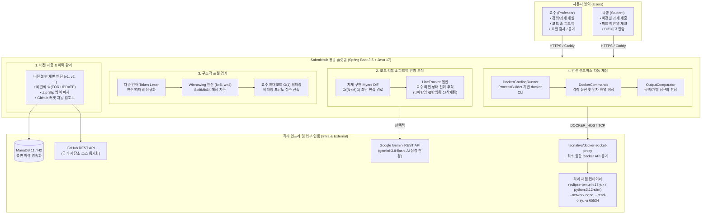
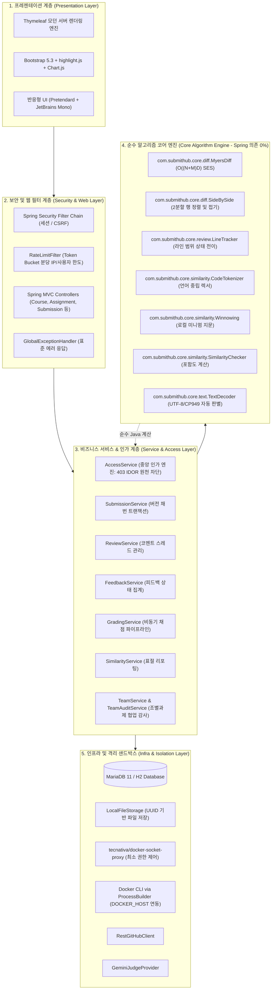
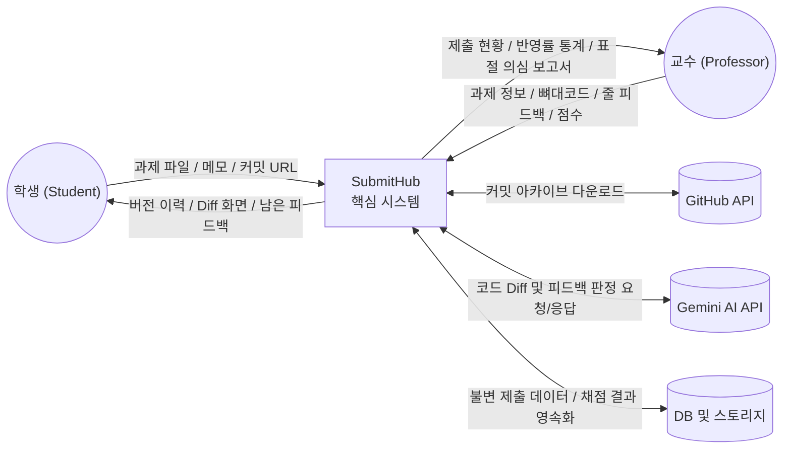
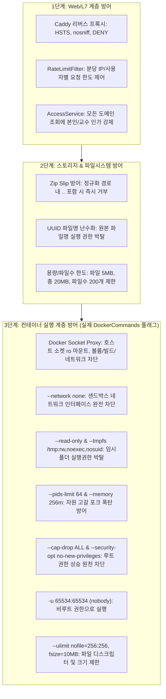

# [산출물 04] 시스템 아키텍처 구상도 및 구성 명세서 (System Architecture Blueprint)

> **프로젝트명**: SubmitHub (버전 관리 기반 과제 제출 및 자동 피드백 추적 플랫폼)  
> **문서 버전**: v1.3 (실제 프로세스 및 이미지 팩트체크 완료)  
> **검증 일자**: 2026-11-07  
> **작성자**: 강서원

---

## 1. 시스템 개념 구상도 (Conceptual Architecture)

SubmitHub는 기존 학습관리시스템(LMS)의 단순 파일 업로드 한계를 극복하고, **Git의 버전 관리 철학**, **GitHub PR의 인라인 코드 리뷰**, **MOSS의 정밀 표절 검사**, **온라인 저지(OJ)의 격리 자동 채점**을 단일 웹 플랫폼으로 통합한 차세대 교육 플랫폼입니다.



---

## 2. 5계층 논리 아키텍처 (Layered Architecture)

SubmitHub는 각 계층의 결합도를 낮추고 응집도를 극대화한 **계층형 아키텍처(Layered Architecture)**를 준수합니다.



---

## 3. 물리적 네트워크 및 배포 구성도 (Deployment Architecture)

운영 환경에서는 단일 호스트 머신 내에서 모든 컨테이너가 내부 가상 네트워크(`internal`)로 격리되며, Caddy 리버스 프록시를 통해서만 외부와 통신합니다.

```mermaid
flowchart TB
    Internet(("외부 인터넷 (클라이언트 웹 브라우저)"))
    
    subgraph HostServer ["클라우드 호스트 머신 (Ubuntu 22.04 LTS)"]
        direction TB
        
        subgraph EdgeLayer ["Edge 리버스 프록시"]
            Caddy["Caddy v2 웹 서버<br/>• 포트: 80 / 443<br/>• Let's Encrypt 자동 TLS 발급<br/>• HSTS / nosniff / DENY 보안 헤더<br/>• /actuator/health 외 403 차단"]
        end

        subgraph InternalNetwork ["Docker 내부 격리 네트워크 (internal bridge)"]
            direction TB
            App["submithub-app (Spring Boot)<br/>• 포트: 8080 (호스트 미노출)<br/>• ProcessBuilder로 docker CLI 실행<br/>• DOCKER_HOST=tcp://socket-proxy:2375"]
            DB[("mariadb:11 (Database)<br/>• 포트: 3306 (호스트 미노출)<br/>• 볼륨: db-data:/var/lib/mysql")]
            Proxy["docker-socket-proxy<br/>• 포트: 2375 (내부망 전용)<br/>• 읽기 전용(:ro) 소켓 마운트<br/>• CONTAINERS=1, POST=1 만 허용"]
        end

        subgraph DockerHostDaemon ["호스트 Docker 데몬"]
            Daemon["/var/run/docker.sock"]
        end

        subgraph GradingSandboxes ["동적 채점 샌드박스 컨테이너 (실행 후 즉시 파기)"]
            Box1["채점 컨테이너: eclipse-temurin:17-jdk<br/>--network none, --read-only, --pids-limit 64, -u 65534"]
            Box2["채점 컨테이너: python:3.12-slim<br/>--network none, --read-only, --pids-limit 64, -u 65534"]
        end
    end

    Internet -->|HTTPS (443)| Caddy
    Caddy -->|HTTP 역방향 프록시| App
    App -->|JDBC| DB
    App -->|docker CLI with DOCKER_HOST TCP| Proxy
    Proxy -->|최소 권한 API만 전달| Daemon
    Daemon -->|컨테이너 기동/삭제| GradingSandboxes
```

---

## 4. 데이터 흐름도 (Data Flow Diagram - DFD)

### 4.1. Level 0: Context Diagram (전체 시스템 데이터 흐름)



### 4.2. Level 1: 핵심 서브시스템 데이터 흐름

```mermaid
flowchart TD
    P1["1.0 인증 및 권한 검사 (AccessService)"]
    P2["2.0 버전 제출 및 스토리지 영속화"]
    P3["3.0 Myers Diff 및 LineTracker 피드백 추적"]
    P4["4.0 Winnowing 표절 분석 엔진"]
    P5["5.0 Docker 격리 자동 채점 엔진"]

    D1[("Users / Courses")]
    D2[("Submissions / Files")]
    D3[("ReviewComments")]
    D4[("SimilarityRuns")]
    D5[("GradingRuns")]

    Student(("학생")) -->|로그인/제출| P1
    Professor(("교수")) -->|로그인/피드백/검사| P1
    
    P1 -->|권한 검증 통과| P2 & P3 & P4 & P5
    
    P2 -->|버전 채번 및 파일 저장| D2
    D2 -->|버전 텍스트 공급| P3
    D3 -->|코멘트 구간 공급| P3
    P3 -->|반영 상태 (UNCHANGED/MODIFIED)| D3
    
    D2 -->|최신 제출물 집합| P4
    P4 -->|의심 쌍 및 하이라이트| D4
    
    P2 -.제출 트리거.-> P5
    P5 -->|테스트 케이스 검증 결과| D5
```

---

## 5. 인프라 보안 및 격리 매커니즘 (Security Architecture)

SubmitHub는 외부 소스코드 실행에 따른 보안 위협을 철저히 차단하기 위해 3단계 격리 모델을 구축하였습니다.


