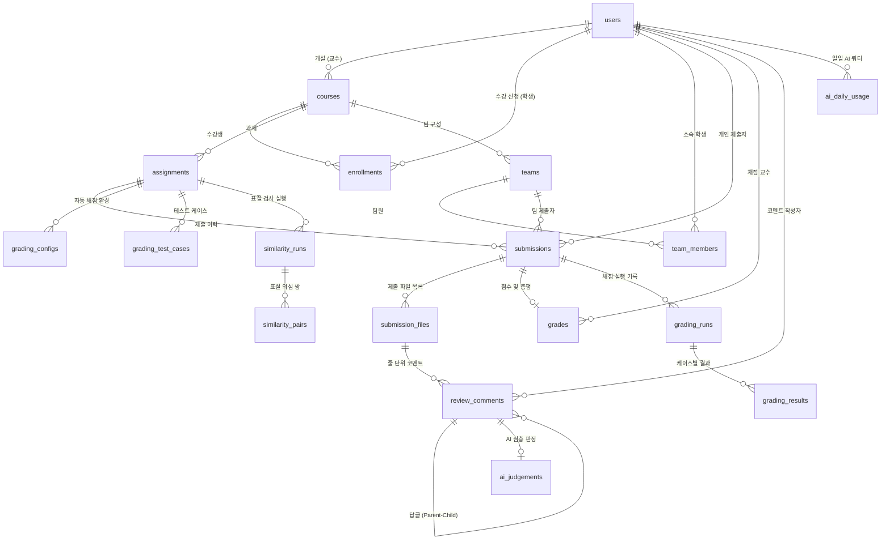

# [산출물 05] 데이터베이스 설계서 및 데이터 명세서 (Database Design Specification)

> **프로젝트명**: SubmitHub (버전 관리 기반 과제 제출 및 자동 피드백 추적 플랫폼)  
> **DBMS**: MariaDB 11 LTS (운영) / H2 In-Memory (로컬/테스트)  
> **문서 버전**: v1.2  
> **작성일자**: 2026-11-07  
> **작성자**: 강서원

---

## 1. 데이터베이스 설계 원칙 및 모델링 전략

### 1.1. 불변 제출 이력 모델링 (INSERT-Only Architecture)
- 과제 제출 도메인(`submissions`, `submission_files`)은 Git의 커밋 스냅샷과 동일하게 **불변(Immutable)** 데이터로 취급됩니다.
- 한 번 제출된 버전은 절대 `UPDATE`되거나 물리 삭제(`DELETE`)되지 않으며, 오직 새로운 버전으로 `INSERT`만 발생합니다.
- 이를 통해 학생의 제출 이력 무결성과 재현성을 $100\%$ 보장합니다.

### 1.2. 피드백 반영 상태의 동적 계산 원칙
- 줄 피드백(`review_comments`)의 반영 상태(🔴미반영/🟢반영됨/⚪삭제됨)는 DB 컬럼에 고정값으로 저장하지 않습니다.
- 최신 버전과의 관계에 따라 상태가 지속적으로 변하므로, 조회 시점마다 `LineTracker` 알고리즘이 Myers diff를 통해 메모리 상에서 동적으로 계산하여 데이터 불일치(Inconsistency)를 원천 방지합니다.

---

## 2. 전체 물리 ERD (Entity Relationship Diagram)

---

## 3. 테이블 명세서 (Data Dictionary 전수 정의)

### 3.1. 사용자 및 강의/수강 관리

#### (1) `users` (사용자 계정)
| 컬럼명 | 논리명 | 데이터 타입 | Null | Key | 설명 |
| :--- | :--- | :--- | :---: | :---: | :--- |
| `id` | 사용자 고유번호 | BIGINT | N | PK | 자동 증가 (Identity) |
| `login_id` | 로그인 아이디 | VARCHAR(50) | N | UK | 영문/숫자 로그인 ID |
| `password_hash` | 비밀번호 해시 | VARCHAR(255) | N | | BCrypt 일방향 암호화 해시 |
| `name` | 사용자 이름 | VARCHAR(50) | N | | 학생 또는 교수 실명 |
| `role` | 역할 권한 | VARCHAR(20) | N | | `PROFESSOR`, `STUDENT` |
| `student_no` | 학번 | VARCHAR(30) | Y | | 학생의 경우 학번 등록 |
| `department` | 소속 학과 | VARCHAR(50) | Y | | 소속 학과명 |
| `created_at` | 가입 일시 | DATETIME | N | | 계정 생성 타임스탬프 |

#### (2) `courses` (강의)
| 컬럼명 | 논리명 | 데이터 타입 | Null | Key | 설명 |
| :--- | :--- | :--- | :---: | :---: | :--- |
| `id` | 강의 고유번호 | BIGINT | N | PK | 자동 증가 |
| `professor_id` | 담당 교수 번호 | BIGINT | N | FK | `users.id` 참조 |
| `name` | 강의명 | VARCHAR(100) | N | | 예: "자료구조 및 실습" |
| `semester` | 개설 학기 | VARCHAR(30) | N | | 예: "2026-2" |
| `invite_code` | 수강 초대 코드 | VARCHAR(20) | N | UK | 8자리 고유 난수 코드 |
| `created_at` | 개설 일시 | DATETIME | N | | 강의 생성 타임스탬프 |

#### (3) `enrollments` (수강생 등록)
| 컬럼명 | 논리명 | 데이터 타입 | Null | Key | 설명 |
| :--- | :--- | :--- | :---: | :---: | :--- |
| `id` | 등록 번호 | BIGINT | N | PK | 자동 증가 |
| `course_id` | 수강 강의 번호 | BIGINT | N | FK | `courses.id` 참조 (복합 UK) |
| `student_id` | 수강 학생 번호 | BIGINT | N | FK | `users.id` 참조 (복합 UK) |
| `joined_at` | 수강 신청 일시 | DATETIME | N | | 신청 완료 타임스탬프 |

---

### 3.2. 과제 및 버전 제출 관리

#### (4) `assignments` (과제)
| 컬럼명 | 논리명 | 데이터 타입 | Null | Key | 설명 |
| :--- | :--- | :--- | :---: | :---: | :--- |
| `id` | 과제 고유번호 | BIGINT | N | PK | 자동 증가 |
| `course_id` | 소속 강의 번호 | BIGINT | N | FK | `courses.id` 참조 |
| `title` | 과제 제목 | VARCHAR(200) | N | | 예: "연결 리스트 구현" |
| `description` | 과제 설명 | TEXT | Y | | 과제 요구사항 및 안내 |
| `due_at` | 정규 마감 일시 | DATETIME | N | | 정상 제출 기한 |
| `allow_late` | 지각 허용 여부 | BOOLEAN | N | | 지각 제출 승인 플래그 |
| `late_until` | 지각 마감 일시 | DATETIME | Y | | 지각 최종 허용 시각 |
| `baseline_code` | 뼈대 코드 | LONGTEXT | Y | | 표절 검사 제외용 교수 제공 코드 |
| `team_project` | 조별과제 여부 | BOOLEAN | N | | 팀 과제 여부 (기본: false) |
| `created_at` | 등록 일시 | DATETIME | N | | 과제 등록 타임스탬프 |

#### (5) `submissions` (제출물 - 불변 모델)
| 컬럼명 | 논리명 | 데이터 타입 | Null | Key | 설명 |
| :--- | :--- | :--- | :---: | :---: | :--- |
| `id` | 제출 고유번호 | BIGINT | N | PK | 자동 증가 |
| `assignment_id` | 과제 번호 | BIGINT | N | FK | `assignments.id` 참조 (복합 UK) |
| `student_id` | 제출 학생 번호 | BIGINT | Y | FK | `users.id` 참조 (개인 과제) |
| `team_id` | 제출 팀 번호 | BIGINT | Y | FK | `teams.id` 참조 (조별 과제) |
| `version_no` | 버전 번호 | INT | N | | `v1, v2, ...` 순차 채번 (복합 UK) |
| `message` | 제출 메모 | VARCHAR(500) | Y | | 학생 작성 커밋 메시지 |
| `late` | 지각 제출 여부 | BOOLEAN | N | | 마감 후 제출 시 true |
| `source_repo` | GitHub 저장소 | VARCHAR(200) | Y | | GitHub 연동 시 원본 저장소 |
| `source_ref` | GitHub 브랜치/Ref | VARCHAR(100) | Y | | 제출 시 입력한 브랜치명 또는 커밋 ref |
| `source_commit` | GitHub 커밋 SHA | VARCHAR(40) | Y | | 연동된 40자리 커밋 해시 |
| `submitted_at` | 제출 일시 | DATETIME | N | | 제출 완료 타임스탬프 |

#### (6) `submission_files` (제출 파일 목록)
| 컬럼명 | 논리명 | 데이터 타입 | Null | Key | 설명 |
| :--- | :--- | :--- | :---: | :---: | :--- |
| `id` | 파일 고유번호 | BIGINT | N | PK | 자동 증가 |
| `submission_id` | 제출물 번호 | BIGINT | N | FK | `submissions.id` 참조 (복합 UK) |
| `path` | 파일 내부 경로 | VARCHAR(300) | N | | 정규화된 상대 경로 (복합 UK) |
| `size` | 파일 크기 (Byte) | BIGINT | N | | 원본 바이트 수 |
| `sha256` | SHA-256 해시 | VARCHAR(64) | N | | 파일 무결성 검증 해시 |
| `charset` | 문자 인코딩 | VARCHAR(20) | N | | `UTF-8`, `CP949` |
| `content_text` | 텍스트 원문 | LONGTEXT | Y | | 텍스트 파일인 경우 소스 저장 |
| `storage_path` | 스토리지 파일명 | VARCHAR(100) | N | | 디스크 저장 UUID 파일명 |

---

### 3.3. 코드 리뷰 및 피드백

#### (7) `review_comments` (줄 단위 리뷰 코멘트)
| 컬럼명 | 논리명 | 데이터 타입 | Null | Key | 설명 |
| :--- | :--- | :--- | :---: | :---: | :--- |
| `id` | 코멘트 고유번호 | BIGINT | N | PK | 자동 증가 |
| `submission_file_id` | 대상 파일 번호 | BIGINT | N | FK | `submission_files.id` 참조 |
| `author_id` | 작성자 번호 | BIGINT | N | FK | `users.id` 참조 |
| `start_line` | 시작 줄 번호 | INT | N | | 피드백 대상 시작 라인 (1부터) |
| `end_line` | 끝 줄 번호 | INT | N | | 피드백 대상 끝 라인 (포함) |
| `body` | 코멘트 본문 | VARCHAR(2000) | N | | 피드백 내용 |
| `parent_id` | 부모 코멘트 번호 | BIGINT | Y | FK | Self-referencing (답글 스레드) |
| `resolved_by_student` | 학생 해결 표시 | BOOLEAN | N | | 학생의 자율 확인 플래그 |
| `created_at` | 작성 일시 | DATETIME | N | | 코멘트 등록 타임스탬프 |

#### (8) `grades` (점수 및 총평)
| 컬럼명 | 논리명 | 데이터 타입 | Null | Key | 설명 |
| :--- | :--- | :--- | :---: | :---: | :--- |
| `id` | 평가 고유번호 | BIGINT | N | PK | 자동 증가 |
| `submission_id` | 평가 대상 제출물 | BIGINT | N | FK | `submissions.id` 참조 (1:1 매핑) |
| `professor_id` | 채점 교수 번호 | BIGINT | N | FK | `users.id` 참조 |
| `score` | 점수 (0~100) | INT | N | | 정수형 최종 평가 점수 |
| `summary` | 총평 피드백 | VARCHAR(2000) | Y | | 버전 종합 평가 의견 |
| `created_at` | 채점 일시 | DATETIME | N | | 채점 타임스탬프 |

---

### 3.4. 조별과제 (Team) 관리

#### (9) `teams` (과제 팀)
| 컬럼명 | 논리명 | 데이터 타입 | Null | Key | 설명 |
| :--- | :--- | :--- | :---: | :---: | :--- |
| `id` | 팀 고유번호 | BIGINT | N | PK | 자동 증가 |
| `course_id` | 소속 강의 번호 | BIGINT | N | FK | `courses.id` 참조 |
| `name` | 팀명 | VARCHAR(100) | N | | 예: "1조 - RAG 챗봇 구축팀" |
| `invite_code` | 팀 초대 코드 | VARCHAR(20) | N | UK | 6자리 팀 합류 코드 |
| `github_repo_url` | 팀 GitHub 저장소 | VARCHAR(300) | Y | | 팀 공용 GitHub 저장소 URL |
| `created_at` | 팀 생성 일시 | DATETIME | N | | 생성 타임스탬프 |

#### (10) `team_members` (팀원 구성)
| 컬럼명 | 논리명 | 데이터 타입 | Null | Key | 설명 |
| :--- | :--- | :--- | :---: | :---: | :--- |
| `id` | 멤버 고유번호 | BIGINT | N | PK | 자동 증가 |
| `team_id` | 소속 팀 번호 | BIGINT | N | FK | `teams.id` 참조 (복합 UK) |
| `student_id` | 팀원 학생 번호 | BIGINT | N | FK | `users.id` 참조 (복합 UK) |
| `role` | 팀 내 역할 | VARCHAR(20) | N | | `LEADER`(팀장), `MEMBER`(팀원) |
| `branch_name` | 담당 기능 브랜치 | VARCHAR(100) | Y | | 예: `feature/rag-pipeline` |
| `role_description` | 담당 역할 설명 | VARCHAR(100) | Y | | 예: "벡터 DB 파이프라인 구축" |
| `joined_at` | 합류 일시 | DATETIME | N | | 합류 타임스탬프 |

---

### 3.5. Docker 자동 채점 관리

#### (11) `grading_configs` (채점 환경 설정)
| 컬럼명 | 논리명 | 데이터 타입 | Null | Key | 설명 |
| :--- | :--- | :--- | :---: | :---: | :--- |
| `id` | 설정 고유번호 | BIGINT | N | PK | 자동 증가 |
| `assignment_id` | 대상 과제 번호 | BIGINT | N | FK | `assignments.id` 참조 (1:1) |
| `language` | 실행 언어 | VARCHAR(20) | N | | `JAVA`, `PYTHON` |
| `main_file` | 실행 메인 파일명 | VARCHAR(100) | N | | 예: "Main.java", "solution.py" |
| `time_limit_seconds` | 제한 시간 (초) | INT | N | | 기본 3초 (무한 루프 방어) |
| `memory_limit_mb` | 메모리 제한 (MB) | INT | N | | 기본 256MB |

#### (12) `grading_test_cases` (테스트 케이스)
| 컬럼명 | 논리명 | 데이터 타입 | Null | Key | 설명 |
| :--- | :--- | :--- | :---: | :---: | :--- |
| `id` | 케이스 고유번호 | BIGINT | N | PK | 자동 증가 |
| `assignment_id` | 소속 과제 번호 | BIGINT | N | FK | `assignments.id` 참조 |
| `name` | 케이스 이름 | VARCHAR(100) | N | | 예: "기본 정렬 검증" |
| `input_data` | 입력 데이터 | TEXT | Y | | stdin으로 주입될 문자열 |
| `expected_output` | 기대 출력 데이터 | TEXT | N | | 정답 문자열 (공백 정규화 대조) |
| `points` | 배점 | INT | N | | 해당 케이스 통과 시 부여 점수 |
| `hidden` | 비공개 여부 | BOOLEAN | N | | 학생 화면 입출력 숨김 여부 |

#### (13) `grading_runs` (채점 실행 이력)
| 컬럼명 | 논리명 | 데이터 타입 | Null | Key | 설명 |
| :--- | :--- | :--- | :---: | :---: | :--- |
| `id` | 실행 고유번호 | BIGINT | N | PK | 자동 증가 |
| `submission_id` | 대상 제출물 번호 | BIGINT | N | FK | `submissions.id` 참조 |
| `status` | 채점 상태 | VARCHAR(20) | N | | `SUCCESS`, `FAILED`, `UNAVAILABLE` |
| `total_score` | 획득 점수 | INT | N | | 테스트 케이스 합산 점수 |
| `max_score` | 만점 기준 | INT | N | | 등록된 케이스 총점 |
| `executed_at` | 채점 실행 일시 | DATETIME | N | | 실행 완료 타임스탬프 |

---

### 3.6. 표절 검사 및 AI 판정

#### (14) `similarity_runs` (표절 검사 실행)
| 컬럼명 | 논리명 | 데이터 타입 | Null | Key | 설명 |
| :--- | :--- | :--- | :---: | :---: | :--- |
| `id` | 실행 고유번호 | BIGINT | N | PK | 자동 증가 |
| `assignment_id` | 대상 과제 번호 | BIGINT | N | FK | `assignments.id` 참조 |
| `threshold` | 유사도 임계값 | DOUBLE | N | | 의심 추출 기준 (예: 0.70) |
| `compared_pairs` | 비교된 쌍 개수 | INT | N | | 총 비교된 제출물 쌍 수 |
| `created_at` | 검사 일시 | DATETIME | N | | 검사 실행 타임스탬프 |

#### (15) `similarity_pairs` (표절 의심 쌍)
| 컬럼명 | 논리명 | 데이터 타입 | Null | Key | 설명 |
| :--- | :--- | :--- | :---: | :---: | :--- |
| `id` | 의심 쌍 번호 | BIGINT | N | PK | 자동 증가 |
| `run_id` | 검사 실행 번호 | BIGINT | N | FK | `similarity_runs.id` 참조 |
| `submission_a_id` | 학생 A 제출물 | BIGINT | N | FK | `submissions.id` 참조 |
| `submission_b_id` | 학생 B 제출물 | BIGINT | N | FK | `submissions.id` 참조 |
| `score` | 종합 유사도 점수 | DOUBLE | N | | $\max(cov_A, cov_B)$ (0~1.0) |
| `coverage_a` | A 기준 포함도 | DOUBLE | N | | A의 지문 중 B와 겹치는 비율 |
| `coverage_b` | B 기준 포함도 | DOUBLE | N | | B의 지문 중 A와 겹치는 비율 |

#### (16) `ai_judgements` (AI 심층 판정 소견서)
| 컬럼명 | 논리명 | 데이터 타입 | Null | Key | 설명 |
| :--- | :--- | :--- | :---: | :---: | :--- |
| `id` | 판정 고유번호 | BIGINT | N | PK | 자동 증가 |
| `comment_id` | 대상 코멘트 번호 | BIGINT | N | FK | `review_comments.id` 참조 (1:1) |
| `version_no` | 판정 대상 버전 | INT | N | | 변경이 감지된 시점의 버전 번호 |
| `verdict` | 판정 결과 | VARCHAR(30) | N | | `RESOLVED`, `PARTIAL`, `UNRESOLVED` |
| `reason` | 판정 사유 | VARCHAR(1000)| N | | Gemini 모델이 생성한 1~2문장 근거 |
| `decision` | 교수 수락 여부 | VARCHAR(20) | N | | `PENDING`, `ACCEPTED`, `REJECTED` |

#### (17) `ai_daily_usage` (일일 AI 호출 쿼터)
| 컬럼명 | 논리명 | 데이터 타입 | Null | Key | 설명 |
| :--- | :--- | :--- | :---: | :---: | :--- |
| `id` | 쿼터 고유번호 | BIGINT | N | PK | 자동 증가 |
| `user_id` | 사용자 번호 | BIGINT | N | FK | `users.id` 참조 (복합 UK) |
| `usage_date` | 사용 일자 | DATE | N | | 일일 한도 집계 기준일 (복합 UK) |
| `call_count` | 호출 횟수 | INT | N | | 당일 누적 AI 판정 호출 수 |

---

## 4. 인덱스(Index) 설계 및 성능 최적화 전략

1. **복합 유니크 제약 및 검색 최적화 인덱스**:
   - `idx_sub_assign_student_ver`: `submissions (assignment_id, student_id, version_no)` UNIQUE $\to$ 동시 제출 중복 차단 및 최신 버전 조회 $O(1)$.
   - `idx_sub_file_path`: `submission_files (submission_id, path)` UNIQUE $\to$ 파일 트리 및 특정 파일 조회 가속.
   - `idx_rc_file_parent`: `review_comments (submission_file_id, parent_id)` $\to$ 파일별 피드백 스레드 렌더링 최적화.
2. **N+1 문제 원천 차단 (JPA Fetch Join)**:
   - 과제 상세 및 제출 목록 조회 시 `Submission`과 `User`, `Assignment`를 페치 조인(`JOIN FETCH`)하여 쿼리 1회로 최적화.
   - 통계 집계 시 DTO Projection 쿼리를 활용해 필요한 컬럼만 추출하여 메모리 낭비 방지.
