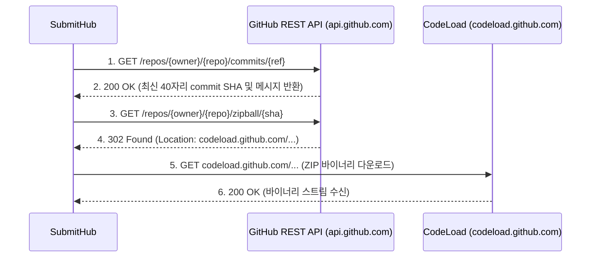

# [산출물 06] 인터페이스 및 API 상세 명세서 (Interface Specification)

> **프로젝트명**: SubmitHub (버전 관리 기반 과제 제출 및 자동 피드백 추적 플랫폼)  
> **문서 버전**: v1.2  
> **작성일자**: 2026-11-07  
> **작성자**: 강서원

---

## 1. 개요

본 문서는 SubmitHub 시스템의 **① 웹 화면 라우팅 인터페이스**, **② 내부 AJAX / REST API 명세**, **③ 3대 외부 시스템(GitHub API, Docker Socket Proxy, Google Gemini API) 연동 인터페이스**를 정의합니다.

---

## 2. 웹 화면 라우팅 인터페이스 (Web Routing Table)

| URL 경로 | Method | 권한 (Role) | 담당 Controller | 설명 및 렌더링 템플릿 |
| :--- | :---: | :---: | :--- | :--- |
| `/login` | GET | ALL | `AuthController` | 로그인 화면 (`auth/login.html`) |
| `/signup` | GET/POST | ALL | `AuthController` | 회원가입 화면 및 가입 처리 |
| `/courses` | GET | 교수, 학생 | `CourseController` | 내 개설/수강 강의 목록 대시보드 (`courses/list.html`) |
| `/courses/new` | GET/POST | 교수 | `CourseController` | 신규 강의 개설 폼 및 처리 |
| `/courses/join` | GET/POST | 학생 | `CourseController` | 초대 코드를 통한 수강 등록 |
| `/courses/{id}` | GET | 해당 강의 구성원 | `CourseController` | 강의 상세 (과제 목록, 수강생, 팀 목록) |
| `/courses/{id}/assignments/new` | GET/POST | 교수 | `AssignmentController` | 신규 과제 등록 및 뼈대 코드 설정 |
| `/assignments/{id}` | GET | 해당 강의 구성원 | `AssignmentController` | 과제 상세 (학생: 제출폼/남은피드백, 교수: 제출현황) |
| `/assignments/{id}/submit` | POST | 학생 | `SubmissionController` | 파일/ZIP 업로드 버전 제출 처리 |
| `/assignments/{id}/submit/github`| POST | 학생 | `SubmissionController` | GitHub 커밋 연동 버전 제출 처리 |
| `/assignments/{id}/submit/my-branch` | POST | 학생 (팀원) | `SubmissionController` | 조별과제 내 담당 브랜치 원클릭 제출 처리 |
| `/submissions/{id}` | GET | 본인, 교수 | `SubmissionController` | 소스코드 뷰어 및 줄 피드백 화면 (`submissions/detail.html`) |
| `/assignments/{a}/students/{s}/diff` | GET | 본인, 교수 | `SubmissionController` | 임의 두 버전 간 2분할 Diff 비교 화면 (`diff/view.html`) |
| `/assignments/{id}/similarity` | GET/POST | 교수 | `SimilarityController` | Winnowing 표절 검사 실행 및 순위표 (`similarity/list.html`) |
| `/similarity/pairs/{id}` | GET | 교수 | `SimilarityController` | 표절 의심 쌍 2분할 대조 및 하이라이트 뷰어 |
| `/courses/{id}/stats` | GET | 교수 | `StatsController` | 제출 통계 대시보드 (Chart.js 연동) (`stats/dashboard.html`) |
| `/courses/{courseId}/teams` | GET/POST | 교수, 학생 | `TeamController` | 조별과제 팀 목록, 팀 생성 및 합류 (`teams/list.html`) |
| `/teams/{teamId}/members/me` | POST | 팀원 | `TeamController` | 내 담당 브랜치 및 역할 수정 |
| `/teams/{id}/audit` | GET | 교수, 팀원 | `TeamController` | 조별과제 Git 브랜치 기여도 감사 화면 (`teams/audit.html`) |

---

## 3. 내부 폼 및 액션 API 명세

### 3.1. 코드 줄 피드백 작성 (`POST /files/{fileId}/comments`)
- **설명**: 교수가 특정 파일(`fileId`)의 라인 범위(`startLine` ~ `endLine`)에 코멘트를 등록합니다.
- **권한**: 교수 (`ROLE_PROFESSOR`)
- **Request Parameters (Form URL-Encoded + CSRF)**:
  - `startLine`: 시작 줄 번호 (예: `12`)
  - `endLine`: 끝 줄 번호 (예: `15`)
  - `body`: 피드백 본문 (예: `"루프 경계 조건(i <= length)에서 ArrayIndexOutOfBoundsException 위험이 있습니다."`)
  - `back`: 리다이렉트 복귀 경로 (Open Redirect 방어 검증)
- **Response**: `302 Redirect` $\to$ `{back}#c{commentId}`

### 3.2. 코멘트 답글 및 학생 자율 해결 토글 (`POST /comments/{commentId}/replies`, `POST /comments/{commentId}/resolve`)
- **설명**: 교수/학생이 코멘트 스레드에 답글을 달거나, 학생이 본인 피드백에 대해 "수정함으로 표시" 상태를 토글합니다.
- **권한**: 해당 제출물 본인 학생 또는 담당 교수
- **Response**: `302 Redirect` $\to$ `{back}#c{commentId}`

### 3.3. AI 심층 반영 판정 요청 (`POST /comments/{id}/ai-judge`)
- **설명**: 교수가 `MODIFIED` 상태의 코멘트에 대해 Gemini 3.8 Flash 심층 검증을 요청하고 결과를 수락(`accept`)/기각(`reject`)합니다.
- **권한**: 담당 교수 (`ROLE_PROFESSOR`)

---

## 4. 외부 시스템 연동 인터페이스 명세

### 4.1. GitHub REST API 연동 명세 (`RestGitHubClient`)

SubmitHub는 학생이 제출한 GitHub 공개 저장소의 커밋 아카이브를 안전하게 가져오기 위해 GitHub 공식 REST API를 사용합니다.



- **보안 제약**:
  - `https://github.com` 도메인만 허용하며, IP 주소 또는 타 도메인은 `IllegalArgumentException`으로 즉시 차단.
  - 다운로드 파일은 최대 40MB로 제한하며, `.git`, `node_modules`, 바이너리 파일은 선별적으로 제외.

---

### 4.2. Docker Engine REST API 연동 명세 (via Docker Socket Proxy)

SubmitHub의 `DockerGradingRunner`는 TCP 프록시(`tcp://socket-proxy:2375`)를 통해 최소 권한의 Docker API만 호출합니다.

| 작업 단계 | HTTP 엔드포인트 | Method | 보안 페이로드 주요 파라미터 |
| :--- | :--- | :---: | :--- |
| **1. 컨테이너 생성** | `/containers/create` | POST | • `Image`: `"openjdk:17-slim"` 또는 `"python:3.11-slim"`<br/>• `NetworkMode`: `"none"` (완전 네트워크 차단)<br/>• `ReadonlyRootfs`: `true`<br/>• `HostConfig.Binds`: `["/srv/grading/work:/work:ro"]`<br/>• `HostConfig.PidsLimit`: `64`<br/>• `HostConfig.Memory`: `268435456` (256MB)<br/>• `HostConfig.CapDrop`: `["ALL"]` |
| **2. 컨테이너 시작** | `/containers/{id}/start` | POST | 빈 본문 (컨테이너 기동) |
| **3. 실행 완료 대기** | `/containers/{id}/wait` | POST | `{"condition": "not-running"}` (종료 코드 대기) |
| **4. 출력 수집** | `/containers/{id}/logs` | GET | `?stdout=true&stderr=true` (실행 출력 64KB 수집) |
| **5. 컨테이너 파기** | `/containers/{id}` | DELETE | `?force=true&v=true` (실행 후 즉시 삭제) |

---

### 4.3. Google Gemini 3.8 Flash REST API 연동 명세 (`GeminiJudgeProvider`)

SubmitHub는 `MODIFIED` 피드백에 대해 학생의 실제 해결 여부를 검증하기 위해 Gemini 3.8 Flash (`gemini-3.8-flash`) REST API를 직접 연동합니다.

- **요청 URL**: `POST https://generativelanguage.googleapis.com/v1beta/models/gemini-3.8-flash:generateContent?key={API_KEY}`
- **Request Body (Prompt Injection 방어 격리 템플릿)**:
```json
{
  "contents": [
    {
      "parts": [
        {
          "text": "당신은 프로그래밍 과제 코드 리뷰 검증관입니다.\n\n[교수 피드백]:\n===DATA_START===\n배열 인덱스 범위를 초과하지 않도록 수정하세요.\n===DATA_END===\n\n[이전 코드]:\n===DATA_START===\nfor (int i = 0; i <= a.length; i++) {\n===DATA_END===\n\n[새 코드]:\n===DATA_START===\nfor (int i = 0; i < a.length; i++) {\n===DATA_END===\n\n위 변경이 피드백을 해결했는지 RESOLVED, PARTIAL, NOT_RESOLVED 중 하나와 근거 1문장을 반환하세요."
        }
      ]
    }
  ],
  "generationConfig": {
    "temperature": 0.1,
    "maxOutputTokens": 200
  }
}
```
- **Response Parsing**:
  - `candidates[0].content.parts[0].text`를 파싱하여 첫 단어가 `RESOLVED`, `PARTIAL`, `NOT_RESOLVED`인 경우만 승인하고 나머지는 `FAILED`로 안전 폴백 처리.
