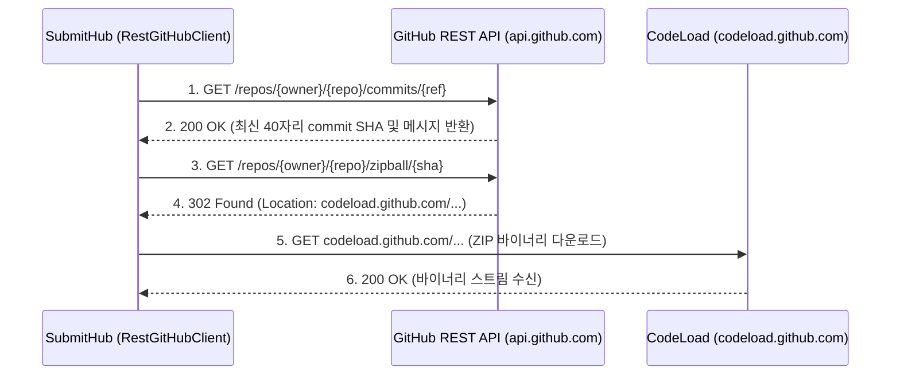

# [산출물 06] 인터페이스 및 API 상세 명세서 (Interface Specification)

> **프로젝트명**: SubmitHub (버전 관리 기반 과제 제출 및 자동 피드백 추적 플랫폼)  
> **문서 버전**: v1.3 (실제 코드 연동 규격 팩트체크 완료)  
> **검증 일자**: 2026-11-07  
> **작성자**: 강서원

---

## 1. 개요

본 문서는 SubmitHub 시스템의 **① 웹 화면 라우팅 인터페이스**, **② 내부 폼/액션 API 명세**, **③ 3대 외부 시스템(GitHub API, Docker CLI via Socket Proxy, Google Gemini API) 연동 규격**을 실제 코드 기반으로 기술합니다.

---

## 2. 웹 화면 라우팅 인터페이스 (Web Routing Table)

| URL 경로 | Method | 권한 (Role) | 담당 Controller | 설명 및 렌더링 템플릿 |
| :--- | :---: | :---: | :--- | :--- |
| `/login` | GET | ALL | `AuthController` | 로그인 화면 (`auth/login.html`) |
| `/signup` | GET/POST | ALL | `AuthController` | 회원가입 화면 및 가입 처리 |
| `/courses` | GET | 교수, 학생 | `CourseController` | 내 개설/수강 강의 목록 대시보드 (`courses/list.html`) |
| `/courses/new` | GET/POST | 교수 | `CourseController` | 신규 강의 개설 폼 및 처리 |
| `/courses/join` | GET/POST | 학생 | `CourseController` | 초대 코드를 통한 수강 등록 |
| `/courses/{id}` | GET | 해당 강의 구성원 | `CourseController` | 강의 상세 (과제 목록, 수강생) |
| `/courses/{id}/assignments/new` | GET/POST | 교수 | `AssignmentController` | 신규 과제 등록 및 뼈대 코드 설정 |
| `/assignments/{id}` | GET | 해당 강의 구성원 | `AssignmentController` | 과제 상세 (학생: 제출폼/남은피드백, 교수: 제출현황) |
| `/assignments/{id}/submit` | POST | 학생 | `SubmissionController` | 파일/ZIP 업로드 버전 제출 처리 |
| `/assignments/{id}/submit/github`| POST | 학생 | `SubmissionController` | GitHub 커밋 연동 버전 제출 처리 |
| `/assignments/{id}/submit/my-branch` | POST | 학생 (팀원) | `SubmissionController` | 조별과제 내 담당 브랜치 원클릭 제출 처리 |
| `/submissions/{id}` | GET | 본인, 교수 | `SubmissionController` | 소스코드 뷰어 및 줄 피드백 화면 (`submissions/detail.html`) |
| `/assignments/{a}/students/{s}/diff` | GET | 본인, 교수 | `SubmissionController` | 임의 두 버전 간 2분할 Diff 비교 화면 (`diff/view.html`) |
| `/assignments/{id}/similarity` | GET/POST | 교수 | `SimilarityController` | Winnowing 표절 검사 실행 및 순위표 (`similarity/list.html`) |
| `/similarity/pairs/{id}` | GET | 교수 | `SimilarityController` | 표절 의심 쌍 2분할 대조 및 하이라이트 뷰어 |
| `/courses/{id}/stats` | GET | 교수 | `StatsController` | 제출 통계 대시보드 (Chart.js 연동) (`stats/dashboard.html`) |
| `/assignments/{assignmentId}/teams` | GET/POST | 교수, 학생 | `TeamController` | 조별과제 팀 목록 조회 및 팀 생성 (`teams/list.html`) |
| `/teams/{teamId}/join` | POST | 학생 | `TeamController` | 조별과제 팀 합류 (담당 브랜치 및 역할 입력) |
| `/teams/{teamId}/members/me` | POST | 팀원 | `TeamController` | 내 담당 브랜치 및 역할 수정 |
| `/teams/{teamId}/audit` | GET | 교수 | `TeamController` | 조별과제 Git 브랜치 기여도 감사 화면 (`teams/audit.html`) |

---

## 3. 내부 폼 및 액션 API 명세 (`ReviewController`, `AiJudgeController`)

### 3.1. 코드 줄 피드백 작성 (`POST /files/{id}/comments`)
- **설명**: 교수가 특정 파일(`id`)의 라인 범위(`startLine` ~ `endLine`)에 코멘트를 등록합니다.
- **권한**: 담당 교수 (`ROLE_PROFESSOR`)
- **Request Parameters (Form URL-Encoded + CSRF)**:
  - `startLine`: 시작 줄 번호 (예: `12`)
  - `endLine`: 끝 줄 번호 (예: `15`)
  - `body`: 피드백 본문 (예: `"루프 경계 조건(i <= length)에서 ArrayIndexOutOfBoundsException 위험이 있습니다."`)
  - `back`: 리다이렉트 복귀 경로 (`safeBack()`으로 Open Redirect 방어 검증)
- **Response**: `302 Redirect` $\to$ `{back}#c{commentId}`

### 3.2. 코멘트 답글 및 학생 자율 해결 토글 (`POST /comments/{id}/replies`, `POST /comments/{id}/resolve`)
- **설명**: 교수/학생이 코멘트 스레드에 답글을 달거나, 학생이 본인 피드백에 대해 "수정함으로 표시" 상태를 토글(`toggleResolved`)합니다.
- **권한**: 본인 학생 또는 담당 교수
- **Response**: `302 Redirect` $\to$ `{back}#c{id}`

### 3.3. AI 심층 반영 판정 요청 (`POST /comments/{id}/ai-judge`)
- **설명**: 교수가 `MODIFIED` 상태의 코멘트에 대해 Gemini 3.8 Flash 심층 검증을 요청하고 결과를 수락(`/accept`)/무시(`/reject`)합니다.
- **권한**: 담당 교수 (`ROLE_PROFESSOR`)

---

## 4. 외부 시스템 연동 인터페이스 명세 (실제 코드 규격)

### 4.1. GitHub REST API 연동 명세 (`RestGitHubClient`)

SubmitHub는 학생이 제출한 GitHub 공개 저장소의 커밋 아카이브를 안전하게 가져오기 위해 GitHub 공식 REST API를 사용합니다.



- **보안 제약**:
  - `https://github.com` 도메인만 허용하며, IP 주소 또는 타 도메인은 `IllegalArgumentException`으로 즉시 차단.
  - 다운로드 파일은 최대 40MB로 제한하며, `.git`, `node_modules`, 바이너리 파일은 선별적으로 제외.

---

### 4.2. Docker 격리 채점 연동 명세 (`DockerGradingRunner` & `DockerCommands`)

> [!IMPORTANT]
> SubmitHub의 Spring Boot 애플리케이션은 임의의 Docker Java SDK를 의존하지 않고, **`ProcessBuilder`를 통해 호스트/컨테이너의 `docker` CLI 명령어(인자 배열)를 직접 실행**합니다. 
> 운영 컨테이너 환경에서는 `DOCKER_HOST=tcp://socket-proxy:2375` 환경변수가 주입되어 `docker` CLI가 내부적으로 `tecnativa/docker-socket-proxy`와 통신하여 호스트 소켓을 안전하게 제어합니다.

#### 채점 컨테이너 실행 명령 인자 배열 (`DockerCommands.isolation`)
```bash
docker run --rm -i \
  --name "run-{uuid}" \
  --network none \
  --read-only \
  --tmpfs /tmp:rw,noexec,nosuid,size=16m \
  --memory 256m \
  --memory-swap 256m \
  --cpus 1 \
  --pids-limit 64 \
  --cap-drop ALL \
  --security-opt no-new-privileges \
  --ulimit nofile=256:256 \
  --ulimit fsize=10485760:10485760 \
  -u 65534:65534 \
  -e LANG=C.UTF-8 \
  -v /srv/submithub/grading-work/run-xxx:/work:ro \
  -w /work \
  eclipse-temurin:17-jdk \
  java -Xmx153m -Xss512k -XX:-UsePerfData -XX:+UseSerialGC -cp /work/out Main
```

- **표준입력(stdin) 주입**: 테스트 케이스의 입력값을 프로세스의 `OutputStream`을 통해 직접 주입.
- **출력 수집 및 제한**: `STORED_OUTPUT_BYTES = 64KB`까지만 버퍼에 저장하며, 전체 출력이 1MB를 초과하면 즉시 프로세스를 강제 종료하고 컨테이너를 `docker rm -f`로 안전 파기.

---

### 4.3. Google Gemini REST API 연동 명세 (`GeminiJudgeProvider`)

SubmitHub는 `MODIFIED` 피드백에 대해 학생의 실제 해결 여부를 검증하기 위해 Gemini REST API를 직접 호출합니다.

- **기본 모델**: `gemini-3.8-flash` (환경변수 `GEMINI_MODEL`로 변경 가능)
- **요청 URL**: `POST https://generativelanguage.googleapis.com/v1beta/models/{model}:generateContent`
- **인증 헤더**: `x-goog-api-key: {GEMINI_API_KEY}`
- **타임아웃**: 10초 (`HttpTimeoutException` 처리)

#### Request Body (JSON 구조화 응답 및 Prompt Injection 방어)
```json
{
  "systemInstruction": {
    "parts": [
      {
        "text": "당신은 학생 프로그래밍 과제의 코드 리뷰 반영 여부를 판정하는 조교입니다. ... 반환 형식: 반드시 지정된 JSON 스키마를 준수하십시오."
      }
    ]
  },
  "contents": [
    {
      "role": "user",
      "parts": [
        {
          "text": "[교수 코멘트]\n===RANDOM_TOKEN_START===\n배열 인덱스 오류 수정 요망\n===RANDOM_TOKEN_END===\n\n[이전 코드]\n...\n[새 코드]\n..."
        }
      ]
    }
  ],
  "generationConfig": {
    "temperature": 0,
    "responseMimeType": "application/json"
  },
  "thinkingConfig": {
    "thinkingLevel": "LOW"
  }
}
```

#### Response Body 파싱 규격
```json
{
  "verdict": "RESOLVED",
  "reason": "배열 순회 조건식이 i <= a.length에서 i < a.length로 올바르게 수정되었습니다."
}
```
- `verdict` 값이 `RESOLVED`, `PARTIAL`, `NOT_RESOLVED` 중 하나가 아니면 `AiJudgeException`을 발생시켜 안전하게 실패 처리.
