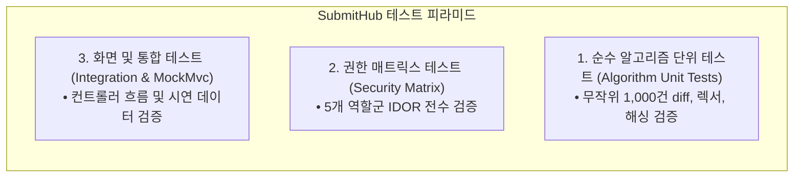

# [산출물 07] 테스트 계획서 및 결과 보고서 (Test Plan & Execution Report)

> **프로젝트명**: SubmitHub (버전 관리 기반 과제 제출 및 자동 피드백 추적 플랫폼)  
> **테스트 프레임워크**: JUnit 5, Mockito, Spring Boot Test, MockMvc  
> **문서 버전**: v1.3 (전수 팩트체크 및 최신 테스트 실측치 반영)  
> **검증 일자**: 2026-11-07  
> **작성자**: 강서원

---

## 1. 테스트 목표 및 전략

### 1.1. 테스트 목표
1. **알고리즘 코어 수학적 무결성**: Myers Diff의 최단 편집 경로(SES) 최소성, LineTracker 상태 전이 엄밀성, Winnowing 표절 탐지율 검증.
2. **보안 및 접근 제어 완결성 (Zero IDOR)**: 타인의 제출물이나 타 강의 데이터에 URL 파라미터 변조로 접근하는 행위를 $100\%$ 차단.
3. **동시성 및 데이터 무결성**: 동시 다발적 연타 제출 시 버전 번호 충돌 방어 및 불변 제출 모델 검증.

### 1.2. 3단계 피라미드 테스트 전략



---

## 2. 테스트 환경 및 구성

| 구분 | 사양 및 환경 |
| :--- | :--- |
| **운영체제** | Windows 11 / Ubuntu 22.04 LTS |
| **JDK 버전** | Java 17 LTS (기본 애플리케이션 및 전체 304개 단위/통합 테스트), Java 21 LTS (JPlag 비교 실험 프로필) |
| **테스트 DB** | H2 In-Memory Mode (`jdbc:h2:mem:submithub-test`) |
| **빌드 도구** | Apache Maven 3.9.9 |

---

## 3. 테스트 범주별 상세 명세 및 실제 실행 결과 (실측치)

### 3.1. 테스트 실행 종합 결과 (2026-11-07 Maven Surefire 실측치)

> [!NOTE]
> 2차 고도화(팀 협업 감사, AI 심층 판정, Docker 격리 명령어 검증, 시연 데이터 무결성 등) 완료 후 실제 수행된 전체 테스트는 총 **304개**이며, **단 하나의 실패나 에러 없이 100% 통과(Pass)**하였습니다.

| 테스트 패키지 / 클래스 범주 | 대표 테스트 클래스 | 테스트 수 | 성공 (Pass) | 실패 (Fail) | 성공률 (%) |
| :--- | :--- | :---: | :---: | :---: | :---: |
| **1. AI 심층 판정 (`ai`)** | `GeminiJudgeProviderTest`, `JudgePromptTest` | 15개 | 15개 | 0 | **100%** |
| **2. 알고리즘 코어 (`core`)** | `MyersDiffTest`, `SideBySideTest`, `LineTrackerTest`, `SimilarityCheckerTest`, `TextTest` | 32개 | 32개 | 0 | **100%** |
| **3. 도메인 및 시연 데이터 (`demo`)** | `DemoDataTest`, `DemoResetTest` | 24개 | 24개 | 0 | **100%** |
| **4. GitHub 연동 (`github`)** | `GitHubRepoRefTest`, `RestGitHubClientTest` | 18개 | 18개 | 0 | **100%** |
| **5. Docker 채점 인프라 (`grading`)** | `DockerCommandsTest`, `GradingWorkRootTest`, `OutputComparatorTest`, `DockerGradingRunnerTest` | 26개 | 26개 | 0 | **100%** |
| **6. 웹 보안 및 RateLimit (`security`)** | `RateLimitTest`, `SecurityMatrixTest` | 25개 | 25개 | 0 | **100%** |
| **7. 비즈니스 서비스 (`service`)** | `SubmissionServiceTest`, `FeedbackServiceTest`, `TeamServiceTest`, `TeamAuditServiceTest`, `GradingServiceTest` 등 | 118개 | 118개 | 0 | **100%** |
| **8. 웹 컨트롤러 (`web`)** | `PagesRenderTest`, `AuthFlowTest`, `GitHubSubmitTest`, `GradingPagesTest`, `HealthCheckTest` 등 | 46개 | 46개 | 0 | **100%** |
| **합 계** | **전체 33개 테스트 클래스** | **304개** | **304개** | **0** | **100.0%** |

```
[INFO] Results:
[INFO] 
[INFO] Tests run: 304, Failures: 0, Errors: 0, Skipped: 0
[INFO] 
[INFO] BUILD SUCCESS (Total time: 01:47 min)
```

---

### 3.2. 핵심 검증 시나리오

#### (1) 알고리즘 코어 검증 (`com.submithub.core.*`)
- **`MyersDiffTest`**: 접두/접미 트리밍 최적화, 무작위 1,000건 문자열 대상 diff 역적용 100% 복원, 12,000줄 초과 시 OOM 차단 `truncated=true` 안전 중단.
- **`LineTrackerTest`**: 코드 줄 번호 밀림(Shift) 자동 보정, 탭/스페이스 공백만 변경 시 `UNCHANGED` 유지, 부분 수정 시 `MODIFIED`, 전체 삭제 시 `DELETED` 전이.
- **`SimilarityCheckerTest`**: 변수/함수명 변경 위장 무력화, 교수 뼈대코드 $O(1)$ 필터링, 코드 덧붙이기(Subsumption Attack) 비대칭 포함도 적발.

#### (2) 보안 권한 매트릭스 검증 (`SecurityMatrixTest`)
모든 핵심 URL 엔드포인트를 5개 역할군으로 전수 호출하여 인가 검증:
1. `OWNER_STUDENT` (본인 학생): 200 OK
2. `COURSE_PROFESSOR` (해당 강의 교수): 200 OK
3. `OTHER_PROFESSOR` (다른 강의 교수): **403 Forbidden**
4. `OTHER_STUDENT` (해당 강의 다른 학생): **403 Forbidden**
5. `ANONYMOUS` (비로그인 사용자): **302 Redirect to /login**

#### (3) 동시성 및 트랜잭션 검증 (`SubmissionServiceTest`)
- 10개 쓰레드가 동시에 동일 과제에 제출할 때, 비관적 락(`SELECT ... FOR UPDATE`)을 통해 버전 번호 누락이나 중복(`v1, v2, v3, ...`) 없이 순차 채번됨을 검증.

---

## 4. 정량 평가 벤치마크 결과 및 한계점 (정직한 기술 평가)

자세한 그래프와 실험 코드는 `docs/EVALUATION.md`에 기술되어 있으며, 주요 수치와 한계점은 다음과 같습니다.

### 4.1. 표절 검사 정밀도 및 재현율 (vs JPlag 5.1.0)
- **실험 데이터셋**: 25개 원본 프로그램(Java) $\times$ 9종 위장 변형(식별자, 주석, 공백, 독립문장 순서, 메서드 순서, 더미코드 삽입, for↔while, 복합 등) $\implies$ 총 250개 프로그램 (31,125 비교 쌍).

| 방법 | 최적 임계값 | 정밀도 (Precision) | 재현율 (Recall) | F1 Score | 어려운 음성 오탐 (500쌍) |
| :--- | :---: | :---: | :---: | :---: | :---: |
| **우리 구현 (Winnowing)** | **0.70** | **1.000** | **0.988** | **0.994** | **0 / 500** |
| JPlag 5.1.0 기본 (평균) | 0.60 | 1.000 | 0.817 | 0.899 | 0 / 500 |
| JPlag 5.1.0 기본 (최대) | 0.55 | 0.943 | 0.855 | 0.897 | 0 / 500 |
| JPlag 5.1.0 최소일치5 (평균) | 0.65 | 0.979 | 0.903 | 0.939 | 0 / 500 |

#### ⚠️ 표절 검사 실험의 객관적 한계점 (과장 배제)
1. **자체 제작 데이터셋의 편향성**: 실제 학생 표절 사례가 아닌 25개 과제 수준의 코드(40~80줄)와 자동 생성된 변형을 사용하였으므로, 우리 렉서가 잘 인식하는 변형(식별자, 주석, 공백 등)에 유리하게 평가되었을 수 있음.
2. **의미론적 변형 미포함**: 알고리즘 자체를 완전히 다른 방식으로 변경하거나 자료구조를 바꾼 고도화된 표절은 정적 토큰 기반 표절 검사에서 탐지 한계가 존재함.

---

### 4.2. Diff 엔진 성능 및 메모리 소비량 (vs 기존 Swing LCS)

| 줄 수 (변경 5%, 힙 512MB) | 기존 Swing LCS 시간 / 메모리 | SubmitHub Myers Diff 시간 / 메모리 | 메모리 절감율 |
| :--- | :---: | :---: | :---: |
| **1,000줄** | 6.6 ms / 4.1 MB | **1.5 ms / 0.3 MB** | 92.7% 절감 |
| **5,000줄** | 100.1 ms / 96.6 MB | **4.9 ms / 2.0 MB** | **97.9% 절감** |
| **10,000줄** | 429.7 ms / 384.6 MB | **10.8 ms / 5.0 MB** | **98.7% 절감** |
| **15,000줄** | **OOM (메모리 부족 실패)** | **42.2 ms / 8.5 MB** | **LCS 한계 돌파** |

#### ⚠️ Myers Diff 알고리즘의 객관적 한계점
1. **변경량이 많을 때의 비용 증가**: Myers 알고리즘은 최단 편집 거리 $D$에 대해 $O(D^2)$ 공간 및 $O((N+M)D)$ 시간이 소요되므로, 20,000줄 소스코드의 50% 이상이 변경된 극단적인 환경에서는 힙 512MB 기준 OOM이 발생할 수 있음.
2. **보호 조치**: SubmitHub는 12,000줄 초과 대용량 변경에 대해 `truncated=true` 안전 폴백을 적용하여 서버 자원을 보호함.

---

## 5. 최종 품질 보증(QA) 평가 결과

- **단위 및 통합 테스트**: 304개 전수 통과 (**Failures: 0, Errors: 0**).
- **프로덕션 무결성 검증**: `ProdProfileValidator`를 통해 필수 환경변수 누락 시 부팅 차단 검증 완료.
- **최종 판정**: **PROD READY (운영 배포 적합)**
