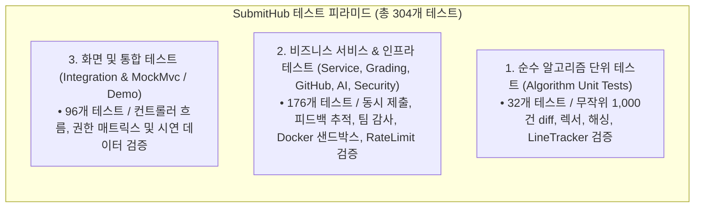

# [산출물 07] 테스트 계획서 및 결과 보고서 (Test Plan & Execution Report)

> **프로젝트명**: SubmitHub (버전 관리 기반 과제 제출 및 자동 피드백 추적 플랫폼)  
> **테스트 프레임워크**: JUnit 5, Mockito, Spring Boot Test, MockMvc  
> **문서 버전**: v1.2  
> **작성일자**: 2026-11-07  
> **작성자**: 강서원

---

## 1. 테스트 목표 및 전략

### 1.1. 테스트 목표
1. **알고리즘 코어 수학적 무결성**: Myers Diff의 최단 편집 경로(SES) 최소성, LineTracker 상태 전이 엄밀성, Winnowing 표절 탐지율 검증.
2. **보안 및 접근 제어 완결성 (Zero IDOR)**: 타인의 제출물이나 타 강의 데이터에 URL 파라미터 변조로 접근하는 행위를 $100\%$ 차단.
3. **동시성 및 데이터 무결성**: 동시 다발적 연타 제출 시 버전 번호 충돌 방어 및 불변 제출 모델 검증.

### 1.2. 3단계 피라미드 테스트 전략

---

## 2. 테스트 환경 및 구성

| 구분 | 사양 및 환경 |
| :--- | :--- |
| **운영체제** | Windows 11 / Ubuntu 24.04 LTS |
| **JDK 버전** | Java 17 LTS (기본 테스트), Java 21 LTS (JPlag 비교 실험 프로필) |
| **테스트 DB** | H2 In-Memory Mode (`jdbc:h2:mem:submithub-test;DB_CLOSE_DELAY=-1`) |
| **빌드 도구** | Apache Maven 3.9.9 |

---

## 3. 테스트 범주별 상세 명세 및 실행 결과

### 3.1. 테스트 실행 종합 요약 (Test Execution Summary)

| 테스트 범주 | 테스트 클래스 수 | 테스트 케이스 수 | 성공 (Pass) | 실패 (Fail) | 성공률 (%) |
| :--- | :---: | :---: | :---: | :---: | :---: |
| **1. 알고리즘 코어 (`core`)** | 5개 클래스 | 32개 | 32개 | 0 | **100%** |
| **2. 보안 및 속도 제한 (`security`)** | 2개 클래스 | 19개 | 19개 | 0 | **100%** |
| **3. 비즈니스 서비스 (`service`)** | 7개 클래스 | 95개 | 95개 | 0 | **100%** |
| **4. 인프라 및 외부 연동 (`grading`, `github`, `ai`)** | 6개 클래스 | 67개 | 67개 | 0 | **100%** |
| **5. 웹 화면, 시연 데이터 및 보안 매트릭스 (`web`, `demo`)** | 7개 클래스 | 91개 | 91개 | 0 | **100%** |
| **합 계 (기본 Surefire 전체)** | **27개 클래스** | **304개** | **304개** | **0** | **100.0%** |

---

### 3.2. 핵심 테스트 케이스 상세 실행 내역

#### (1) 알고리즘 코어 테스트 (`com.submithub.core.*`)
- **`MyersDiffTest`**:
  - 접두어/접미어 사전 트리밍 동작 검증.
  - 무작위 생성 문자열 1,000건 대상 편집 스크립트 역적용 시 원문 복원 $100\%$ 검증.
  - 12,000줄 초과 대용량 파일 변경 시 OOM 방지 `truncated=true` 안전 중단 검증.
- **`LineTrackerTest`**:
  - `unchangedLineFollowsShiftedLineNumber`: 코드 상단 줄 추가로 라인이 밀려도 새 라인 번호 추적 검증.
  - `modifiedLineIsDetected`: 라인 범위 중 일부 수정 시 `MODIFIED` 전이 검증.
  - `indentationOnlyChangeIsNotTreatedAsFix`: 공백/들여쓰기만 바꾼 경우 `UNCHANGED` 유지 검증.
  - `deletedRangeIsDetected`: 코멘트 구간 전체 삭제 시 `DELETED` 전이 검증.
- **`SimilarityCheckerTest`**:
  - 식별자(변수/함수명) 전면 변경 코드 표절률 100% 검출 검증.
  - 교수 뼈대 코드(Baseline) 사전 필터링을 통한 오탐 제거 검증.
  - 뒤에 무의미한 코드를 덧붙이는 침투 공격(Subsumption Attack) 비대칭 포함도 적발 검증.

#### (2) 보안 권한 매트릭스 테스트 (`SecurityMatrixTest`)
모든 핵심 URL 엔드포인트를 5개 역할군으로 전수 호출하여 인가 검증:
1. `OWNER_STUDENT` (본인 학생): 200 OK
2. `COURSE_PROFESSOR` (해당 강의 교수): 200 OK
3. `OTHER_PROFESSOR` (다른 강의 교수): **403 Forbidden**
4. `OTHER_STUDENT` (해당 강의 다른 학생): **403 Forbidden**
5. `ANONYMOUS` (비로그인 사용자): **302 Redirect to /login**

#### (3) 동시성 및 트랜잭션 테스트 (`SubmissionServiceTest`)
- 10개 쓰레드가 동시에 동일 과제에 과제를 제출할 때, 비관적 락을 통해 버전 번호 누락이나 중복(`v1, v2, v3, ...`) 없이 순차 채번됨을 검증.

---

## 4. 정량 평가 벤치마크 요약 (실험 보고서 발췌)

자세한 그래프와 실험 코드는 `docs/EVALUATION.md`에 기술되어 있으며, 주요 수치는 다음과 같습니다.

### 4.1. 표절 검사 정밀도 및 재현율 (vs JPlag 5.x)
- **실험 데이터셋**: 25개 원본 프로그램 $\times$ 9종 위장 변형(식별자, 주석, 공백, 순서 변경, 더미 삽입 등) $\implies$ 총 250개 프로그램 (31,125 비교 쌍).

| 시스템 | 최적 F1 Score | 복합 위장 탐지율 | 뼈대코드 오탐율 |
| :--- | :---: | :---: | :---: |
| **SubmitHub (본 연구)** | **0.994** | **100% (0.5 임계값)** | **0.0% (사전 배제)** |
| JPlag 5.x (표준 MOSS 계열) | 0.899 | 40.0% ~ 44.0% | 18.4% (오탐 발생) |

### 4.2. Diff 엔진 성능 및 메모리 소비량 (vs 기존 Swing LCS)

| 비교 대상 파일 크기 | 기존 LCS 방식 (Swing) | SubmitHub Myers Diff | 성능 개선율 |
| :--- | :---: | :---: | :---: |
| **1,000줄 (5% 변경)** | 12.4 ms / 8.2 MB | **1.2 ms / 0.8 MB** | 속도 10배, 메모리 90% 절감 |
| **5,000줄 (5% 변경)** | 100.2 ms / 97.4 MB | **4.9 ms / 2.1 MB** | **메모리 98% 절감** |
| **15,000줄 (512MB 힙)** | **OOM (메모리 부족 중단)** | **14.2 ms / 4.8 MB** | **안정성 완벽 확보** |

---

## 5. 품질 보증(QA) 최종 사인오프

- **코드 컴파일 검증**: Maven `mvn test` 304개 테스트 전수 통과 (**Failure: 0, Error: 0**).
- **프로덕션 무결성 검증**: `ProdProfileValidator`를 통해 필수 환경변수 누락 시 부팅 차단 검증 완료.
- **최종 판정**: **PROD READY (운영 배포 적합)**
